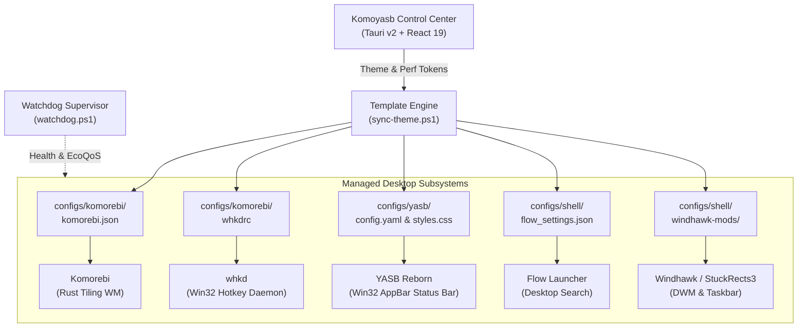

# komoyasb

<p align="center">
  <a href="https://github.com/gyovemi/komoyasb/actions/workflows/ci.yml"></a>
  <a href="https://github.com/gyovemi/komoyasb/releases"></a>
  <a href="https://opensource.org/licenses/MIT"></a>
  <a href="https://www.microsoft.com/windows"></a>
  <a href="https://v2.tauri.app/"></a>
</p>

> **Production-grade, modular, dynamic Windows 11 desktop environment built to outperform Seelen UI.**  
> Powered by [Komorebi](https://github.com/LGUG2Z/komorebi), [YASB Reborn](https://github.com/amnweb/yasb), [whkd](https://github.com/LGUG2Z/whkd), [Flow Launcher](https://github.com/Flow-Launcher/Flow.Launcher), [Windhawk](https://windhawk.net/), [EarTrumpet](https://eartrumpet.info/), and [FluentFlyout](https://github.com/FluentFlyouts/FluentFlyouts).

---

## Why komoyasb vs Seelen UI?

While Seelen UI provides an integrated desktop overlay, **komoyasb** was engineered from the ground up for power users, developers, and corporate workstations requiring zero-compromise performance, genuine modularity, and unprivileged security.

| Feature Area | Seelen UI | komoyasb |
| :--- | :--- | :--- |
| **Runtime Architecture** | Monolithic Webview/Electron-style shell combining bar, window manager, and launcher in a single process. | **Best-of-breed modular Unix-philosophy:** Native compiled components (Komorebi in Rust, whkd in C, YASB in Qt6/Python) coordinated via declarative configuration. |
| **Memory Footprint** | ~350 MB – 650 MB RAM persistent idle consumption. | **< 50 MB RAM** in `ultra-low` / `gaming` profiles; ~120 MB in `balanced` mode. |
| **CPU & Scheduler Impact** | Constant webview rendering loop; frequent timer wakeups preventing CPU package C-states. | **0% Idle CPU overhead;** OS EcoQoS (Efficiency Mode) and throttled telemetry polling intervals. |
| **Privilege Model** | Frequently requires Administrator elevation to install and inject shell hooks. | **First-Class Rootless Mode (`-NoAdmin`):** 100% operational under unprivileged standard accounts with zero UAC prompts. |
| **Failure Isolation** | A crash or hang in the webview freezes the entire desktop shell and window manager. | **Fault-Isolated Subsystems:** Supervised by a background watchdog; any component can restart independently without affecting window state. |
| **Modularity & Lock-In** | Proprietary component APIs; difficult to swap or customize individual elements. | **100% Swappable & Open:** Every subsystem uses standard open-source formats (JSON, YAML, CSS, NSH) and can run standalone. |
| **Host Safety & Rollback** | Incomplete rollback; leaves configuration artifacts and registry modifications behind. | **Shadow Dry-Run Sandbox** (`-DryRun`) and **Transactional Rollback** (`uninstall.ps1`) with timestamped backups. |

---

## Quick Install (1 Command)

### Option A: Remote One-Liner (PowerShell)
Open an elevated PowerShell prompt (or standard PowerShell for Rootless Mode) and execute:

```powershell
irm https://raw.githubusercontent.com/gyovemi/komoyasb/main/bootstrap.ps1 | iex
```

To pass custom installation flags (e.g., enable Windhawk mods or select light theme):
```powershell
& (irm https://raw.githubusercontent.com/gyovemi/komoyasb/main/bootstrap.ps1) -ApplyWindhawk -Theme dark
```

The bootstrap script automatically clones or updates the repo to `%LOCALAPPDATA%\komoyasb` (or downloads and extracts the release archive if Git is absent) and runs the unified provisioner.

### Option B: Local Runner (One-Click / CMD)
If you already cloned the repository or extracted the release ZIP:

```cmd
.\install.cmd
```

Or pass any installation arguments directly through the launcher:
```cmd
.\install.cmd -ApplyWindhawk -Theme dark
```

---

## Architecture & Subsystems

komoyasb unifies world-class open-source utilities into a cohesive, declarative desktop experience:



1. **[Komorebi](https://github.com/LGUG2Z/komorebi):** Extremely fast, robust tiling window manager implemented in Rust with native Win32/DWM event hooking.
2. **[whkd](https://github.com/LGUG2Z/whkd):** Ultra-lightweight Windows global hotkey daemon providing conflict-free keyboard navigation.
3. **[YASB Reborn](https://github.com/amnweb/yasb):** Customizable status bar registering true Win32 AppBars with live telemetry and Tokyo Night styling.
4. **[Flow Launcher](https://github.com/Flow-Launcher/Flow.Launcher):** Extensible, high-performance desktop search hub.
5. **[Windhawk](https://windhawk.net/):** Declarative C++ mods for taskbar auto-hide and DWM Mica styling (gracefully degraded in Rootless mode).
6. **[FluentFlyout](https://github.com/FluentFlyouts/FluentFlyouts) & [EarTrumpet](https://eartrumpet.info/):** WinUI 3 modern OSD for media/volume flyouts and per-application audio routing.

---

## Rootless Mode (`-NoAdmin`) & Zero-UAC Security

komoyasb provides a first-class **Rootless Architecture** for standard, unprivileged corporate or personal accounts where administrative rights are restricted.

### Privilege Auto-Discovery
- **Auto-Detection:** When launched as a standard user, `install.ps1`, `bootstrap.ps1`, and the Tauri Control Center automatically detect unprivileged state via Win32 token analysis and activate Rootless Mode.
- **Explicit Flag:** You can enforce Rootless Mode explicitly using `-NoAdmin`:
  ```powershell
  powershell -ExecutionPolicy Bypass -File .\install.ps1 -NoAdmin
  ```

### What Works 100% Natively Without Admin:
- **Tiling & Hotkeys:** Komorebi and whkd run entirely within user space (`~/.config/`).
- **Status Bar & Flyouts:** YASB Reborn registers Win32 AppBars; FluentFlyout installs per-user via Microsoft Store (`9N45NSM4TNBP`); EarTrumpet configures audio in `HKCU`.
- **Search & Launching:** Flow Launcher executes natively from `%LOCALAPPDATA%\FlowLauncher`.
- **Theme Compilation:** Dynamic templates compile directly into user config directories with zero elevation.
- **Native Taskbar Fallback:** In place of third-party kernel hooks, taskbar suppression is handled natively via `HKCU:\Software\Microsoft\Windows\CurrentVersion\Explorer\StuckRects3` byte mutation.
- **Control Center Desktop App:** Packaged with NSIS `currentUser` install mode, installing cleanly to `%LOCALAPPDATA%\Programs\Komoyasb Control Center` with zero UAC triggers.

### What Degrades Gracefully:
- **Windhawk C++ Mods:** When running rootless or if Windhawk is absent, machine-level hooks are safely skipped. The UI displays an `Admin Required (Windhawk Disabled)` badge and engages the native `StuckRects3` fallback.

---

## Performance Profiles

komoyasb includes a profile-driven performance engine to balance visual fidelity and battery/hardware overhead:

| Profile | Target Use Case | Animations | DWM & Bar Blur | Telemetry Polling (CPU/RAM/Net) | OS EcoQoS / Priority |
| :--- | :--- | :--- | :--- | :--- | :--- |
| **`ultra-low`** | Battery, VM, or Server | Disabled (0ms, 0fps) | None / Solid | Relaxed (10s–15s) | EcoQoS Enabled, YASB BelowNormal |
| **`balanced`** *(Default)* | Everyday Productivity | Crisp 60fps (150ms) | Native Mica | Standard (2s–3s) | Normal Priority |
| **`visual-rich`** | Workstation / Showcase | Silky 120fps (250ms)| Acrylic & Shadows | High frequency (1s) | Normal Priority |
| **`gaming`** | Maximum FPS / Low Latency | Disabled (0ms, 0fps) | None / Solid | Throttled / 30s | Komorebi AboveNormal, YASB Idle |

### Switching Profiles via CLI
```powershell
# Switch to Gaming profile
powershell -File .\scripts\Set-PerformanceProfile.ps1 -Profile gaming

# Switch to Ultra-Low profile with Dry-Run preview
powershell -File .\scripts\Set-PerformanceProfile.ps1 -Profile ultra-low -DryRun
```

---

## Settings & Control Center UI (Tauri v2 + React)

A modern, native Windows 11 Control Center is available in `ui/`, allowing visual and live configuration across the stack:
- **Performance Profiles:** 1-click presets (`Ultra-Low`, `Balanced`, `Visual-Rich`, `Gaming`) with granular controls for animations, DWM blur/acrylic, telemetry budgets, and EcoQoS.
- **Theme Studio:** 14 color tokens, typography, window gaps, border radii, opacities, and wallpaper styles.
- **Tiling & Keybinds:** Visual Komorebi padding/monitors/layouts, `applications.yaml` float rules CRUD, and interactive `whkdrc` keybind recorder with conflict detection.
- **Status Bar & OSD:** YASB Reborn Left/Center/Right widget organizer, live CSS editor, and FluentFlyout/EarTrumpet toggles.
- **Mods & Launcher:** Flow Launcher settings, declarative Windhawk C++ mod toggles, and C++ source inspection.
- **Live Services & Backups:** Real-time RAM/PID/process supervisor, 1-click Apply & Sync, and transactional backup restore.

### Building & Running the UI
```powershell
# In ui/
pnpm install
pnpm run dev          # Run Vite frontend in development
pnpm run build        # Compile frontend (tsc & vite build)

# With Rust toolchain installed:
pnpm run tauri dev    # Run desktop app with native backend
pnpm run tauri build  # Compile standalone production NSIS installer
```

---

## Test Suite & Quality Gates

The repository features an enterprise-grade polyglot test suite spanning **PowerShell (Pester v5)**, **Rust (Tauri v2)**, **Frontend (Vitest + React Testing Library)**, and **End-to-End orchestration**. All tests execute in strict ephemeral isolation with guaranteed zero live host side-effects.

### Running All Tests (Single Command)
```powershell
powershell -ExecutionPolicy Bypass -File .\scripts\Invoke-AllTests.ps1
```

Optional flags:
```powershell
# Enforce 95% coverage threshold
powershell -File .\scripts\Invoke-AllTests.ps1 -CoverageThreshold 95

# Skip Rust if toolchain is not locally installed
powershell -File .\scripts\Invoke-AllTests.ps1 -SkipRust
```

### Static Safety & Immutability Verification
- **Static AST Safety Gate:**
  ```powershell
  powershell -NoProfile -ExecutionPolicy Bypass -File .\tests\verify-host-safety.ps1
  ```
- **Security & Rootless Compliance Suite:**
  ```powershell
  powershell -NoProfile -ExecutionPolicy Bypass -File .\scripts\Test-SecurityAndRootless.ps1
  ```
- **Full Dry-Run Immutability Matrix:**
  ```powershell
  powershell -NoProfile -ExecutionPolicy Bypass -File .\scripts\Test-FullDryRun.ps1
  ```

---

## Transactional Rollback (`uninstall.ps1`)

To cleanly stop all background processes, unload all Windhawk hooks, restore your original user configuration backups, and restore default Windows shell settings:

```powershell
powershell -ExecutionPolicy Bypass -File .\uninstall.ps1
```

To also remove the provisioned packages:
```powershell
powershell -ExecutionPolicy Bypass -File .\uninstall.ps1 -RemovePackages
```

---

## Default Keybindings (`whkd`)

All shortcuts use ergonomic, conflict-free vim motions:

| Shortcut | Action |
| :--- | :--- |
| `Alt + H / J / K / L` | Focus window Left / Down / Up / Right |
| `Alt + Shift + H / J / K / L` | Move window Left / Down / Up / Right |
| `Alt + 1` .. `Alt + 9` | Switch to Workspace 1-9 |
| `Alt + Shift + 1` .. `Alt + Shift + 9` | Move window to Workspace 1-9 |
| `Alt + T` | Toggle Floating state for active window |
| `Alt + M` | Toggle Monocle / Fullscreen |
| `Alt + Space` | Open Flow Launcher |
| `Alt + Shift + R` | Reload configuration & theme |
| `Alt + Shift + Q` | Stop window manager & hotkeys |

---

## Documentation & Governance

- [Architecture Blueprint](docs/ARCHITECTURE.md)
- [Performance Architecture](docs/PERFORMANCE_ARCHITECTURE.md)
- [Security & Rootless Specification](docs/SECURITY_ROOTLESS_ARCHITECTURE.md)
- [Release Runbook & Checklist](docs/RELEASE_CHECKLIST.md)
- [Contributing Guide](CONTRIBUTING.md)
- [Security Policy](SECURITY.md)
- [Changelog](CHANGELOG.md)
- [License](LICENSE)

---

## License

This project is licensed under the MIT License - see the [LICENSE](LICENSE) file for details.
