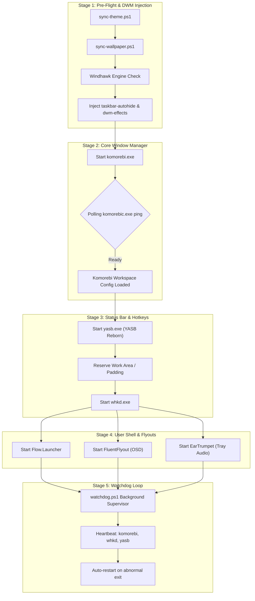

# Desktop Environment Architecture & Swarm Orchestration Contract

> **Target OS:** Windows 11 Build 26300+ (64-bit)  
> **Workspace Root:** `c:\Users\gyove\Projects\komoyasb`  
> **Author:** Lead Windows Systems Architect & Swarm Orchestrator  
> **Status:** Draft / Phase 1 Review (Awaiting User Sign-Off)

---

## 1. Local System Audit Table

Audited via `Get-Command`, `winget list`, `winget search`, `scoop list`, and local filesystem probes on November 22, 2026.

| Component / Tool | Target Version | Status on Host | Host Version / Path | Verified `winget` ID / Source | Config / Profile Target Directory |
| :--- | :--- | :--- | :--- | :--- | :--- |
| **Komorebi** | `v0.1.41+` | **Missing** | Not present | `LGUG2Z.komorebi` (winget) | `%USERPROFILE%\.config\komorebi\komorebi.json` |
| **whkd** | `v0.2.10+` | **Missing** | Not present | `LGUG2Z.whkd` (winget) | `%USERPROFILE%\.config\whkdrc` |
| **YASB Reborn** | `v2.0.8+` | **Missing** | Not present | `AmN.yasb` (winget) / `XPDNDSJBVK9LSS` (msstore) | `%USERPROFILE%\.config\yasb` |
| **Core Engine / Scripts** | PowerShell 5.1 / 7+ | **Installed** | PS 5.1.26100.9818 built-in | Native PowerShell / Task Scheduler | Repository root (`src\core\`) |
| **Flow Launcher** | `v2.1.4+` | **Missing** (Artifacts found) | Config folder at `%APPDATA%\FlowLauncher` | `Flow-Launcher.Flow-Launcher` (winget) | `%APPDATA%\FlowLauncher\Settings\Settings.json` |
| **Everything (Search)** | `v1.4.1+` | **Installed** | 1.4.1.1032 (`voidtools.Everything`) | `voidtools.Everything` (winget) | Standard Windows Service / Flow plugin |
| **Windhawk** | `v1.7.3+` (v2.0 ready) | **Missing** | Not present | `RamenSoftware.Windhawk` (winget) | `%PROGRAMDATA%\Windhawk\Engine\windhawk-cli.exe` & `%PROGRAMDATA%\Windhawk\Mods` |
| **EarTrumpet** | `v2.3.0.0+` | **Missing** | Not present | `File-New-Project.EarTrumpet` (winget) | `%LOCALAPPDATA%\EarTrumpet` |
| **FluentFlyout** | Modern Store app | **Missing** | Not present | `9N45NSM4TNBP` (msstore via winget) | `%LOCALAPPDATA%\Packages\*FluentFlyout*\LocalState` |
| **Nerd Fonts** | JetBrainsMono-NF | **Installed** | `3.5.1` (installed via scoop) | `JetBrainsMono-NF` (scoop) | Windows Fonts Subsystem |

---

## 2. Repository Tree & Strict Ownership Map

To ensure **zero file overlap** and eliminate merge collisions across the 5 parallel Swarm workers, every file and directory is isolated. No worker may modify files owned by another worker.

```text
komoyasb/
├── ARCHITECTURE.md                  [LEAD ARCHITECT ONLY]
├── themes/                          [SINGLE SOURCE OF TRUTH]
│   ├── theme.schema.json            [WORKER C]
│   ├── dark.json                    [WORKER C]
│   └── light.json                   [WORKER C]
├── src/
│   ├── tiling/                      [WORKER A EXCLUSIVE]
│   │   ├── komorebi.json.template
│   │   ├── applications.yaml
│   │   ├── whkdrc.template
│   │   └── README.md
│   ├── statusbar/                   [WORKER B EXCLUSIVE]
│   │   ├── config.yaml.template     # YASB Reborn format
│   │   ├── styles.css.template
│   │   ├── custom_widgets/
│   │   └── README.md
│   ├── core/                        [WORKER C EXCLUSIVE]
│   │   ├── install.ps1              # Unified installer & winget orchestrator
│   │   ├── uninstall.ps1            # Rollback engine (registry, symlinks, mods)
│   │   ├── sync-theme.ps1           # Compiler: theme.json -> runtime configs
│   │   ├── watchdog.ps1             # Process monitor & health supervisor
│   │   ├── helpers/
│   │   │   ├── Environment.psm1
│   │   │   └── TemplateEngine.psm1
│   │   └── README.md
│   ├── launcher_shell/              [WORKER D EXCLUSIVE]
│   │   ├── flow_settings.json.template
│   │   ├── flow_theme.fluent.template
│   │   ├── windhawk_mods/
│   │   │   ├── taskbar-autohide.wh.cpp
│   │   │   ├── dwm-mica-effects.wh.cpp
│   │   │   └── notification-styling.wh.cpp
│   │   ├── apply-windhawk-mods.ps1
│   │   └── README.md
│   └── media_osd/                   [WORKER E EXCLUSIVE]
│       ├── fluentflyout_config.json.template
│       ├── eartrumpet_settings.reg
│       ├── sync-wallpaper.ps1       # SystemParametersInfo SPI_SETDESKWALLPAPER
│       ├── assets/
│       │   └── wallpapers/
│       └── README.md
```

### Worker Ownership & Boundaries

| Worker | Subsystem Scope | Allowed Write Targets | Prohibited Actions |
| :--- | :--- | :--- | :--- |
| **Worker A** | Tiling & Keybindings | `configs/komorebi/**` | Writing to shell/bar configs or executing installer scripts. |
| **Worker B** | Status Bar (YASB Reborn) | `configs/yasb/**` | Using legacy YASB v1 schemas; editing global theme JSON directly. |
| **Worker C** | Lifecycle & Theme Engine | `scripts/**`, `themes/**` | Hardcoding values specific to Worker templates without token engine. |
| **Worker D** | Launcher & Shell/DWM | `configs/shell/**` | Directly invoking raw registry hacks without rollback routines. |
| **Worker E** | Audio, OSD & Wallpaper | `configs/polish/**` | Calling archived Flyout tools (ModernFlyouts strictly barred). |

---

## 3. Unified Theme Contract

### 3.1 Syntax Standard: Token Replacement Engine
All template files (`*.template`) must use mustache/double-brace token notation resolved case-sensitively by `sync-theme.ps1`:
```text

```
Examples:
- `{{colors.accent}}` -> `#7aa2f7`
- `{{colors.bg_primary}}` -> `#1a1b26`
- `{{colors.accent_alpha80}}` -> `rgba(122, 162, 247, 0.80)`
- `{{typography.font_family}}` -> `JetBrainsMono Nerd Font`
- `{{geometry.border_radius}}` -> `8`
- `{{wallpaper.path}}` -> `C:\Users\gyove\Projects\komoyasb\src\media_osd\assets\wallpapers\dark.png`

### 3.2 Schema Definition (`themes/theme.schema.json`)
```json
{
  "$schema": "http://json-schema.org/draft-07/schema#",
  "title": "UnifiedThemeSchema",
  "type": "object",
  "required": [
    "name",
    "variant",
    "colors",
    "typography",
    "geometry",
    "opacity",
    "wallpaper"
  ],
  "properties": {
    "name": { "type": "string" },
    "variant": { "type": "string", "enum": ["dark", "light"] },
    "colors": {
      "type": "object",
      "required": [
        "bg_primary",
        "bg_secondary",
        "bg_surface",
        "fg_primary",
        "fg_secondary",
        "fg_muted",
        "accent",
        "accent_secondary",
        "border_active",
        "border_inactive",
        "error",
        "warning",
        "success",
        "info"
      ],
      "properties": {
        "bg_primary": { "type": "string", "pattern": "^#[0-9a-fA-F]{6}$" },
        "bg_secondary": { "type": "string", "pattern": "^#[0-9a-fA-F]{6}$" },
        "bg_surface": { "type": "string", "pattern": "^#[0-9a-fA-F]{6}$" },
        "fg_primary": { "type": "string", "pattern": "^#[0-9a-fA-F]{6}$" },
        "fg_secondary": { "type": "string", "pattern": "^#[0-9a-fA-F]{6}$" },
        "fg_muted": { "type": "string", "pattern": "^#[0-9a-fA-F]{6}$" },
        "accent": { "type": "string", "pattern": "^#[0-9a-fA-F]{6}$" },
        "accent_secondary": { "type": "string", "pattern": "^#[0-9a-fA-F]{6}$" },
        "border_active": { "type": "string", "pattern": "^#[0-9a-fA-F]{6}$" },
        "border_inactive": { "type": "string", "pattern": "^#[0-9a-fA-F]{6}$" },
        "error": { "type": "string", "pattern": "^#[0-9a-fA-F]{6}$" },
        "warning": { "type": "string", "pattern": "^#[0-9a-fA-F]{6}$" },
        "success": { "type": "string", "pattern": "^#[0-9a-fA-F]{6}$" },
        "info": { "type": "string", "pattern": "^#[0-9a-fA-F]{6}$" }
      }
    },
    "typography": {
      "type": "object",
      "required": ["font_family", "font_size_sm", "font_size_md", "font_size_lg"],
      "properties": {
        "font_family": { "type": "string" },
        "font_size_sm": { "type": "string" },
        "font_size_md": { "type": "string" },
        "font_size_lg": { "type": "string" }
      }
    },
    "geometry": {
      "type": "object",
      "required": ["border_width", "border_radius", "window_gap", "bar_height"],
      "properties": {
        "border_width": { "type": "integer", "minimum": 0 },
        "border_radius": { "type": "integer", "minimum": 0 },
        "window_gap": { "type": "integer", "minimum": 0 },
        "bar_height": { "type": "integer", "minimum": 20 }
      }
    },
    "opacity": {
      "type": "object",
      "required": ["bar", "window_unfocused", "flyout", "launcher"],
      "properties": {
        "bar": { "type": "number", "minimum": 0.0, "maximum": 1.0 },
        "window_unfocused": { "type": "number", "minimum": 0.0, "maximum": 1.0 },
        "flyout": { "type": "number", "minimum": 0.0, "maximum": 1.0 },
        "launcher": { "type": "number", "minimum": 0.0, "maximum": 1.0 }
      }
    },
    "wallpaper": {
      "type": "object",
      "required": ["path", "style"],
      "properties": {
        "path": { "type": "string" },
        "style": { "type": "string", "enum": ["Fill", "Fit", "Stretch", "Tile", "Center", "Span"] }
      }
    }
  }
}
```

---

## 4. Startup & Watchdog Sequencing

To avoid race conditions (such as YASB mounting before Komorebi allocates work area or whkd polling unregistered sockets), startup executes in strict pipeline stages:



### Readiness Check Specifications

1. **Pre-flight Stage (0 - 2 sec):**
   - Execute `sync-theme.ps1` to re-generate runtime config files if modified.
   - Execute `sync-wallpaper.ps1` using `SystemParametersInfoW(SPI_SETDESKWALLPAPER)`.
   - Verify `windhawk-cli.exe` is responsive; ensure mods are loaded into explorer and DWM.

2. **Komorebi Initialization (2 - 4 sec):**
   - Launch `komorebi -c %USERPROFILE%\.config\komorebi\komorebi.json`.
   - Poll `komorebic ping` every 200ms with a 5-second timeout until exit code is `0`.

3. **Status Bar & Input (4 - 6 sec):**
   - Launch `yasb` (YASB Reborn). Wait 1s for YASB HWND to register and subtract screen work area margins.
   - Launch `whkd -c %USERPROFILE%\.config\whkdrc`.

4. **Shell & OSD Auxiliaries (6 - 8 sec):**
   - Launch `Flow.Launcher.exe` (no console window).
   - Launch `FluentFlyout` and `EarTrumpet`.

5. **Watchdog Supervision (`watchdog.ps1`):**
   - Polls every 3 seconds for active PIDs: `komorebi`, `whkd`, `yasb`.
   - Exponential backoff restart logic (max 3 retries in 60s) to prevent restart storms upon fatal configuration syntax errors.

---

## 5. Rollback & Reversibility Strategy (`uninstall.ps1`)

Every modification performed during lifecycle execution has a mirror rollback procedure:

1. **Windhawk Customizations:**
   - Command: `windhawk-cli.exe -unload-mod <mod-id>`
   - Restore default Windows 11 taskbar visibility and remove DWM hook injections.
2. **Registry Changes:**
   - Any registry adjustments (e.g., hiding legacy tray icons, accent overrides) will be recorded in a transactional `.reg` backup file before alteration.
   - Restored via `reg import backup_settings.reg`.
3. **Symlinks & Configurations:**
   - User config links (`~/.config/komorebi`, `~/.config/whkdrc`, `~/.config/yasb`) are unlinked and original pre-existing user configurations restored from `.backup` directories.
4. **Process Termination:**
   - Clean shutdown of `whkd`, `komorebi`, `yasb`, and `watchdog`.

---

## 6. Next Phase: Swarm Orchestration Directives

Once this document is approved, execution passes directly to the 5 Swarm Workers:
- **Worker A:** Implement `configs/komorebi/komorebi.json.template` & `whkdrc.template` with vim-like navigation (`Alt+H/J/K/L`) and floating workspace rules.
- **Worker B:** Implement `configs/yasb/config.yaml.template` & `styles.css.template` utilizing YASB Reborn structure with Komorebi workspaces widget and media widget.
- **Worker C:** Build `install.ps1`, `uninstall.ps1`, `scripts/sync-theme.ps1`, and `scripts/watchdog.ps1`.
- **Worker D:** Build Flow Launcher templates and C++ Windhawk mods (`taskbar-autohide`, `dwm-effects`) with clean CLI loading scripts.
- **Worker E:** Implement FluentFlyout/EarTrumpet alignment rules and `sync-wallpaper.ps1`.

