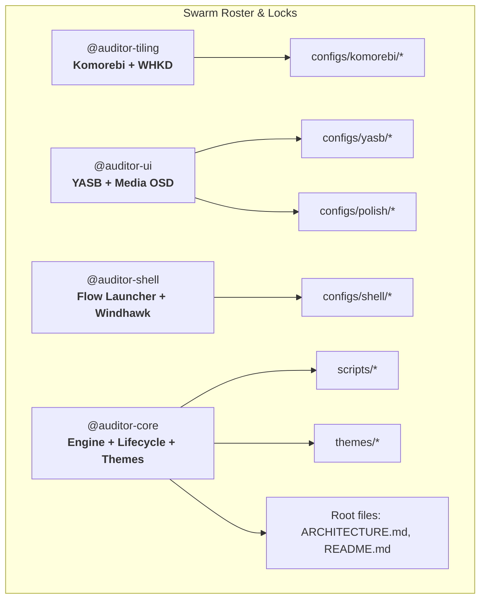

# AUDIT_ARCHITECTURE.md - Swarm Hardening & Verification Contract

## 1. Executive Summary & Baseline Scan Findings

A non-destructive pre-audit scan of the `komoyasb` repository against `ARCHITECTURE.md` was conducted. All existing PowerShell scripts passed AST syntax parsing. All theme templates successfully compiled without unresolved `{{...}}` tokens against both `dark.json` and `light.json`. However, several environmental drifts, command naming mismatches, and critical cross-module failure modes were identified.

### 1.1 Confirmed Environmental & Tooling Status
A ground-truth check of CLI tools on the host environment revealed:
- **`komorebic`**: `NOT FOUND in PATH`.
- **`whkd`**: `NOT FOUND in PATH`.
- **`yasb`**: `NOT FOUND in PATH`.
- **`winget`**: Located at `C:\Users\gyove\AppData\Local\Microsoft\WindowsApps\winget.exe`. Note: Failed execution inside the restricted sandbox environment (`The file cannot be accessed by the system`).
- **`windhawk-cli.exe` / `windhawk`**: `NOT FOUND in PATH`.

> **Implication for Swarm Workers:** All automated unit and contract tests in the CI/local development loop must be capable of running offline in mock/dry-run mode without assuming the binaries are pre-installed or running.

### 1.2 Identified Drifts & Architectural Risks
1. **Script Naming Drift (`Set-ThemeWallpaper.ps1` vs `sync-wallpaper.ps1`)**:
   - `ARCHITECTURE.md` and user prompts specify `Set-ThemeWallpaper.ps1` (or `sync-wallpaper.ps1`). The repository implements `configs/polish/sync-wallpaper.ps1`.
   - Contract lock: Both names should be clarified or aliased/symlinked to avoid broken references across modules.
2. **Global Hotkey Collisions (`Alt + Space`)**:
   - `configs/komorebi/whkdrc.template` (line 71) binds `alt + space : komorebic toggle-bsp`.
   - `configs/shell/flow_settings.json.template` (line 2) assigns `"Hotkey": "Alt + Space"` to Flow Launcher.
   - Result: Severe OS-level hotkey conflict between tiling layout toggle and application launcher activation.
3. **Dual Hotkey Redundancy (`Alt + Enter` vs `Alt + Return`)**:
   - `configs/komorebi/whkdrc.template` binds both `alt + enter : komorebic promote` (line 81) and `alt + return : wt.exe` (line 109). In WHKD / Windows Virtual Key translation, `enter` and `return` often map to the identical keycode (`VK_RETURN` 0x0D), causing an ambiguous override or silent registration drop.
4. **Strict-Mode & Null Traps in Package Checks**:
   - In `scripts/lib/Environment.psm1`, `winget list` execution assumes standard exit codes. In `Set-StrictMode -Version Latest`, unhandled array bounds or unquoted strings can throw terminating errors.
5. **Color Format Heterogeneity**:
   - `Komorebi` (`komorebi.json`): Expects Hex strings (`#1a1b26`).
   - `Flow Launcher` (`flow_settings.json`): Expects Hex string (`#7aa2f7`).
   - `YASB` (`styles.css`): Expects `rgba(r, g, b, a)` or Hex.
   - `EarTrumpet` / `FluentFlyout`: Requires ARGB integer or standard 8-char hex `#AARRGGBB`.

---

## 2. Audit Scope & Worker Ownership Map

To ensure **zero file overlap** and eliminate merge collisions across 4 parallel swarm workers, the repository is strictly partitioned into non-overlapping file locks.



### Detailed Ownership Matrix

| Worker | Target Domain | Exclusive File Locks (Write/Edit Access) | Primary Responsibilities |
| :--- | :--- | :--- | :--- |
| **`@auditor-tiling`** | Komorebi & WHKD | `configs/komorebi/komorebi.json`<br/>`configs/komorebi/komorebi.json.template`<br/>`configs/komorebi/whkdrc`<br/>`configs/komorebi/whkdrc.template`<br/>`configs/komorebi/applications.yaml`<br/>`configs/komorebi/README.md` | - Resolve `alt + space` collision with Flow Launcher.<br/>- Resolve `alt + enter` vs `alt + return` conflict.<br/>- Audit Komorebi v0.1.33 JSON schema compliance.<br/>- Hardening of application rules and float behaviors. |
| **`@auditor-ui`** | YASB Reborn, FluentFlyout, EarTrumpet, Wallpaper | `configs/yasb/config.yaml`<br/>`configs/yasb/config.yaml.template`<br/>`configs/yasb/styles.css`<br/>`configs/yasb/styles.css.template`<br/>`configs/yasb/custom_widgets/*`<br/>`configs/yasb/README.md`<br/>`configs/polish/fluentflyout_config.json`<br/>`configs/polish/fluentflyout_config.json.template`<br/>`configs/polish/eartrumpet_settings.reg`<br/>`configs/polish/sync-wallpaper.ps1`<br/>`configs/polish/README.md` | - Verify YASB YAML schema & custom PowerShell widget outputs (`Get-GpuMetrics.ps1`, `Get-KomorebiStatus.ps1`).<br/>- Audit CSS transparency tokens and styling consistency.<br/>- Audit `sync-wallpaper.ps1` Win32 API handling and safety.<br/>- Ensure alignment between flyout and status bar aesthetics. |
| **`@auditor-shell`** | Flow Launcher & Windhawk Mods | `configs/shell/flow_settings.json`<br/>`configs/shell/flow_settings.json.template`<br/>`configs/shell/flow_theme.fluent`<br/>`configs/shell/flow_theme.fluent.template`<br/>`configs/shell/apply-windhawk-mods.ps1`<br/>`configs/shell/windhawk_mods/*`<br/>`configs/shell/README.md` | - Re-align Flow Launcher activation hotkey (e.g., standard `Alt + Space` while freeing it in tiling).<br/>- Audit Windhawk v2+ mod C++ syntax and CLI parameters.<br/>- Verify fallback logic when Windhawk is not installed.<br/>- Audit Flow Launcher Fluent theme XAML/JSON integrity. |
| **`@auditor-core`** | Theme Engine, Installer, Watchdog, Schemas | `install.ps1`<br/>`uninstall.ps1`<br/>`scripts/watchdog.ps1`<br/>`scripts/sync-theme.ps1`<br/>`scripts/lib/Environment.psm1`<br/>`scripts/lib/TemplateEngine.psm1`<br/>`scripts/README.md`<br/>`themes/dark.json`<br/>`themes/light.json`<br/>`themes/theme.schema.json`<br/>`themes/.current_theme`<br/>`ARCHITECTURE.md` | - Enforce Strict-Mode compliance across all core PowerShell modules.<br/>- Verify transactional backup idempotency and rollback safety.<br/>- Harden watchdog process spawning, named pipe wait, and readiness check logic.<br/>- Validate `theme.schema.json` against theme definitions. |

---

## 3. Cross-Module Risk Register

| Risk ID | Category | Description | Mitigation Strategy & Verification Gate |
| :--- | :--- | :--- | :--- |
| **RSK-01** | Hotkey Collision | `whkdrc.template` has `alt + space` assigned to Komorebi BSP toggle, whereas `flow_settings.json` uses `Alt + Space` for launcher. | Assign `Alt + Shift + Space` or `Alt + b` to Komorebi BSP toggle; preserve `Alt + Space` for Flow Launcher. `@auditor-tiling` owns this change. |
| **RSK-02** | Hotkey Ambiguity | `whkdrc.template` maps `alt + enter` (promote) and `alt + return` (terminal). In Windows, both correspond to `VK_RETURN`. | Change terminal launcher to `alt + shift + enter` or `alt + t`. `@auditor-tiling` owns this change. |
| **RSK-03** | Color Token Drift | Different apps require different color representations (`#HEX`, `rgba(r,g,b,a)`, `#AARRGGBB`). | `TemplateEngine.psm1` auto-expands `_alpha*`, `_argb*`, and `.rgb`. All templates must strictly consume supported expansions without inventing unmapped tokens. |
| **RSK-04** | Windows Backslash Escaping | Paths injected into JSON/YAML configuration files via templates can break parser if unescaped single backslashes `\` are present. | Path tokens must either use forward slashes `/` or double backslashes `\\`. Verified via `ConvertFrom-Json` in dry-run tests. |
| **RSK-05** | Strict-Mode Violations | `Set-StrictMode -Version Latest` throws terminating exceptions on accessing non-existent object properties or uninitialized variables. | Use `Get-Member`, `Contains()`, or `-in` guards before accessing dynamic properties. Tested via AST and strict runtime invocation. |
| **RSK-06** | Pipe & Process Race Conditions | `watchdog.ps1` starts `komorebi`, `whkd`, and `yasb` concurrently. `whkd` or `yasb` may fail if launched before `komorebi` socket/pipe is active. | `watchdog.ps1` must implement readiness polling (e.g. `komorebic ping` with exponential backoff) before spawning downstream dependents. |
| **RSK-07** | Winget Access Restrictions | Under standard sandbox or limited user permissions, direct execution of `winget.exe` may fail with access denied. | `Environment.psm1` must wrap `winget` queries in robust `try / catch` blocks and provide simulated fallbacks when `$DryRun` is active. |
| **RSK-08** | Backup & Rollback Idempotency | Multiple invocations of `install.ps1` without cleanups could create nested backup loops or overwrite original backup points. | Ensure backup directories are timestamped and `uninstall.ps1` correctly references the most recent non-empty snapshot. |

---

## 4. Verification Commands & QA Gates

Every worker must validate their changes locally against the non-destructive verification matrix before completing their audit phase.

### Gate 1: Syntax & AST Integrity
```powershell
# Must execute without syntax errors across all PS scripts and modules
Get-ChildItem -Recurse -Include *.ps1, *.psm1 | ForEach-Object {
    $errors = $null
    $tokens = $null
    [System.Management.Automation.Language.Parser]::ParseFile($_.FullName, [ref]$tokens, [ref]$errors) | Out-Null
    if ($errors.Count -gt 0) {
        Write-Error "Syntax error in $($_.FullName): $($errors[0].Message)"
    } else {
        Write-Host "AST OK: $($_.Name)" -ForegroundColor Green
    }
}
```

### Gate 2: Full Theme Template Compilation & Token Resolution
```powershell
# Must render all templates without unexpanded {{...}} tokens for both dark and light themes
Import-Module ".\src\core\helpers\TemplateEngine.psm1" -Force
foreach ($themeName in @("dark", "light")) {
    $theme = Get-Content ".\themes\$themeName.json" -Raw | ConvertFrom-Json
    $tokens = Get-FlattenedTokens -JsonObject $theme
    $tokens = Expand-ComputedTokens -Tokens $tokens
    
    Get-ChildItem -Recurse -Path ".\src" -Filter "*.template" | ForEach-Object {
        $tempOut = Join-Path $env:TEMP "$($_.BaseName)_test.tmp"
        Invoke-TemplateRendering -TemplatePath $_.FullName -OutputPath $tempOut -Tokens $tokens
        $unresolved = Select-String -Pattern '\{\{.*?\}\}' -Path $tempOut
        if ($unresolved) {
            Write-Error "Unresolved tokens in $($_.Name): $($unresolved.Matches.Value -join ', ')"
        }
        # JSON syntax validation
        if ($_.BaseName.EndsWith(".json")) {
            Get-Content $tempOut -Raw | ConvertFrom-Json | Out-Null
        }
        Remove-Item -Force $tempOut -ErrorAction SilentlyContinue
    }
}
Write-Host "Template engine & schema tests PASSED!" -ForegroundColor Green
```

### Gate 3: End-to-End Dry-Run Lifecycle
```powershell
# 1. Sync Theme DryRun
powershell -NoProfile -File .\src\core\sync-theme.ps1 -Theme "dark" -DryRun

# 2. Installer DryRun
powershell -NoProfile -File .\src\core\install.ps1 -DryRun -SkipPackages

# 3. Watchdog Status Check
powershell -NoProfile -File .\src\core\watchdog.ps1 -Action Status

# 4. Uninstaller DryRun
powershell -NoProfile -File .\src\core\uninstall.ps1 -DryRun
```

### Gate 4: Hotkey Collision Zero-Tolerance Audit
```powershell
# Verify no duplicate key combos exist within whkdrc
$whkd = Get-Content ".\src\tiling\whkdrc" | Where-Object { $_ -match '^\s*[^#].*?:' } | ForEach-Object {
    ($_.Split(':')[0]).Trim().ToLower()
}
$duplicates = $whkd | Group-Object | Where-Object { $_.Count -gt 1 }
if ($duplicates) {
    Write-Error "Duplicate hotkeys detected in whkdrc: $($duplicates.Name -join ', ')"
} else {
    Write-Host "WHKD Hotkeys conflict-free!" -ForegroundColor Green
}
```

