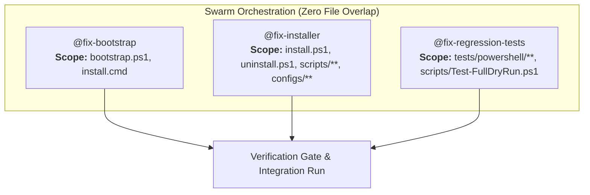

# Architecture & Hotfix Specification: PowerShell StrictMode & IEX Reliability

**Document ID:** `docs/BOOTSTRAP_HOTFIX_ARCHITECTURE.md`  
**Classification:** Diagnostic & Architectural Hotfix Specification  
**Author:** Principal PowerShell Diagnostics & Reliability Engineer  
**Status:** Approved for Parallel Swarm Execution  
**Execution Mode:** Zero File Overlap across 3 Parallel Swarm Workers  

---

## 1. Executive Summary & Incident Overview

When executing the one-line remote installation command as instructed by `README.md`:
```powershell
irm https://raw.githubusercontent.com/gyovemi/komoyasb/main/bootstrap.ps1 | iex
```
or with forwarded parameters (e.g. `-NoAdmin`, `-DryRun`, `-Theme dark`):
```powershell
& (irm https://raw.githubusercontent.com/gyovemi/komoyasb/main/bootstrap.ps1) -NoAdmin
```
the PowerShell process crashes abruptly under Windows PowerShell 5.1 with:
```text
Invoke-Expression : The property 'Count' cannot be found on this object. Verify that the property exists.
At line:1 char:1
+ irm .../bootstrap.ps1 | iex
+ ~~~~~~~~~~~~~~~~~~~~~~~~~~~
    + CategoryInfo          : NotSpecified: (:) [], PropertyNotFoundException
    + FullyQualifiedErrorId : PropertyNotFoundStrict
```

This document details the exact root cause, secondary failures, repo-wide vulnerabilities under `Set-StrictMode -Version Latest`, and an airtight, zero-file-overlap decomposition for 3 parallel Swarm workers to implement and verify the fix.

---

## 2. Root Cause Analysis (Deep Dive)

### 2.1 Primary Crash: Pipeline Collection Unrolling & `[System.String].Count`

- **Faulting File:** `bootstrap.ps1`
- **Faulting Lines:** Line 249 to Line 255
- **Faulting Expression:** `if ($forwardList.Count -gt 0)`
- **Faulting Variable:** `$forwardList`

```powershell
# bootstrap.ps1 lines 249-255:
$forwardList = if ($ForwardArgs) { [System.Collections.Generic.List[string]]::new([string[]]$ForwardArgs) } else { [System.Collections.Generic.List[string]]::new() }
if ($rootlessMode -and -not ($forwardList -contains "-NoAdmin")) {
    $forwardList.Add("-NoAdmin")
}

Write-Host "[komoyasb:bootstrap] Invoking installer: $installerScript" -ForegroundColor Green
if ($forwardList.Count -gt 0) {
```

#### Detailed Failure Mechanism
1. **Pipeline Enumeration in Assignment Expressions:**  
   In PowerShell, assigning the result of an `if (...) { ... }` block expression routes output through PowerShell's object pipeline. When an expression inside the script block evaluates to a collection (such as `[System.Collections.Generic.List[string]]::new([string[]]$ForwardArgs)`), PowerShell unrolls the collection.
2. **Scalar Downcasting:**  
   When `$ForwardArgs` contains exactly one element (such as `-NoAdmin`, `-DryRun`, or any single switch), the `List[string]` is unrolled by the pipeline into a single scalar object: `[System.String]`. `$forwardList` is therefore assigned a `[System.String]`, not a `List` or `Array`.
3. **Branch Bypassing:**  
   If the script is running elevated (`$rootlessMode = $false`), or if `-NoAdmin` was already present in `$ForwardArgs`, the condition `if ($rootlessMode -and -not ($forwardList -contains "-NoAdmin"))` evaluates to `$false`. Line 251 (`$forwardList.Add(...)`) is skipped.
4. **StrictMode Property Rejection:**  
   Execution arrives at line 255: `if ($forwardList.Count -gt 0)`.  
   Because `bootstrap.ps1` declares `Set-StrictMode -Version Latest` (Line 49), PowerShell disables intrinsic property resolution. While `[System.String]` possesses `.Length`, it does **not** possess a `.Count` property.
   PowerShell immediately raises a terminating `PropertyNotFoundStrict` exception:
   `The property 'Count' cannot be found on this object. Verify that the property exists.`
5. **IEX Invocation Context:**  
   Because the outer command was `Invoke-Expression` (`irm ... | iex`), the terminating exception is reported under `Invoke-Expression`:
   `Invoke-Expression: The property 'Count' cannot be found on this object.`

---

### 2.2 Secondary Failure Modes in `bootstrap.ps1`

Even if the `.Count` access is bypassed, two additional fatal bugs exist immediately adjacent in `bootstrap.ps1`:

#### A. MethodNotFound on Scalar or Fixed-Size Array (`.Add`)
- **Faulting Line:** Line 251: `$forwardList.Add("-NoAdmin")`
- **Scenario A (Scalar String):** If running as standard non-admin (`$rootlessMode = $true`) and `$ForwardArgs` has 1 item (e.g. `-DryRun`), `$forwardList` is a `[System.String]`. Calling `.Add("-NoAdmin")` throws:
  `Method invocation failed because [System.String] does not contain a method named 'Add'.`
- **Scenario B (Array):** If `$ForwardArgs` has 2 or more items (e.g. `@("-Theme", "light")`), the pipeline unrolls the List into a fixed-size `[System.Object[]]`. Calling `.Add("-NoAdmin")` on a fixed-size array throws:
  `Method invocation failed because [System.Object[]] does not contain a method named 'Add'.`

#### B. Positional Parameter Scrambling via Array Splatting
- **Faulting Line:** Line 257: `& $installerScript @forwardList`
- **Mechanism:** In PowerShell, splatting an array of strings (`@forwardList`) passes elements as **positional argument tokens**, not named switches.
- **Impact on `install.ps1`:**  
  `install.ps1` defines:
  ```powershell
  param(
      [switch]$SkipPackages,
      [string]$Theme = "dark",
      [switch]$ApplyWindhawk,
      [switch]$NoAdmin,
      [switch]$DryRun,
      [string]$SandboxRoot = "",
      [switch]$KeepSandbox,
      [string]$LedgerPath = ""
  )
  ```
  Since `$SkipPackages` is a switch, it rejects non-boolean positional strings.  
  The first positional string parameter is `$Theme`.  
  Passing `@('-NoAdmin')` binds `"-NoAdmin"` to `$Theme`! `$NoAdmin` remains `$false`!  
  Passing `@('-NoAdmin', '-DryRun')` binds `"-NoAdmin"` to `$Theme` and `"-DryRun"` to `$SandboxRoot`!  
  `$DryRun` remains `$false`, causing the installer to execute real modifications on the host, and `sync-theme.ps1` attempts to resolve `themes/-NoAdmin.json`, which crashes with `Theme not found: -NoAdmin`.

---

### 2.3 Working Directory (`C:\Windows\System32`) Traps

When users launch an elevated PowerShell prompt or run from default system paths, `(Get-Location).Path` is `C:\Windows\System32`.

1. **Empty `$PSScriptRoot` in `install.ps1`:**  
   Line 106: `$coreHelpersDir = Join-Path $PSScriptRoot "scripts\lib"`  
   If `install.ps1` is ever executed via `Invoke-Expression` or dot-sourced without an absolute path, `$PSScriptRoot` is `$null` / `""`. `Join-Path "" "scripts\lib"` resolves to `"scripts\lib"` relative to the current working directory (`C:\Windows\System32\scripts\lib`), throwing `ModuleNotFoundException` on `Import-Module`.
2. **`Get-WorkspaceRoot` CWD Fallback in `scripts\lib\Environment.psm1`:**  
   Line 150: `return (Get-Location).Path`  
   When directory upward-traversal cannot locate `themes/` and `configs/`, it falls back to `(Get-Location).Path` (`C:\Windows\System32`).  
   In `install.ps1`:
   Line 188: `$backupBase = Join-Path (Join-Path $workspaceRoot "themes") ".backups"` becomes `C:\Windows\System32\themes\.backups`. Attempting to create this directory fails with `UnauthorizedAccessException: Access to the path is denied`.

---

## 3. Full Vulnerability Map (Repo-Wide Audit)

Every instance across production scripts where `.Count` or `.Length` is accessed without `@(...)` array wrapping, or where execution context assumptions fail under `Set-StrictMode -Version Latest`:

| File | Line | Code Snippet | Failure Mode under StrictMode / IEX | Required Remediation |
|---|---|---|---|---|
| `bootstrap.ps1` | 249 | `$forwardList = if ($ForwardArgs) { ... }` | Pipeline unrolls `List` into scalar `String` or `Object[]` | Initialize with `[List[string]]::new()` and explicitly append items via `.AddRange()` or `foreach` |
| `bootstrap.ps1` | 255 | `if ($forwardList.Count -gt 0)` | Throws `PropertyNotFoundStrict` when `$forwardList` is `String` | Use `@($forwardList).Count -gt 0` |
| `bootstrap.ps1` | 257 | `& $installerScript @forwardList` | Array splatting binds strings positionally; scrambles parameters | Invoke via `powershell.exe -File $installerScript $argsList` or hashtable splatting |
| `install.ps1` | 106 | `Join-Path $PSScriptRoot "scripts\lib"` | `$PSScriptRoot` is empty under `iex` / dot-source | Robust fallback: `$PSScriptRoot` -> `$MyInvocation.MyCommand.Path` -> `Get-WorkspaceRoot` |
| `install.ps1` | 43 | `[CmdletBinding(SupportsShouldProcess = $true)]` | Allows unexpected positional parameter binding | Add `PositionalBinding = $false` |
| `install.ps1` | 211 | `if ($backupManifest.Backups.Count -eq 0)` | Throws if `Backups` ever becomes a scalar or null | Wrap with `@($backupManifest.Backups).Count -eq 0` |
| `uninstall.ps1` | 50 | `$coreHelpersDir = Join-Path $PSScriptRoot "scripts\lib"` | Empty `$PSScriptRoot` under `iex` context | Robust fallback: `$PSScriptRoot` -> `$MyInvocation.MyCommand.Path` -> `Get-WorkspaceRoot` |
| `uninstall.ps1` | 42 | `[CmdletBinding(SupportsShouldProcess = $true)]` | Allows unexpected positional parameter binding | Add `PositionalBinding = $false` |
| `build-release.ps1` | 77 | `Write-Host "All $($psScripts.Count) ..."` | Throws if `Get-ChildItem` returns single file | Use `@($psScripts).Count` |
| `build-release.ps1` | 179 | `if ($distExeFiles -and $distExeFiles.Count -gt 0)` | Throws if single `.exe` returned (scalar `FileInfo`) | Use `@($distExeFiles).Count` |
| `build-release.ps1` | 186 | `Write-Host "... ($($distExeFiles.Count) artifacts)"` | Throws if single `.exe` artifact | Use `@($distExeFiles).Count` |
| `scripts/lib/Environment.psm1` | 150 | `return (Get-Location).Path` | Returns `C:\Windows\System32` if run outside repo | Inspect standard installation locations (`$env:LOCALAPPDATA\komoyasb`) before fallback |
| `scripts/Set-OsPerformance.ps1` | 220 | `Split-Path -Parent $PSScriptRoot` | Empty string if `$PSScriptRoot` is null | Use `Get-WorkspaceRoot` fallback |
| `configs/yasb/widgets/Get-KomorebiStatus.ps1` | 38 | `$windowCount = $focusedWorkspace.containers.elements.Count` | PS 5.1 `ConvertFrom-Json` scalarizes 1-element arrays into `PSCustomObject` | Wrap with `@($focusedWorkspace.containers.elements).Count` |
| `configs/yasb/widgets/Get-GpuMetrics.ps1` | 88, 91 | `if ($outputParts.Count -ge 2)` | Throws if `$outputParts` is null or scalar under StrictMode | Wrap with `@($outputParts).Count` |

---

## 4. Worker Ownership Map (Zero File Overlap)

To ensure clean, concurrent execution without merge conflicts, work is partitioned across 3 isolated Swarm workers:



### Worker 1: `@fix-bootstrap`
- **Assigned Files (Exclusive):**
  - `bootstrap.ps1`
  - `install.cmd`
- **Responsibilities:**
  1. Fix `bootstrap.ps1` argument forwarding list construction:
     - Replace `if ($ForwardArgs) { [List]::new(...) } else { ... }` with direct instantiation:
       ```powershell
       $forwardList = [System.Collections.Generic.List[string]]::new()
       if ($ForwardArgs) {
           foreach ($arg in $ForwardArgs) {
               if (-not [string]::IsNullOrWhiteSpace($arg)) {
                   $forwardList.Add([string]$arg)
               }
           }
       }
       ```
     - Guarantee `$forwardList` remains a `System.Collections.Generic.List[string]` at all times.
     - Safely append `"-NoAdmin"` when `$rootlessMode` is active.
     - Use `@($forwardList).Count` for count evaluation.
  2. Fix `install.ps1` invocation:
     - When invoking `install.ps1`, pass arguments as a clean string argument array to `& $installerScript` or via child process `powershell.exe -NoProfile -ExecutionPolicy Bypass -File $installerScript $forwardList` to ensure PowerShell parameter parsing binds switches (`-DryRun`, `-NoAdmin`) and parameters (`-Theme`, `-SandboxRoot`) cleanly without positional corruption.
  3. Update `install.cmd` to forward `%*` safely with quoted arguments.

### Worker 2: `@fix-installer`
- **Assigned Files (Exclusive):**
  - `install.ps1`
  - `uninstall.ps1`
  - `build-release.ps1`
  - `scripts/lib/Environment.psm1`
  - `scripts/lib/DryRunContext.psm1`
  - `scripts/Set-OsPerformance.ps1`
  - `configs/yasb/widgets/Get-KomorebiStatus.ps1`
  - `configs/yasb/widgets/Get-GpuMetrics.ps1`
- **Responsibilities:**
  1. In `install.ps1` and `uninstall.ps1`:
     - Add `PositionalBinding = $false` to `[CmdletBinding(SupportsShouldProcess = $true, PositionalBinding = $false)]` to forbid positional argument hijacking.
     - Add resilient script root resolution:
       ```powershell
       $scriptDir = if ($PSScriptRoot) { $PSScriptRoot }
                    elseif ($MyInvocation.MyCommand.Path) { Split-Path -Parent $MyInvocation.MyCommand.Path }
                    else { Get-WorkspaceRoot }
       ```
     - Defensively array-wrap backup counts: `@($backupManifest.Backups).Count`.
  2. In `scripts/lib/Environment.psm1`:
     - Harden `Get-WorkspaceRoot`: if directory climbing fails and `(Get-Location).Path` is `C:\Windows\System32` (or system directory), check `$env:LOCALAPPDATA\komoyasb` or known parent directories before defaulting to CWD.
  3. In `build-release.ps1`:
     - Wrap all `Get-ChildItem` file counts with `@(...)`: `@($distExeFiles).Count`, `@($psScripts).Count`, `@($astErrors).Count`.
  4. In `configs/yasb/widgets/`:
     - Wrap `@($focusedWorkspace.containers.elements).Count` in `Get-KomorebiStatus.ps1`.
     - Wrap `@($outputParts).Count` in `Get-GpuMetrics.ps1`.

### Worker 3: `@fix-regression-tests`
- **Assigned Files (Exclusive):**
  - `tests/powershell/Bootstrap.Tests.ps1` (new test suite)
  - `tests/powershell/Install.Tests.ps1`
  - `tests/powershell/Environment.Tests.ps1`
  - `scripts/Test-FullDryRun.ps1`
- **Responsibilities:**
  1. Create `tests/powershell/Bootstrap.Tests.ps1`:
     - Test `Invoke-Expression` execution of `bootstrap.ps1` with single switch (`-NoAdmin`), ensuring no `PropertyNotFoundStrict` or `MethodNotFound` exceptions.
     - Test execution when caller's CWD is `C:\Windows\System32`.
     - Test parameter forwarding verification: ensure `-NoAdmin`, `-DryRun`, and `-Theme` pass through to `install.ps1` without positional scrambling.
  2. In `tests/powershell/Install.Tests.ps1`:
     - Verify `install.ps1` runs safely under `Set-StrictMode -Version Latest` when `$PSScriptRoot` is `$null`.
     - Verify zero backup files found behaves cleanly.
  3. In `scripts/Test-FullDryRun.ps1`:
     - Add **Stage 14: Bootstrap & IEX Reliability Gate**:
       Executes `bootstrap.ps1` via `[scriptblock]::Create` and `Invoke-Expression` in a simulated `C:\Windows\System32` context with `-DryRun` and verifies zero mutations and exit code 0.

---

## 5. Verification Gate & Acceptance Commands

The fix is accepted when all of the following commands execute with exit code 0 and zero warnings/exceptions:

### Gate 1: Safe `Invoke-Expression` Execution from `C:\Windows\System32`
Execute `bootstrap.ps1` via `Invoke-Expression` simulating `irm ... | iex` with CWD in `System32`:
```powershell
powershell.exe -NoProfile -ExecutionPolicy Bypass -Command "
Set-Location 'C:\Windows\System32'
`$script = Get-Content 'C:\Users\gyove\Projects\komoyasb\bootstrap.ps1' -Raw
`$sb = [scriptblock]::Create(`$script)
& `$sb -DryRun -InstallDir 'C:\Users\gyove\Projects\komoyasb' -NoAdmin
if (`$LASTEXITCODE -ne 0) { throw 'Bootstrap IEX test failed!' }
Write-Host 'Gate 1 Passed: Bootstrap executed cleanly under IEX from System32.' -ForegroundColor Green
"
```

### Gate 2: Full Repository Test Suite & Coverage Gate
Execute the unified test runner:
```powershell
powershell.exe -NoProfile -ExecutionPolicy Bypass -Command "& '.\scripts\Invoke-AllTests.ps1' -SkipRust -SkipFrontend -CoverageThreshold 90"
```
**Criteria:**
- PowerShell Pester Suite: 100% PASS, >= 90% Line Coverage.
- End-to-End & Security Gate: 14/14 stages PASS (including Stage 14 Bootstrap Gate).
- Host-Safety AST Gate: 0 violations.

---

## 6. Next Steps & Approval Workflow

This diagnostic specification completes Phase 1 (Read-Only).  
Upon explicit user confirmation, the 3 workers (`@fix-bootstrap`, `@fix-installer`, `@fix-regression-tests`) will be provisioned in parallel via `/swarm`.
