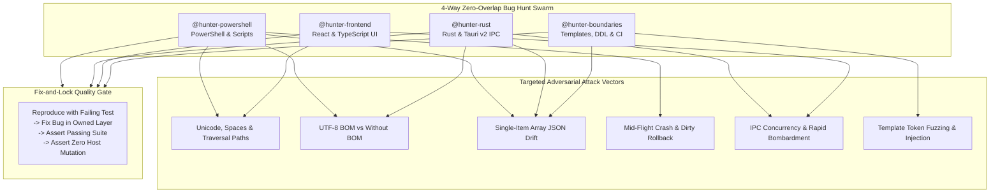

# Adversarial Bug Hunt & Reliability Architecture

This document defines the failure-mode reconnaissance, vulnerability matrix, adversarial test vectors, and swarm worker partition plan for conducting a comprehensive chaos and reliability test across the `komoyasb` Windows 11 desktop environment stack.

---

## 1. Executive Summary & Chaos Engineering Philosophy

The `komoyasb` stack integrates four distinct runtime layers on Windows 11:
1. **PowerShell Engine (5.1 & 7+):** Provisioning, dry-run shadow virtualization, theme compiling, and supervisor daemon orchestration.
2. **Rust / Tauri v2 Core:** IPC command dispatch, system telemetry sampling, Win32 atomic persistence, and security jailing.
3. **React 19 / TypeScript UI:** Desktop Control Center workbench, reactive state synchronization, and IPC client bridge.
4. **Configuration Templates:** Multi-target template compiler for Komorebi (JSON), YASB (YAML/CSS), WHKD (DSL), Flow Launcher, and FluentFlyout.

### Core Adversarial Principle: "Assume Every Boundary Is Hostile"
Desktop environment automation on Windows 11 suffers from unique failure vectors: file locks by running window managers, Win32 `MoveFileExW` edge cases, UTF-8 BOM vs. non-BOM parsing, PowerShell `ConvertTo-Json` array unwrapping, and race conditions between IPC triggers and filesystem operations.

The objective of this adversarial bug hunt is to aggressively probe every boundary, uncover real failure modes, implement bulletproof fixes, and lock in regression tests that guarantee permanent stability.

### The Non-Destructive Guarantee
All chaos experiments, fuzz testing, and adversarial test harnesses must execute strictly within ephemeral sandboxes:
- PowerShell: Ephemeral `$TestDrive` or `$SandboxRoot` via `Initialize-ShadowContext`.
- Rust Backend: Ephemeral temporary directories created via `tempfile::tempdir()` and mapped through `SandboxContext`.
- Frontend: Isolated Vitest DOM instances with mocked IPC boundaries or sandboxed Tauri mocks.
- Host Immutability: Zero bytes modified on live user configurations (`~/.config`, `%APPDATA%`, `%LOCALAPPDATA%`).



---

## 2. Top Suspects & Vulnerability Matrix

Reconnaissance across the repository has uncovered the following concrete suspects and bugs:

| Bug ID | Layer | File / Subsystem | Severity | Symptom & Failure Mode | Root Cause |
|---|---|---|---|---|---|
| **BUG-01** | **Rust Core** | `ui/src-tauri/src/commands/system.rs`<br>`restore_backup` | **Critical** | Restoring any backup snapshot dumps all files into `configs/komorebi/` with `.backup_timestamp` names instead of original locations. | `restore_backup` ignores `manifest.json` mapping; hardcodes destination to `configs/komorebi/<source_filename>`. |
| **BUG-02** | **Frontend** | `ui/src/lib/validation.ts`<br>`validateThemeName` | **High** | Default shipped themes (`Tokyo Night Dark`, `Tokyo Night Light`) fail validation and cannot be loaded or activated from UI. | Regex `/^[a-zA-Z0-9_-]+$/` forbids spaces, while default themes contain spaces and Rust allows them (`c == ' '`). |
| **BUG-03** | **IPC Drift** | `ui/src-tauri/src/commands/system.rs`<br>`apply_sync_theme`<br>`commands/performance.rs` | **High** | Invoking theme sync or performance profile switch in dry-run mode crashes PowerShell with `ParameterBindingException`. | Tauri passes `-SandboxRoot <path>` to `sync-theme.ps1` and `Set-PerformanceProfile.ps1`, but neither script declares `-SandboxRoot`. |
| **BUG-04** | **PowerShell** | `scripts/watchdog.ps1`<br>`ui/src-tauri/src/commands/system.rs` | **Medium** | Stopping or restarting a single service in UI stops or restarts all managed services (`komorebi`, `whkd`, `yasb`). | `watchdog.ps1` lacks `-Service` parameter; Rust passes service name but watchdog ignores it and operates on the entire stack. |
| **BUG-05** | **Encoding** | `ui/src-tauri/src/utils/atomic_write.rs`<br>`read_file_string` | **High** | Files saved with UTF-8 BOM (PowerShell 5.1 default, Notepad) cause `serde_json` to panic with syntax error at line 1 column 1. | `fs::read_to_string` preserves byte order mark (`\u{feff}`); standard JSON specification (RFC 8259) forbids BOM. |
| **BUG-06** | **Boundary** | `scripts/lib/Environment.psm1`<br>`install.ps1`<br>`Set-PerformanceProfile.ps1` | **Medium** | In PowerShell 5.1, single-element arrays serialized with `ConvertTo-Json` unwrap into a single object `{}` instead of `[{}]`. | `ConvertTo-Json` lacks array preservation without `@()` or `-AsArray` (which is unavailable in PS 5.1), breaking Rust `Vec<T>` deserialization. |
| **BUG-07** | **Process** | `ui/src-tauri/src/utils/process.rs`<br>`run_powershell_script` | **Medium** | Subprocess calls block indefinitely with no timeout if a PowerShell command or external daemon hangs. | `command_runner.output()` waits indefinitely for process termination without a timeout guard. |
| **BUG-08** | **Frontend** | `ui/src/components/views/services/SyncApplyPanel.tsx`<br>`FirstRunBanner.tsx` | **Medium** | Rapid double-clicking "Apply & Sync" or "Start Provisioning" triggers overlapping concurrent background jobs. | State update `setIsApplyingSync(true)` is asynchronous; click handlers lack synchronous re-entrance locks (`useRef`). |
| **BUG-09** | **Frontend** | `ui/src/components/shell/FirstRunBanner.tsx`<br>`useEffect` | **Low** | Unmounting `FirstRunBanner` before the async `listen()` promise resolves leaves orphaned Tauri event listeners active in memory. | Asynchronous `listen(...).then(unlisten => ...)` cleanup runs synchronously before `unlisten` reference is assigned. |
| **BUG-10** | **Templates** | `scripts/lib/TemplateEngine.psm1`<br>`Invoke-TemplateRendering` | **High** | Missing/unresolved tokens in templates are left as raw `{{token}}`, causing invalid JSON in `komorebi.json` and crash on launch. | Regex replacement defaults to returning `$regexMatch.Value` when token is absent rather than evaluating strict schema defaults. |
| **BUG-11** | **Rust Core** | `ui/src-tauri/src/utils/atomic_write.rs`<br>`atomic_write_file` | **Medium** | Windows file replacement fails immediately with `ERROR_SHARING_VIOLATION` if a file is momentarily locked by an indexer or daemon. | `MoveFileExW` is executed without retry loop or jittered exponential backoff. |
| **BUG-12** | **Rust Core** | `ui/src-tauri/src/commands/theme.rs`<br>`save_theme` | **Medium** | Saving a theme with name `custom-dark` and variant `dark` overwrites `themes/dark.json`. | Target filename uses `theme.variant` (`{variant}.json`) rather than the theme's unique identifier. |
| **BUG-13** | **CI/CD** | `.github/workflows/` | **Medium** | No automated continuous integration workflow exists in the repository. | Directory `.github/` is completely absent; test suites rely solely on local manual invocations. |

---

## 3. Adversarial Test Vectors & Chaos Attack Scenarios

Each swarm worker must construct and execute specific attack vectors against its assigned territory.

### Vector A: Paths with Spaces, Parentheses, and Unicode Characters
- **Malformed Inputs:**
  - `C:\Users\José René (Admin)\AppData\Local\Temp\komoyasb-chaos-üñîçødé\repo`
  - Paths containing square brackets: `C:\Test[Build]\komoyasb` (known PowerShell wildcard trap).
  - Extended-length Windows paths: `\\?\C:\VeryLongDirectoryPath\...` exceeding MAX_PATH (260 characters).
  - UNC network paths: `\\localhost\c$\komoyasb`.
- **Expected Resiliency:**
  - All PowerShell cmdlets must use `-LiteralPath` (never `-Path`).
  - Path canonicalization in Rust must strip verbatim UNC prefixes (`strip_unc_prefix`) and handle case-insensitive NTFS matching.
  - Frontend `assertValidPath` must allow valid Windows drive paths with spaces and parentheses while blocking directory traversal (`..`).

### Vector B: UTF-8 BOM vs. Non-BOM Encoding Traps
- **Malformed Inputs:**
  - `performance.json` prefixed with `0xEF 0xBB 0xBF`.
  - `themes/dark.json` generated by PowerShell 5.1 `Set-Content -Encoding UTF8`.
  - Config templates containing Unicode characters (e.g. Nerd Font icons: `󰘳`, `󱂬`, `󰇄`).
- **Expected Resiliency:**
  - Rust `read_file_string` must automatically strip leading UTF-8 byte order mark (`\u{feff}`) before parsing with `serde_json` or `serde_yaml`.
  - PowerShell scripts must save files using `[System.Text.UTF8Encoding]::new($false)` to guarantee clean UTF-8 without BOM across PS 5.1 and PS 7+.

### Vector C: Single-Item Array Unwrapping in `ConvertTo-Json`
- **Malformed Inputs:**
  - Backup manifest containing exactly 1 backed up file: `@(@{ Original = "C:\a"; Backup = "C:\b" })`.
  - Package array containing exactly 1 package: `@("LGUG2Z.komorebi")`.
  - Monitor definition containing exactly 1 workspace.
- **Expected Resiliency:**
  - `manifest.json` must always serialize `Backups` as a JSON array `[ ... ]`, never a lone object `{ ... }`.
  - Deserialization in Rust must parse single-element arrays without `invalid type: map, expected a sequence` errors.

### Vector D: Mid-Flight Process Termination & Dirty State Rollback
- **Chaos Injection Scenarios:**
  - Terminate `install.ps1` with `Stop-Process -Force` during Phase 4 (Directory creation and file copying).
  - Corrupt `manifest.json` by writing truncated JSON: `{"Timestamp": "20261122", "Backups": [`.
  - Truncate `.latest_backup.txt` to zero bytes.
  - Delete `themes/.backups` while `.latest_backup.txt` still points to it.
- **Expected Resiliency:**
  - `uninstall.ps1` must detect corrupted or missing manifests and gracefully fall back to cleaning known runtime deployment targets.
  - Zero host configuration files may be corrupted or left half-restored.

### Vector E: IPC Concurrency, Rapid Bombardment & Process Hanging
- **Chaos Injection Scenarios:**
  - Rapidly fire 50 simultaneous `set_performance_profile` calls with alternating profiles (`ultra-low`, `gaming`, `balanced`).
  - Concurrent `save_theme` and `save_performance_config` calls touching disk simultaneously.
  - Inject a synthetic 30-second delay into PowerShell execution to test timeout and cancellation handling.
  - Double-click Apply/Sync and Install buttons in the UI within 5 milliseconds.
- **Expected Resiliency:**
  - File writes must remain atomic via `MoveFileExW` without sharing violation crashes.
  - Subprocess calls must enforce timeouts and return structured `AppError::ProcessError` without hanging the Tokio thread pool.
  - UI buttons must lock synchronously, discarding duplicate triggers.

### Vector F: Template Token Fuzzing & Syntax Injection
- **Fuzz Inputs:**
  - Font family containing unescaped double quotes: `JetBrains "Mono" Nerd`.
  - Wallpapers with Windows backslashes: `configs\polish\wallpapers\dark.png` interpolated into YAML and CSS.
  - Missing token keys: theme missing `colors.accent` or performance missing `perf.komorebi.border_width`.
  - Extreme values: negative margins, zero bar height, border width = 99999.
- **Expected Resiliency:**
  - JSON templates must escape all string token substitutions.
  - Unresolved tokens in JSON/YAML templates must fail pre-compilation validation rather than generating broken runtime configs.
  - Numeric ranges must be clamped to schema-compliant bounds.

---

## 4. Swarm Worker Ownership Map (Zero File Overlap)

To prevent file collision during parallel execution across 4 Swarm workers, files and responsibilities are partitioned with strict physical boundaries.

```
+----------------------------------------------------------------------------------------------------+
|                                    REPOSITORY ROOT (komoyasb)                                      |
+---------------------------------+--------------------------------+---------------------------------+
| @hunter-powershell              | @hunter-rust                   | @hunter-frontend                |
|                                 |                                |                                 |
| - install.ps1                   | - ui/src-tauri/src/**/*.rs     | - ui/src/**/*.ts                |
| - uninstall.ps1                 | - ui/src-tauri/tests/**/*.rs   | - ui/src/**/*.tsx               |
| - bootstrap.ps1                 | - ui/src-tauri/Cargo.toml      | - ui/src/**/*.test.ts           |
| - scripts/**/*.ps1              |                                | - ui/src/**/*.test.tsx          |
| - scripts/**/*.psm1             |                                |                                 |
| - tests/powershell/**/*.ps1     |                                |                                 |
+---------------------------------+--------------------------------+---------------------------------+
| @hunter-boundaries                                                                                 |
| - configs/**/*.template                                                                            |
| - configs/**/!(.*.template) (static defaults)                                                      |
| - themes/*.json, themes/*.schema.json                                                              |
| - performance.json                                                                                 |
| - scripts/Test-FullDryRun.ps1                                                                      |
| - .github/workflows/**/*.yml                                                                       |
+----------------------------------------------------------------------------------------------------+
```

### Worker 1: `@hunter-powershell`
- **Ownership:**
  - `install.ps1`
  - `uninstall.ps1`
  - `bootstrap.ps1`
  - `build-release.ps1`
  - `scripts/apply-windhawk-mods.ps1`
  - `scripts/Invoke-AllTests.ps1`
  - `scripts/Set-OsPerformance.ps1`
  - `scripts/Set-PerformanceProfile.ps1`
  - `scripts/sync-theme.ps1`
  - `scripts/sync-wallpaper.ps1`
  - `scripts/Test-SecurityAndRootless.ps1`
  - `scripts/watchdog.ps1`
  - `scripts/lib/DryRunContext.psm1`
  - `scripts/lib/Environment.psm1`
  - `scripts/lib/TemplateEngine.psm1`
  - `tests/verify-host-safety.ps1`
  - `tests/powershell/*.ps1`
  - `tests/unit/*.ps1`
- **Mandate:**
  1. Fix BUG-03: Add `[Parameter(Mandatory = $false)][string]$SandboxRoot = ""` to `sync-theme.ps1` and `Set-PerformanceProfile.ps1`, forwarding to `Initialize-ShadowContext`.
  2. Fix BUG-04: Implement granular `-Service <name>` filtering in `watchdog.ps1`.
  3. Fix BUG-06: Resolve single-element array unwrapping in `ConvertTo-Json` (enforce JSON array serialization across PS 5.1/7+).
  4. Fix BUG-05: Enforce BOM-free UTF-8 file writing via `[System.Text.UTF8Encoding]::new($false)`.
  5. Harden crash recovery in `uninstall.ps1` against corrupted, empty, or missing `manifest.json`.
  6. Add regression tests in `tests/powershell/` covering unicode paths, bracket paths, and dirty-state crash recovery.

### Worker 2: `@hunter-rust`
- **Ownership:**
  - `ui/src-tauri/src/**/*.rs`
  - `ui/src-tauri/tests/**/*.rs`
  - `ui/src-tauri/Cargo.toml`
  - `ui/src-tauri/build.rs`
  - `ui/src-tauri/tauri.conf.json`
- **Mandate:**
  1. Fix BUG-01: Rewrite `restore_backup` to parse `manifest.json`, validate safe paths with `validate_safe_path`, resolve `entry.original`, and restore each file to its true destination (stripping `.backup_timestamp`).
  2. Fix BUG-02: Ensure `validate_safe_name` and identifier checks cleanly support theme names with spaces.
  3. Fix BUG-03: Harmonize argument passing in `apply_sync_theme` and `set_performance_profile`.
  4. Fix BUG-04: Pass `-Service` argument from `service_action` into `watchdog.ps1`.
  5. Fix BUG-05: Strip UTF-8 byte order mark (`\u{feff}`) in `read_file_string` in `atomic_write.rs`.
  6. Fix BUG-07: Add process execution timeout handling in `run_powershell_script`.
  7. Fix BUG-11: Add retry loop with exponential backoff to `atomic_write_file` for transient Win32 file locks.
  8. Fix BUG-12: Update `save_theme` to save files under normalized theme name slugs rather than overwriting variants.
  9. Add comprehensive Rust unit/integration tests in `ui/src-tauri/tests/` verifying BOM stripping, real backup restoration from manifest, and timeout guards.

### Worker 3: `@hunter-frontend`
- **Ownership:**
  - `ui/src/**/*.{ts,tsx}`
  - `ui/src/**/*.test.{ts,tsx}`
  - `ui/package.json`
  - `ui/tsconfig.json`
  - `ui/vite.config.ts`
  - `ui/vitest.config.ts`
- **Mandate:**
  1. Fix BUG-02: Update `validateThemeName` in `ui/src/lib/validation.ts` to allow spaces (`/^[a-zA-Z0-9_ -]+$/`), permitting shipped themes (`Tokyo Night Dark`, `Tokyo Night Light`).
  2. Fix BUG-08: Add synchronous submission guards (`isSubmittingRef`) to `SyncApplyPanel`, `FirstRunBanner`, and `StatusBar` to eliminate rapid double-click race conditions.
  3. Fix BUG-09: Fix asynchronous `unlisten` race condition in `FirstRunBanner.tsx` `useEffect`.
  4. Fix BUG-04 (UI side): In `ServicesView.tsx`, prevent `handleBulkAction` from calling single-service endpoints 4 times in a loop.
  5. Add tab-switch unsaved dirty-state guards in `App.tsx`.
  6. Add Vitest regression tests in `ui/src/lib/validation.test.ts` and component tests verifying space-containing theme validation, double-click suppression, and error boundary containment.

### Worker 4: `@hunter-boundaries`
- **Ownership:**
  - `configs/**/*.template`
  - `configs/**/!(.*.template)` (static defaults)
  - `themes/*.json`
  - `themes/*.schema.json`
  - `performance.json`
  - `scripts/Test-FullDryRun.ps1`
  - `.github/workflows/**/*.yml`
- **Mandate:**
  1. Fix BUG-10: Audit all template tokens across Komorebi, YASB, whkd, Flow Launcher, and FluentFlyouts. Ensure every token used in templates has a valid, typed counterpart in `dark.json`, `light.json`, and all 4 profiles in `performance.json`.
  2. Implement strict token validation and schema fallback defaults in `Test-FullDryRun.ps1`.
  3. Fuzz test templates against paths containing spaces, backslashes, double quotes, and single quotes.
  4. Fix BUG-13: Create `.github/workflows/ci.yml` running all four quality domains (`Pester`, `Vitest`, `cargo test`, `Test-FullDryRun.ps1`) on Windows runners.
  5. Expand `Test-FullDryRun.ps1` to test single-item array backups, Unicode sandbox paths, and corrupted backup manifests.

---

## 5. The Fix-and-Lock Engineering Standard

Every bug uncovered during the adversarial hunt must adhere strictly to the **Fix-and-Lock Rule**:

```
[Adversarial Probe]
       │
       ▼
[Confirm Failure Scenario]
       │
       ▼
[Write Failing Regression Test] ──> Test FAILS (Proves bug exists)
       │
       ▼
[Implement Production Fix] (Within worker's owned files only)
       │
       ▼
[Run Regression Suite] ───────────> Test PASSES (Proves bug resolved)
       │
       ▼
[Assert Zero Host Mutation] ──────> 100% Intact ($TestDrive / UI_SANDBOX_DIR only)
       │
       ▼
[Lock Permanent Regression Test]
```

### Mandatory Rules for All Workers:
1. **Never edit files outside your assigned ownership domain.** Zero file overlap guarantees zero Git merge conflicts during swarm synthesis.
2. **Never mock away the bug.** If testing a backup restore, write a real temporary directory structure on disk with a real `manifest.json` and assert the files move to their real destination.
3. **Always verify host immutability.** No live user directories (`~/.config/komorebi`, `~/.config/yasb`, `%APPDATA%\FlowLauncher`) may be touched during testing.
4. **All test suites must pass clean.**
   - PowerShell: `powershell -File .\scripts\Test-FullDryRun.ps1` (100% pass).
   - Security: `powershell -File .\scripts\Test-SecurityAndRootless.ps1` (100% pass).
   - Host Safety: `powershell -File .\tests\verify-host-safety.ps1` (100% pass).
   - Frontend: `pnpm --dir ui test` (363+ tests pass).
   - Overall Gate: `powershell -File .\scripts\Invoke-AllTests.ps1`.

---

## 6. Swarm Execution & Verification Protocol

When `/swarm` is launched following user approval:

1. **Phase 1: Concurrent Attack & Regression Authoring**
   - `@hunter-powershell`: Injects Unicode paths, single-item array JSON, and mid-install crash simulations into Pester tests.
   - `@hunter-rust`: Injects UTF-8 BOM, locked-file collisions, and corrupted manifests into `ui/src-tauri/tests/`.
   - `@hunter-frontend`: Injects spaced theme names, rapid double-clicks, and listener unmount race conditions into Vitest tests.
   - `@hunter-boundaries`: Injects malformed template tokens and missing schema properties into `Test-FullDryRun.ps1` and authors `.github/workflows/ci.yml`.

2. **Phase 2: Fix Implementation & Verification**
   - Each worker implements the targeted fix inside its isolated codebase partition.
   - Each worker runs its domain-specific test suite until 100% green.

3. **Phase 3: Integration & Final Gate Assertion**
   - Coordinator executes unified gate:
     - `powershell -File .\tests\verify-host-safety.ps1`
     - `powershell -File .\scripts\Test-SecurityAndRootless.ps1`
     - `powershell -File .\scripts\Test-FullDryRun.ps1`
     - `pnpm --dir ui test`
   - Zero host mutations verified across all monitored paths.
