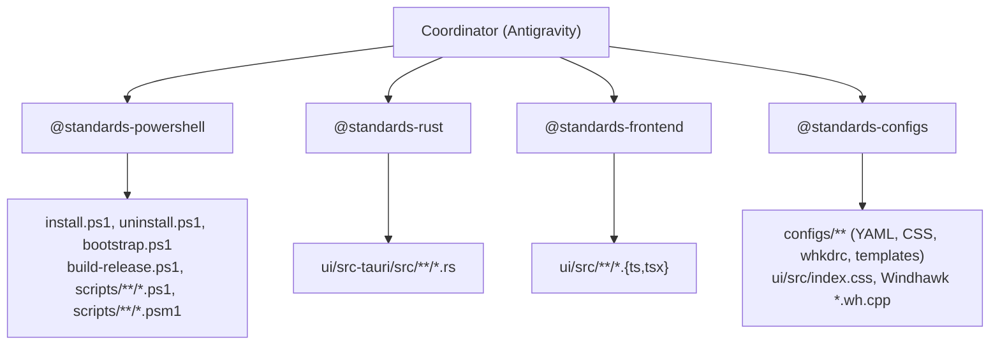

# Code Standards & Documentation Architecture

This specification defines the repository-wide engineering standards for code documentation, identifier naming, comment quality, worker file boundaries, and verification gates across the `komoyasb` polyglot codebase.

---

## 1. Language-Specific Google-Style Documentation Specifications

### 1.1 PowerShell (`.ps1`, `.psm1`)
All PowerShell scripts and module files must feature a standardized file-level comment-based help block at the top, followed by function-level documentation for every internal and exported function.

#### File-Level Header Spec:
```powershell
<#
.SYNOPSIS
    Concise one-line summary of script or module functionality.
.DESCRIPTION
    Detailed architectural description of module responsibilities, integration points,
    and side-effects (e.g. process management, registry mutation, file generation).
.NOTES
    Part of the komoyasb desktop automation suite.
#>
```

#### Function-Level Google-Style Comment Block:
PowerShell native comment-based help tags must be populated with Google-style structure and English phrasing:
```powershell
function Set-ProcessEcoQos {
    <#
    .SYNOPSIS
        Configures Windows EcoQoS (Efficiency Mode) for target processes.
    .DESCRIPTION
        Enables or disables EcoQoS process throttling via Win32 SetProcessInformation P/Invoke.
        In DryRun mode, logs the intended kernel throttle operation without modifying process state.
    .PARAMETER ProcessName
        Name of the target process without extension (e.g. "yasb").
    .PARAMETER Enable
        Boolean switch indicating whether efficiency mode should be enforced.
    .OUTPUTS
        [bool] Returns true if QoS state was successfully applied, false otherwise.
    .EXAMPLE
        Set-ProcessEcoQos -ProcessName "yasb" -Enable $true
    #>
    [CmdletBinding()]
    param(
        [Parameter(Mandatory = $true)]
        [string]$ProcessName,

        [Parameter(Mandatory = $true)]
        [bool]$Enable
    )
    # ...
}
```

### 1.2 Rust (`ui/src-tauri/**/*.rs`)
All Rust modules must contain module-level inner doc comments (`//!`) explaining the subsystem role. All structs, enums, public traits, and Tauri IPC functions (`#[tauri::command]`) must contain outer doc comments (`///`) following Google Rust style guidelines.

#### Module-Level Header Spec:
```rust
//! Window tiling management commands for Komorebi and WHKD.
//!
//! Provides transactional configuration loading, serialization, and hotkey
//! validation across virtual desktops and display boundaries.
```

#### Struct & Tauri Command Spec:
```rust
/// Represents runtime performance throttling and polling intervals for YASB.
#[derive(Debug, Clone, Serialize, Deserialize)]
pub struct YasbPerfSettings {
    /// Whether visual blur is enabled for the status bar container.
    pub blur_enabled: bool,
    /// Refresh interval for GPU utilization queries in milliseconds.
    pub gpu_interval_ms: u32,
}

/// Loads and validates Komorebi window manager configuration from disk.
///
/// # Arguments
///
/// * `state` - Thread-safe application state containing workspace paths and sandbox mode.
///
/// # Returns
///
/// * `Ok(KomorebiConfig)` - Parsed and validated configuration payload.
/// * `Err(AppError)` - If file reading fails or JSON schema validation fails.
///
/// # Errors
///
/// Returns [`AppError::IoError`] if the configuration file is unreadable.
#[tauri::command]
pub async fn load_komorebi_config(
    state: State<'_, AppState>,
) -> Result<KomorebiConfig, AppError> {
    // ...
}
```

### 1.3 TypeScript & React (`ui/src/**/*.{ts,tsx}`)
All React components, custom hooks, and shared utility modules must feature JSDoc/TSDoc blocks adhering to Google TypeScript style.

#### Component & Function Spec:
```typescript
/**
 * Props for the `PresetCards` performance profile selector.
 */
interface PresetCardsProps {
  /** Currently active performance profile key. */
  activeProfile: PerformanceProfileKey;
  /** Callback triggered when a new performance profile is selected by the user. */
  onSelectProfile: (profile: PerformanceProfileKey) => void;
  /** Whether controls are disabled during active provisioning or dry-run evaluation. */
  isDisabled?: boolean;
}

/**
 * Renders interactive performance profile preset selection cards.
 *
 * Provides instant visual switching between ultra-low, balanced, visual-rich,
 * and gaming optimization tiers with hardware capability badge indicators.
 *
 * @param props - Component properties and change handlers.
 * @returns JSX element representing the profile preset grid.
 */
export const PresetCards: React.FC<PresetCardsProps> = ({
  activeProfile,
  onSelectProfile,
  isDisabled = false,
}) => {
  // ...
};
```

### 1.4 Config Templates & Styles (`configs/`, `whkdrc`, YAML, CSS)
All template files (`*.template`), YAML files, CSS files, and hotkey definitions (`whkdrc`) must include a clean English header comment explaining purpose, token dependencies, and non-obvious rules.
*(Note: Strict `.json` files must not contain comments to prevent JSON parse errors).*

#### Template & Config Header Spec:
```yaml
# ==============================================================================
# YASB Reborn (v2.0.8+) Status Bar Configuration Template
# Processed dynamically via scripts/sync-theme.ps1
# Token Dependencies: {{colors.*}}, {{typography.*}}, {{performance.yasb.*}}
# ==============================================================================
```

#### WHKD Hotkey Configuration Header Spec:
```ini
# ==============================================================================
# .whkdrc - Windows Hotkey Daemon Configuration
# Ergonomic vim-like bindings for Komorebi tiling window manager
# Managed dynamically by komoyasb configuration pipeline
# ==============================================================================
```

---

## 2. Naming & Commenting Rubric

### 2.1 Identifier Naming Rules
1. **Language Idioms & Casing:**
   - **PowerShell:** `Verb-Noun` for functions (`Get-WorkspaceRoot`, `Set-ProcessEcoQos`, `Invoke-OsAction`). `camelCase` for internal variables (`$workspaceRoot`, `$targetPath`, `$isDryRun`).
   - **Rust:** `snake_case` for functions/variables (`load_theme`, `border_width`), `PascalCase` for types/structs (`UnifiedTheme`, `KomorebiConfig`).
   - **TypeScript:** `camelCase` for functions/variables/hooks (`usePerformanceMetrics`, `loadConfig`), `PascalCase` for React components/types (`GranularControls`, `ApplyResult`).
2. **Descriptive Intent (No Cryptic Placeholders):**
   - Forbid single-letter or vague abbreviations (`x`, `tmp`, `data`, `res`, `obj`, `cfg2`, `fn1`).
   - Replace with domain-specific terms: `processRecord`, `themePayload`, `tokenDictionary`, `hotkeyCandidate`.
3. **Boolean Names:**
   - Must use interrogative prefixes: `isDryRun`, `hasAnimation`, `shouldReloadService`, `canApply`.
4. **Explicit Units:**
   - Any identifier representing time or measurement must include explicit unit suffixes: `duration_ms`, `interval_ms`, `border_width_px`, `memory_bytes`.
5. **Paths & File Names:**
   - Variables referencing paths must include suffix `_path`, `_dir`, or `Path`, `Dir` (`templatePath`, `backupDir`, `script_path`).

### 2.2 Comment Quality Guidelines
1. **Explain "Why", Not "What":**
   - Disallowed: `# increment count by 1`, `# return true`.
   - Required: Explain why a specific Win32 API flag is used, why a process throttle is delayed, or why a pipe read handles non-blocking EOF.
2. **Win32 P/Invoke & Native Interop:**
   - Every Win32 P/Invoke declaration (e.g. `SetProcessInformation`, `DwmSetWindowAttribute`, `SystemParametersInfo`) must have a comment stating the target OS build requirement, memory safety assumptions, and failure handling strategy.
3. **Strict English Requirement:**
   - All comments, log strings, and documentation must be in clear English. Zero Italian or mixed-language comments are permitted.

---

## 3. Public Contract Boundaries (Immunity List)

The following public contracts connect separate architectural layers and **MUST NOT** be renamed unilaterally. Any rename requires a coordinated schema and UI migration via `@mention`.

### 3.1 Tauri IPC Command Names
Defined in `ui/src-tauri/src/commands/*.rs` and invoked in `ui/src/lib/ipc.ts`:
- `load_flow_settings`, `save_flow_settings`, `get_windhawk_mods`, `set_windhawk_mod_state`
- `get_performance_config`, `save_performance_config`, `set_performance_profile`
- `load_yasb_config`, `save_yasb_config`, `load_yasb_css`, `save_yasb_css`
- `load_fluentflyout_config`, `save_fluentflyout_config`, `get_eartrumpet_config`, `set_eartrumpet_config`
- `check_deployment_status`, `run_install_provisioning`, `execute_full_dryrun`
- `get_services_status`, `service_action`, `apply_sync_theme`, `get_backups`, `restore_backup`, `get_sandbox_state`
- `get_themes`, `load_theme`, `save_theme`, `get_active_theme_name`, `set_active_theme`
- `load_komorebi_config`, `save_komorebi_config`, `load_float_rules`, `save_float_rules`, `load_hotkeys`, `save_hotkeys`, `validate_hotkeys`

### 3.2 Configuration Schemas & Token Names
- **`themes/theme.schema.json` & `themes/*.json`**:
  - Keys: `name`, `variant`, `author`, `colors.*`, `typography.*`, `geometry.*`, `opacity.*`.
- **`themes/performance.schema.json` & `performance.json`**:
  - Keys: `version`, `active_profile`, `profiles.*.komorebi.*`, `profiles.*.yasb.*`, `profiles.*.dwm.*`, `profiles.*.os.*`.
- **Template Substitution Tokens**:
  - e.g. `{{colors.bg_primary}}`, `{{colors.accent}}`, `{{performance.komorebi.animation_duration_ms}}`.

### 3.3 PowerShell CLI Script Parameters
- **`install.ps1`**: `-Theme`, `-DryRun`, `-SkipPackages`, `-SkipBackup`, `-Force`, `-PerformanceProfile`
- **`uninstall.ps1`**: `-DryRun`, `-RemovePackages`, `-Force`, `-PurgeBackups`
- **`bootstrap.ps1`**: `-RepoUrl`, `-Branch`, `-InstallDir`, `-ForwardArgs`
- **`build-release.ps1`**: `-SkipFrontend`, `-Target`, `-Clean`
- **`scripts/sync-theme.ps1`**: `-Theme`, `-PerformanceProfile`, `-DryRun`, `-WhatIf`
- **`scripts/Set-PerformanceProfile.ps1`**: `-ProfileName`, `-DryRun`
- **`scripts/Set-OsPerformance.ps1`**: `-ProfileName`, `-ProcessAffinity`, `-DryRun`
- **`scripts/apply-windhawk-mods.ps1`**: `-Action`, `-ModName`, `-PerformanceProfile`, `-DryRun`
- **`scripts/watchdog.ps1`**: `-Action`, `-CheckInterval`, `-MaxRestarts`, `-DryRun`
- **`scripts/Test-FullDryRun.ps1`**: `-KeepSandbox`

---

## 4. Swarm Worker Ownership Map (Zero File Overlap)

To prevent file collision and git merge conflicts, 4 specialized Swarm workers operate across disjoint directory boundaries:



### 4.1 `@standards-powershell`
- **Ownership Scope:**
  - `bootstrap.ps1`
  - `build-release.ps1`
  - `install.ps1`
  - `uninstall.ps1`
  - `scripts/apply-windhawk-mods.ps1`
  - `scripts/Set-OsPerformance.ps1`
  - `scripts/Set-PerformanceProfile.ps1`
  - `scripts/sync-theme.ps1`
  - `scripts/sync-wallpaper.ps1`
  - `scripts/Test-FullDryRun.ps1`
  - `scripts/watchdog.ps1`
  - `scripts/lib/DryRunContext.psm1`
  - `scripts/lib/Environment.psm1`
  - `scripts/lib/TemplateEngine.psm1`
  - `configs/yasb/widgets/Get-GpuMetrics.ps1`
  - `configs/yasb/widgets/Get-KomorebiStatus.ps1`
  - `tests/verify-host-safety.ps1`
  - `tests/unit/Test-DryRunContext.Tests.ps1`
- **Tasks:**
  - Standardize file headers and function docblocks (`.SYNOPSIS`, `.DESCRIPTION`, `.PARAMETER`, `.OUTPUTS`).
  - Add explanatory comments for Win32 P/Invoke calls, regex token matching, and DryRun context redirection.
  - Eliminate cryptic variable names without modifying public cmdlet parameter contracts.

### 4.2 `@standards-rust`
- **Ownership Scope:**
  - `ui/src-tauri/src/main.rs`
  - `ui/src-tauri/src/lib.rs`
  - `ui/src-tauri/src/state.rs`
  - `ui/src-tauri/src/error.rs`
  - `ui/src-tauri/src/commands/mod.rs`
  - `ui/src-tauri/src/commands/mods.rs`
  - `ui/src-tauri/src/commands/performance.rs`
  - `ui/src-tauri/src/commands/statusbar.rs`
  - `ui/src-tauri/src/commands/system.rs`
  - `ui/src-tauri/src/commands/theme.rs`
  - `ui/src-tauri/src/commands/tiling.rs`
  - `ui/src-tauri/src/utils/mod.rs`
  - `ui/src-tauri/src/utils/atomic_write.rs`
  - `ui/src-tauri/src/utils/process.rs`
  - `ui/src-tauri/src/utils/sandbox.rs`
  - `ui/src-tauri/src/utils/validator.rs`
- **Tasks:**
  - Add `//!` module doc comments to every module and submodule.
  - Add `///` Google-style doc comments to all structs, methods, helper functions, and `#[tauri::command]` functions (`# Arguments`, `# Returns`, `# Errors`).
  - Maintain exact Tauri command identifiers and `#[serde(rename = "...")]` field tags.

### 4.3 `@standards-frontend`
- **Ownership Scope:**
  - `ui/src/App.tsx`
  - `ui/src/main.tsx`
  - `ui/src/lib/ipc.ts`
  - `ui/src/lib/utils.ts`
  - `ui/src/types/ipc.ts`
  - `ui/src/features/**/*.ts`
  - `ui/src/components/shell/*.tsx`
  - `ui/src/components/ui/*.tsx`
  - `ui/src/components/views/mods/*.tsx`
  - `ui/src/components/views/performance/*.tsx`
  - `ui/src/components/views/services/*.tsx`
  - `ui/src/components/views/statusbar/*.tsx`
  - `ui/src/components/views/system/*.tsx`
  - `ui/src/components/views/theme/*.tsx`
  - `ui/src/components/views/tiling/*.tsx`
- **Tasks:**
  - Add Google-style JSDoc headers for all React components, hooks, and IPC invoke wrappers.
  - Document all prop interfaces with field-level descriptions.
  - Ensure zero regressions in TypeScript compiler checks (`tsc`).

### 4.4 `@standards-configs`
- **Ownership Scope:**
  - `configs/komorebi/applications.yaml`
  - `configs/komorebi/whkdrc`
  - `configs/komorebi/whkdrc.template`
  - `configs/shell/windhawk/*.wh.cpp`
  - `configs/yasb/config.yaml`
  - `configs/yasb/config.yaml.template`
  - `configs/yasb/styles.css`
  - `configs/yasb/styles.css.template`
  - `ui/src/index.css`
- **Tasks:**
  - Insert standardized English header banners across YAML, CSS, and WHKD files.
  - Document template replacement tokens and dependencies.
  - Add clarifying comments for non-obvious rules in `applications.yaml` and Windhawk C++ hook files.
  - Strict exclusion: Never add comments to raw JSON files (`komorebi.json`, `performance.json`, `themes/*.json`, etc.).

---

## 5. Verification Gate (Zero-Regression Testing)

Every Swarm worker and the final integration gate must pass the following non-destructive verification test suite without errors:

```powershell
# 1. Static AST Host-Safety Verification Gate
powershell -File tests\verify-host-safety.ps1

# 2. Comprehensive Cryptographic Dry-Run Harness (Zero Host Mutation)
powershell -File scripts\Test-FullDryRun.ps1

# 3. TypeScript Compilation & UI Production Build Verification
npm --prefix ui run build
```

Any standardisation commit that fails any of these three verification commands is rejected.
