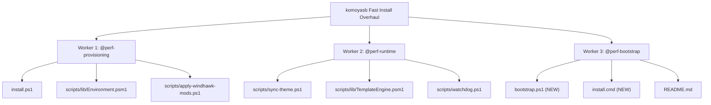

# Fast Installation & Bootstrapper Architecture Specification

## 1. Executive Summary & Objective

The objective of this specification is to transform the `komoyasb` deployment pipeline into an ultra-fast, zero-friction, one-command installation process while maintaining 100% of the existing guarantees established by `DryRunContext.psm1`, Shadow Execution, and transactional host safety.

This document defines:
1. Complete audit of every latency bottleneck across `install.ps1`, `scripts/lib/Environment.psm1`, `scripts/sync-theme.ps1`, `scripts/lib/TemplateEngine.psm1`, `scripts/apply-windhawk-mods.ps1`, and `scripts/watchdog.ps1`.
2. Strict division of responsibilities for 3 parallel Swarm workers with **Zero File Overlap**.
3. Concurrency constraints (single-process winget requirement due to SQLite/COM locking).
4. Full Dry-Run contract preservation rules and verification gates.

---

## 2. Comprehensive Bottleneck Audit

| ID | Component / File | Current Slow Path | Root Cause | Target Optimization |
|---|---|---|---|---|
| **BOT-01** | `scripts/lib/Environment.psm1` (`Test-WingetPackageInstalled`) | Iterative calls to `winget list --exact --id <PackageId>` inside `install.ps1` package loop (8 packages = 8 process forks of winget). | `winget list` launches an entire Python/C++ engine, queries SQLite, and takes ~1.5s–3.5s per package. When winget is missing or slow, this adds 15–25 seconds alone. | **Single-Pass Winget Snapshot Cache**: Before package iteration, run `winget list` once (or export installed IDs to a HashSet / cache table). Individual lookups become O(1) in-memory checks. |
| **BOT-02** | `install.ps1` / `scripts/lib/Environment.psm1` | Command pre-check fallback order and missing standard binary paths. | `Test-CommandAvailable` only checks `Get-Command` in the current PATH. If user PATH has not been reloaded, it falls back to winget unnecessarily. | Fast pre-check: inspect candidate binary paths (`%ProgramFiles%`, `%LOCALAPPDATA%\Microsoft\WinGet\Packages`, `%LOCALAPPDATA%\Programs`) before hitting winget. |
| **BOT-03** | `scripts/lib/Environment.psm1` (`Install-WingetPackage`) | Minimal flags passed: `winget install --exact --id $PackageId --accept-package-agreements --accept-source-agreements`. | Winget prompts/interacts, checks for upgrades unnecessarily, and waits for background telemetry. | Add `--silent --disable-interactivity --no-upgrade --force`. |
| **BOT-04** | `scripts/apply-windhawk-mods.ps1` | `windhawk-cli.exe` is repeatedly invoked sequentially for each mod (`-load-mod`) without checking if mod source is identical. | Windhawk compiles mods upon load; reloading unchanged C++ mods causes recompilation latency. Also `Get-Command` lookup repeated in loops. | **Hash-checked staging**: Compute SHA-256 of `configs/shell/windhawk/*.wh.cpp` vs target in ProgramData/Mods. Skip `-load-mod` if hash matches and mod is active. Cache `windhawk-cli` path resolution. |
| **BOT-05** | `scripts/sync-theme.ps1` & `TemplateEngine.psm1` | Redundant disk reads/writes during theme compilation: writes to workspace repo, then writes to runtime, even when content has not changed. | File I/O overhead on NVMe/SSD, triggering filesystem watchers. | **In-memory single-pass rendering & SHA-256 skip-unchanged writes**: Calculate MD5/SHA-256 of rendered buffer vs existing destination file. If identical, skip write. |
| **BOT-06** | `scripts/watchdog.ps1` (`Start-FullStack`) | Hardcoded `Start-Sleep -Milliseconds 250` (up to 20 attempts = 5s) and `Start-Sleep -Milliseconds 500`. | Sleep introduces fixed artificial delays regardless of whether the socket is ready in 15ms. | Replace fixed delay with **adaptive 100ms readiness polling** with fast initial pipe/socket ping (`\\.\pipe\komorebi`). |
| **BOT-07** | Pipeline Entry / Distribution | No 1-command web bootstrapper (`irm ... | iex`) or batch file double-click wrapper. Users must clone and run PowerShell with manual parameters. | High friction, ExecutionPolicy roadblocks for new users. | Introduce `bootstrap.ps1` (download via `git --depth 1` or raw ZIP extraction if git is absent) + `install.cmd` (auto-elevates / bypasses ExecutionPolicy). |
| **BOT-08** | Diagnostics & Telemetry | No phase timer breakdown in `install.ps1`. | Difficult to identify future regressions or user-specific bottlenecks. | Add `[System.Diagnostics.Stopwatch]` per-phase metrics logging table at the end of execution. |

---

## 3. Worker Ownership Map (Zero File Overlap)

To prevent merge conflicts and lock contentions, all changes are strictly partitioned across three parallel Swarm workers:



### Worker 1: `@perf-provisioning`
* **Owned Files:**
  - `install.ps1`
  - `scripts/lib/Environment.psm1`
  - `scripts/apply-windhawk-mods.ps1`
* **Key Responsibilities:**
  1. **Single-Pass Winget Snapshot**:
     - Implement `Get-InstalledWingetPackages` in `Environment.psm1` that runs `winget list --accept-source-agreements` **once** and parses IDs into a `[System.Collections.Generic.HashSet[string]]` cached in session.
     - `Test-WingetPackageInstalled` queries this memory hash set in O(1) time instead of spawning `winget.exe`.
  2. **Fast Pre-check**:
     - Check binary existence via known install locations (`%LOCALAPPDATA%\Programs\...`, `%ProgramFiles%\...`, `winget` alias links) before invoking winget CLI.
  3. **Winget Fast Flags**:
     - Pass `--silent --disable-interactivity --no-upgrade` to `Install-WingetPackage`.
  4. **Batched & Hash-Checked Windhawk Deployment**:
     - In `apply-windhawk-mods.ps1`, resolve `$WindhawkCli` once at initialization.
     - Calculate SHA-256 hash of `.wh.cpp` source vs target destination; skip `-load-mod` if hash is unchanged.
  5. **Stopwatch Per-Phase Telemetry**:
     - Instrument `install.ps1` with `[System.Diagnostics.Stopwatch]` measuring: Pre-flight, Package Provisioning, Backups, Target Dirs, Theme Compilation, Windhawk Injection.
     - Display an ASCII telemetry summary table at completion.

### Worker 2: `@perf-runtime`
* **Owned Files:**
  - `scripts/sync-theme.ps1`
  - `scripts/lib/TemplateEngine.psm1`
  - `scripts/watchdog.ps1`
* **Key Responsibilities:**
  1. **In-Memory Rendering & Smart Hash-Gated Writes**:
     - In `TemplateEngine.psm1`, compare rendered UTF-8 string hash with target destination hash. If target exists and hash matches, log `[SKIPPED - UNCHANGED]` and perform zero disk I/O.
     - Ensure this is compatible with `DryRunContext` (in dry-run, compute hash against virtual shadow or live fallback).
  2. **Single-Pass Theme Synchronization**:
     - In `sync-theme.ps1`, optimize token flattening and regex substitutions using compiled regex or string builders.
  3. **Tight Adaptive Readiness Polling in Watchdog**:
     - In `watchdog.ps1`, replace `Start-Sleep -Milliseconds 250` with high-frequency 100ms polling for Komorebi named pipe (`\\.\pipe\komorebi`) with early break upon socket response.
     - Reduce inter-stage pause between YASB and whkd to 100ms readiness check instead of 500ms blind sleep.

### Worker 3: `@perf-bootstrap`
* **Owned Files:**
  - `bootstrap.ps1` *(New file at repository root)*
  - `install.cmd` *(New batch wrapper at repository root)*
  - `README.md`
* **Key Responsibilities:**
  1. **One-Liner Web Bootstrapper (`bootstrap.ps1`)**:
     - Support `irm https://raw.githubusercontent.com/<owner>/komoyasb/main/bootstrap.ps1 | iex` (with clean configurable `$RepoUrl` fallback).
     - Detect if `git` is present:
       - If `git` is available: clone with `git clone --depth 1 https://github.com/<owner>/komoyasb.git $targetDir`.
       - If `git` is absent: download `main.zip` from GitHub archive/releases, extract via `[System.IO.Compression.ZipFile]`, and run `install.ps1`.
     - Forward CLI arguments (e.g. `-Theme light`, `-ApplyWindhawk`, `-DryRun`, `-SkipPackages`) to `install.ps1`.
  2. **Zero-Friction Local Runner (`install.cmd`)**:
     - Create a Windows batch launcher for users who download or double-click:
       ```cmd
       @echo off
       powershell.exe -NoProfile -ExecutionPolicy Bypass -Command "& '%~dp0install.ps1' %*"
       ```
  3. **README Documentation Update**:
     - Add prominent "1-Command Quick Install" section with copy-pasteable PowerShell snippet.
     - Document both the web bootstrap and the local `install.cmd` offline/git clone methods.

---

## 4. Safety & Concurrency Rules

1. **Strict Winget Concurrency Ban**:
   > [!CAUTION]
   > `winget` uses an internal SQLite database (`%LOCALAPPDATA%\Packages\Microsoft.DesktopAppInstaller_8wekyb3d8bbwe\LocalState\settings.db` or source database) and Windows AppInstaller COM servers. Running concurrent instances of `winget install` in parallel background jobs causes SQLite table locks (`0x8A15000F: WINGET_INSTALLED_STATUS_INSTALL_FAILED_DATABASE_BUSY`).
   > **Rule**: Package installations MUST remain sequential. All speed gains must come from single-pass caching, early binary detection, and fast flags, NEVER from parallel `winget install` jobs.

2. **Strict DryRun & Shadow Execution Preservation**:
   > [!IMPORTANT]
   > The optimizations must not bypass or alter `DryRunContext.psm1`.
   > - Any file write check (including hash comparison) must query `Resolve-TargetPath` when `Test-IsDryRun` is active.
   > - Every simulated action must still call `Invoke-SystemAction` with complete metadata.
   > - Idempotency and 100% zero host mutation must be maintained identically across live and dry-run environments.

---

## 5. Verification Gate & Acceptance Criteria

Every PR / Swarm execution must pass the following verification sequence without warnings or failures:

1. **PowerShell AST & Syntax Validation**:
   ```powershell
   Get-ChildItem -Recurse -Filter *.ps*1 | ForEach-Object {
       $errors = $null
       [System.Management.Automation.Language.Parser]::ParseFile($_.FullName, [ref]$null, [ref]$errors) | Out-Null
       if ($errors) { Write-Error "Syntax Error in $($_.Name): $($errors.Message)" }
   }
   ```

2. **Harness Verification & Host Zero-Mutation Gate**:
   ```powershell
   powershell -NoProfile -ExecutionPolicy Bypass -File scripts\Test-FullDryRun.ps1
   ```
   *Must verify exit code 0 and confirm "Zero host mutation confirmed (100% untouched)".*

3. **Stopwatch Timing Capture**:
   Execute both dry-run and live tests capturing execution duration:
   ```powershell
   $sw = [System.Diagnostics.Stopwatch]::StartNew()
   powershell -NoProfile -ExecutionPolicy Bypass -File install.ps1 -DryRun
   $sw.Stop()
   Write-Host "DryRun Execution Completed in $($sw.Elapsed.TotalSeconds)s"
   ```
   *Target: Package discovery phase overhead reduced by >70% on cached systems.*
