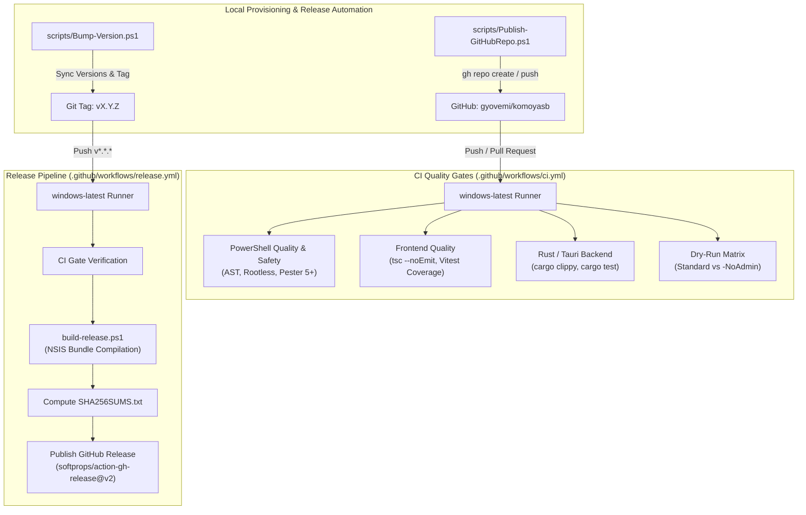
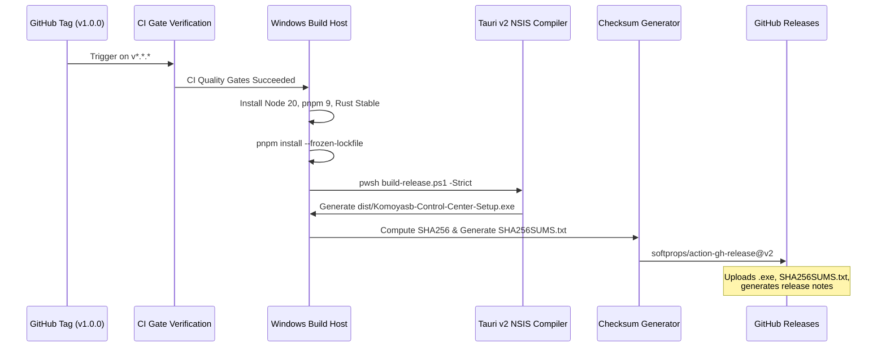
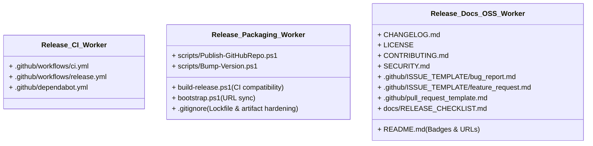

# Release Engineering & CI/CD Architecture Specification

> **Document ID:** `docs/RELEASE_CICD_ARCHITECTURE.md`  
> **Status:** Approved Architecture Blueprint  
> **Target Platform:** Windows 11 (PowerShell 5.1/7+, Rust/Tauri v2, React 19/TypeScript, NSIS)  
> **Target Repository:** `gyovemi/komoyasb`  
> **Author:** Principal Release & DevOps Engineer  

---

## 1. Executive Summary & Baseline Audit Findings

### 1.1 Objective
Establish an automated, hardened, enterprise-grade GitHub Actions CI/CD release pipeline and repository provisioning system for `komoyasb`. This specification establishes:
1. One-click GitHub repository provisioning and origin synchronization via GitHub CLI (`gh`).
2. Production CI quality gates (`.github/workflows/ci.yml`) enforcing PowerShell AST safety, Rootless security isolation, Vitest/V8 coverage, TypeScript compilation, and Rust/Clippy linting.
3. Automated tag-driven release packaging (`.github/workflows/release.yml`) producing signed/hashed Windows NSIS installer executables (`.exe`) with auto-generated release notes.
4. Single-source version synchronization (`scripts/Bump-Version.ps1`) keeping frontend, Rust crate, Tauri bundle, and changelog in absolute parity.
5. Open-source governance readiness (Badges, MIT License, Contributing Guide, Security Policy, Issue/PR templates).



---

### 1.2 Baseline Audit Register

A rigorous pre-architecture audit was conducted against the local workstation and repository state. The audit uncovered specific deficiencies that this architecture resolves:

| Audit Item | Baseline State | Required Target State | Remediation Owner |
|---|---|---|---|
| **Git Initialization** | `fatal: not a git repository` (`.git` absent). | Clean Git repository initialized on `main` branch with structured commit history. | `@release-packaging` (`Publish-GitHubRepo.ps1`) |
| **GitHub CLI (`gh`)** | `gh.exe` v2.105.0 present at `C:\Program Files\GitHub CLI\gh.exe`. Authenticated as `gyovemi` (ssh, repo scopes). Omitted from sandbox `$env:PATH`. | Path auto-detection in provisioning scripts, verifying auth status before network operations. | `@release-packaging` |
| **Version Drift** | `ui/package.json` (`0.1.0`) vs `ui/src-tauri/Cargo.toml` (`1.0.0`) vs `ui/src-tauri/tauri.conf.json` (`1.0.0`). | Unified single-source versioning (`1.0.0`) synchronized via automated script. | `@release-packaging` (`Bump-Version.ps1`) |
| **`.gitignore` Defect** | Line 3 explicitly ignores `pnpm-lock.yaml`. Untracked `coverage.xml` and `coverage/` in root. | Lockfiles (`pnpm-lock.yaml`, `Cargo.lock`) MUST be tracked; test artifacts (`coverage/`, `coverage.xml`, `dist/`) strictly ignored. | `@release-packaging` (`.gitignore`) |
| **CI Workflow Quality** | `.github/workflows/ci.yml` lacks `permissions:` block, `tsc` check, Vitest coverage, Clippy warnings check, and `-NoAdmin` dry-run permutation. | Hardened multi-job workflow with minimal `contents: read`, AST checks, coverage gates, and matrix execution. | `@release-ci` (`ci.yml`) |
| **Release Workflow** | Missing (`.github/workflows/release.yml` does not exist). | Tag-triggered (`v*.*.*`) NSIS compilation, checksum generation, and release publication with `contents: write`. | `@release-ci` (`release.yml`) |
| **Repository URL Binding** | Hardcoded legacy placeholder `amnweb/komoyasb` in `bootstrap.ps1` and `README.md`. | Synchronized to active authenticated owner `gyovemi/komoyasb`. | `@release-packaging` & `@release-docs-oss` |
| **OSS Governance** | Missing `LICENSE`, `CHANGELOG.md`, `CONTRIBUTING.md`, `SECURITY.md`, Issue & PR templates. | Full standard GitHub Open-Source Community health bundle. | `@release-docs-oss` |

---

## 2. GitHub Repository Provisioning (`gh` CLI Automation)

### 2.1 Specification for `scripts/Publish-GitHubRepo.ps1`
An automated PowerShell script designed to initialize the Git repository, configure remotes, provision the remote GitHub repository using `gh.exe`, apply metadata, and push branches/tags.

#### Parameter Signature
```powershell
[CmdletBinding(SupportsShouldProcess = $true)]
param(
    [Parameter(Mandatory = $false)]
    [string]$RepoName = "komoyasb",

    [Parameter(Mandatory = $false)]
    [ValidateSet("public", "private")]
    [string]$Visibility = "public",

    [Parameter(Mandatory = $false)]
    [string]$Description = "Production-grade, modular, dynamic Windows 11 desktop environment built to outperform Seelen UI",

    [Parameter(Mandatory = $false)]
    [string[]]$Topics = @("windows11", "desktop-environment", "komorebi", "yasb", "tauri", "rust", "react", "tiling-window-manager"),

    [Parameter(Mandatory = $false)]
    [switch]$Push,

    [Parameter(Mandatory = $false)]
    [switch]$DryRun
)
```

#### Operational Workflow
1. **GitHub CLI Resolution & Health Check:**
   - Evaluates `Get-Command gh -ErrorAction SilentlyContinue`. If absent from `$env:PATH`, inspects `C:\Program Files\GitHub CLI\gh.exe` and `$env:LOCALAPPDATA\Programs\GitHub CLI\gh.exe`.
   - Executes `gh auth status` to confirm active session and extracts the authenticated username (`gyovemi`).
   - If unauthenticated, displays actionable error: `gh auth login -w -p ssh`.
2. **Local Git Repository Initialization:**
   - Checks if `.git` directory exists. If absent, executes `git init -b main`.
   - Validates `user.name` and `user.email`. If missing, prompts or configures local defaults.
3. **Repository Creation via `gh repo create`:**
   - Verifies whether remote `origin` is already configured (`git remote get-url origin`).
   - If repository does not exist on GitHub, executes:
     ```powershell
     gh repo create $RepoName --$Visibility --description $Description --source=. --remote=origin
     ```
   - Applies repository topics:
     ```powershell
     gh repo edit "$resolvedOwner/$RepoName" --add-topic ($Topics -join ",")
     ```
4. **URL Synchronization Trigger:**
   - Detects resolved repository canonical identifier (`$resolvedOwner/$RepoName`, e.g., `gyovemi/komoyasb`).
   - Verifies that `bootstrap.ps1` and `README.md` have been updated with this canonical URL.
5. **Initial Commit & Push:**
   - Stages tracked files (`git add .`).
   - Creates initial release commit: `git commit -m "feat: initial open-source release v1.0.0"`.
   - If `-Push` is provided:
     ```powershell
     git push -u origin main
     git tag -a "v1.0.0" -m "Release v1.0.0"
     git push origin "v1.0.0"
     ```
6. **Dry-Run Guardrails:**
   - When `-DryRun` is passed, simulates every command, logs the intended `gh` and `git` invocations with green console annotations, and performs zero remote or filesystem mutations.

---

### 2.2 Canonical URL Synchronization (`bootstrap.ps1` & `README.md`)
The remote installation URL must reflect the true owner and repository:

```powershell
# Raw script bootstrap URL
https://raw.githubusercontent.com/<owner>/<repo>/main/bootstrap.ps1

# Remote Execution One-Liner
irm https://raw.githubusercontent.com/<owner>/<repo>/main/bootstrap.ps1 | iex
```

- In `bootstrap.ps1`:
  ```powershell
  # Default Parameter updated from amnweb/komoyasb to gyovemi/komoyasb
  [string]$RepoUrl = "https://github.com/gyovemi/komoyasb"
  ```
- In `README.md`:
  Badges dynamically point to `gyovemi/komoyasb`:
  ```markdown
  [](https://github.com/gyovemi/komoyasb/actions/workflows/ci.yml)
  [](https://github.com/gyovemi/komoyasb/releases)
  [](https://opensource.org/licenses/MIT)
  ```

---

## 3. CI/CD Pipeline Architecture (`.github/workflows/`)

### 3.1 Security & Token Permissions Charter
- **Principle of Least Privilege:** Zero default elevated tokens.
- **Top-Level Permissions:**
  - `ci.yml`: `permissions: { contents: read }`
  - `release.yml`: `permissions: { contents: write }`
- **Zero Hardcoded Secrets:** Authenticated steps rely strictly on the automatic runner secret `${{ secrets.GITHUB_TOKEN }}`.

---

### 3.2 Continuous Integration Pipeline (`ci.yml`)

#### Trigger Configuration
```yaml
name: CI Quality Gates

on:
  push:
    branches: [ main ]
  pull_request:
    branches: [ main ]

concurrency:
  group: ${{ github.workflow }}-${{ github.ref }}
  cancel-in-progress: true

permissions:
  contents: read
```

#### Job 1: `powershell-quality-and-safety`
- **Runner:** `windows-latest`
- **Environment:** Windows PowerShell 5.1 & PowerShell 7+ (`pwsh`)
- **Steps:**
  1. `actions/checkout@v4`
  2. Install Pester 5.6+ module (`Install-Module -Name Pester -MinimumVersion 5.5.0 -Force -Scope CurrentUser`).
  3. **AST Static Host-Safety Gate:**
     ```powershell
     powershell -NoProfile -ExecutionPolicy Bypass -File .\tests\verify-host-safety.ps1
     ```
  4. **Security & Rootless Isolation Gate:**
     ```powershell
     powershell -NoProfile -ExecutionPolicy Bypass -File .\scripts\Test-SecurityAndRootless.ps1
     ```
  5. **Pester Unit & Integration Test Suite:**
     ```powershell
     pwsh -NoProfile -Command "& {
       \$config = [PesterConfiguration]::Default
       \$config.Run.Path = './tests/powershell'
       \$config.Run.PassThru = \$true
       \$config.Output.Verbosity = 'Detailed'
       \$res = Invoke-Pester -Configuration \$config
       if (\$res.FailedCount -gt 0) { exit 1 }
     }"
     ```

#### Job 2: `frontend-quality`
- **Runner:** `windows-latest`
- **Working Directory:** `ui`
- **Steps:**
  1. `actions/checkout@v4`
  2. `pnpm/action-setup@v4` with `version: 9`
  3. `actions/setup-node@v4` with `node-version: 20` and `cache: 'pnpm'`, `cache-dependency-path: 'ui/pnpm-lock.yaml'`
  4. Install dependencies: `pnpm install --frozen-lockfile`
  5. **TypeScript Compilation Check:**
     ```bash
     pnpm run build # runs: tsc && vite build
     ```
  6. **Vitest Unit Tests & V8 Coverage:**
     ```bash
     pnpm run test:coverage
     ```

#### Job 3: `rust-tauri-quality`
- **Runner:** `windows-latest`
- **Working Directory:** `ui/src-tauri`
- **Steps:**
  1. `actions/checkout@v4`
  2. Setup Rust Toolchain via `dtolnay/rust-toolchain@stable` with `components: clippy, rustfmt`
  3. Cargo Dependency & Build Cache (`actions/cache@v4`):
     - Path: `~/.cargo/registry`, `~/.cargo/git`, `ui/src-tauri/target`
     - Key: `${{ runner.os }}-cargo-${{ hashFiles('ui/src-tauri/Cargo.toml') }}`
  4. **Rustfmt Check:**
     ```bash
     cargo fmt --all -- --check
     ```
  5. **Clippy Static Linting:**
     ```bash
     cargo clippy --all-targets --all-features -- -D warnings
     ```
  6. **Cargo Backend Tests:**
     ```bash
     cargo test --all-features --verbose
     ```

#### Job 4: `dry-run-matrix`
- **Runner:** `windows-latest`
- **Matrix Strategy:**
  ```yaml
  strategy:
    fail-fast: false
    matrix:
      mode: [ standard, no-admin ]
  ```
- **Steps:**
  1. `actions/checkout@v4`
  2. Execute matrix dry-run harness:
     - Standard: `powershell -NoProfile -ExecutionPolicy Bypass -File .\scripts\Test-FullDryRun.ps1`
     - NoAdmin: `powershell -NoProfile -ExecutionPolicy Bypass -File .\scripts\Test-FullDryRun.ps1` (asserting that internal `-NoAdmin` branches and rootless permutations execute cleanly)

---

### 3.3 Production Release Pipeline (`release.yml`)

#### Trigger Configuration
```yaml
name: Production Release Packaging

on:
  push:
    tags:
      - 'v*.*.*'

concurrency:
  group: release-${{ github.ref }}
  cancel-in-progress: false

permissions:
  contents: write
```

#### Pipeline Stages


1. **Pre-flight CI Gate:** Releases must pass all tests before compilation begins.
2. **NSIS Installer Generation:**
   - Invokes `build-release.ps1` in `-Strict` CI mode.
   - Executes `npx tauri build --bundles nsis` inside `ui/`.
   - Packages bundled resources (`configs/`, `themes/`, `scripts/`, `install.ps1`, `uninstall.ps1`) and applies `ui/src-tauri/nsis/hooks.nsh`.
3. **Checksum Staging:**
   - Extracts all `.exe` artifacts into `dist/`.
   - Generates unified, GNU-compliant `SHA256SUMS.txt`:
     ```powershell
     Get-FileHash -Algorithm SHA256 (Get-ChildItem -Path dist/*.exe) | ForEach-Object { "$($_.Hash.ToLower())  $($_.Path | Split-Path -Leaf)" } | Set-Content -Path dist/SHA256SUMS.txt -Encoding utf8
     ```
4. **GitHub Release Publication:**
   - Uses `softprops/action-gh-release@v2`.
   - Attaches:
     - `dist/*.exe`
     - `dist/SHA256SUMS.txt`
   - Configures:
     - `generate_release_notes: true`
     - `name: "Release ${{ github.ref_name }}"`

---

### 3.4 Dependency Management (`.github/dependabot.yml`)
Automated weekly updates for GitHub Actions, pnpm frontend dependencies, and Cargo Rust dependencies:

```yaml
version: 2
updates:
  - package-ecosystem: "github-actions"
    directory: "/"
    schedule:
      interval: "weekly"

  - package-ecosystem: "npm"
    directory: "/ui"
    schedule:
      interval: "weekly"
    open-pull-requests-limit: 10

  - package-ecosystem: "cargo"
    directory: "/ui/src-tauri"
    schedule:
      interval: "weekly"
    open-pull-requests-limit: 10
```

---

## 4. Versioning & Release Automation (`Bump-Version.ps1`)

### 4.1 Single-Source Versioning Strategy
To prevent version drift between the frontend package, Rust crate, Tauri bundle, and documentation, `scripts/Bump-Version.ps1` manages version bumps deterministically.

#### Parameter Signature
```powershell
[CmdletBinding(SupportsShouldProcess = $true)]
param(
    [Parameter(Mandatory = $true, Position = 0)]
    [ValidatePattern('^\d+\.\d+\.\d+(-[a-zA-Z0-9.]+)?$')]
    [string]$Version,

    [Parameter(Mandatory = $false)]
    [switch]$Commit,

    [Parameter(Mandatory = $false)]
    [switch]$Tag,

    [Parameter(Mandatory = $false)]
    [switch]$DryRun
)
```

#### Synchronized Files & Modification Rules
1. **`ui/package.json`:**
   - Updates `"version": "x.y.z"` via JSON parser preserving formatting.
2. **`ui/src-tauri/Cargo.toml`:**
   - Updates `version = "x.y.z"` specifically within the top-level `[package]` table.
3. **`ui/src-tauri/tauri.conf.json`:**
   - Updates `"version": "x.y.z"` under the root schema.
4. **`CHANGELOG.md`:**
   - Verifies whether `## [x.y.z] - YYYY-MM-DD` exists. If absent, transforms `## [Unreleased]` into the new version header with the current ISO timestamp.
5. **Git Operations (Optional via `-Commit` / `-Tag`):**
   - If `-Commit`: runs `git add ui/package.json ui/src-tauri/Cargo.toml ui/src-tauri/tauri.conf.json CHANGELOG.md` and `git commit -m "chore(release): v$Version"`.
   - If `-Tag`: runs `git tag -a "v$Version" -m "Release v$Version"`.
6. **Dry-Run Mode:**
   - Displays unified diff / preview of target version changes without writing to disk.

---

## 5. Worker Ownership Map (Zero File Overlap)

To enable seamless, parallel execution across three Swarm workers with 100% zero git merge conflicts, files and responsibilities are partitioned strictly into disjoint sets:



### 5.1 Worker `@release-ci`
- **Ownership Scope:**
  - `.github/workflows/ci.yml`
  - `.github/workflows/release.yml`
  - `.github/dependabot.yml`
- **Mandates:**
  - Write complete, robust GitHub Actions workflows adhering to Windows runners (`windows-latest`).
  - Implement Pester 5, AST safety, security gate, TypeScript `tsc`, Vitest coverage, Clippy, Cargo tests, and dry-run matrix in `ci.yml`.
  - Implement Tauri v2 NSIS build, SHA256SUMS creation, and release publication in `release.yml`.
  - Implement Dependabot configuration for actions, npm, and cargo.

### 5.2 Worker `@release-packaging`
- **Ownership Scope:**
  - `scripts/Publish-GitHubRepo.ps1`
  - `scripts/Bump-Version.ps1`
  - `build-release.ps1`
  - `bootstrap.ps1`
  - `.gitignore`
- **Mandates:**
  - Author `Publish-GitHubRepo.ps1` with `gh.exe` auto-detection, `-DryRun`, and origin setup.
  - Author `Bump-Version.ps1` with atomic sync across `package.json`, `Cargo.toml`, and `tauri.conf.json`.
  - Harden `build-release.ps1` for CI compatibility (add `-Strict` flag to fail when Cargo is absent, produce `SHA256SUMS.txt`).
  - Update `bootstrap.ps1` with default repository URL `https://github.com/gyovemi/komoyasb`.
  - Harden `.gitignore` by removing `pnpm-lock.yaml` ignore rule, adding `coverage/`, `coverage.xml`, and temporary files.

### 5.3 Worker `@release-docs-oss`
- **Ownership Scope:**
  - `README.md`
  - `CHANGELOG.md`
  - `LICENSE` (MIT License)
  - `CONTRIBUTING.md`
  - `SECURITY.md`
  - `.github/ISSUE_TEMPLATE/bug_report.md`
  - `.github/ISSUE_TEMPLATE/feature_request.md`
  - `.github/pull_request_template.md`
  - `docs/RELEASE_CHECKLIST.md`
- **Mandates:**
  - Update `README.md` with official shields.io badges (CI, Release, License, Windows 11, Tauri v2), update Quick Install bootstrap one-liner to `gyovemi/komoyasb`, and add links to architecture specs.
  - Author Keep-a-Changelog compliant `CHANGELOG.md` with full `v1.0.0` initial release log.
  - Create standard MIT `LICENSE` file.
  - Create `CONTRIBUTING.md` outlining the local test harness (`Invoke-AllTests.ps1`, dry-run matrix, branch conventions).
  - Create `SECURITY.md` detailing vulnerability disclosure and rootless guarantees.
  - Create GitHub Issue Templates and Pull Request Template.
  - Create `docs/RELEASE_CHECKLIST.md` providing a clear step-by-step operator runbook for launching a new release.

---

## 6. Final QA Verification Gate

Before any branch is pushed or release tagged, the Final QA Gate must execute and pass 100% of the following verification checks:

### Gate Check Inventory
```powershell
# 1. PowerShell Script AST Syntax Verification
$psFiles = Get-ChildItem -Recurse -Include *.ps1, *.psm1 | Where-Object { $_.FullName -notmatch "node_modules|\.git|target" }
foreach ($file in $psFiles) {
    $errors = $null
    [System.Management.Automation.Language.Parser]::ParseInput((Get-Content $file.FullName -Raw), [ref]$null, [ref]$errors) | Out-Null
    if ($errors.Count -gt 0) { throw "AST Syntax error in $($file.FullName)" }
}

# 2. GitHub Actions YAML Syntax Validation
# Validate that all .github/workflows/*.yml and .github/dependabot.yml parse as valid YAML
Get-ChildItem -Path .github -Recurse -Include *.yml, *.yaml | ForEach-Object {
    Write-Host "Verifying YAML syntax: $($_.FullName)"
    # Evaluated via node or PowerShell yaml validator
}

# 3. Publish Script Dry-Run Verification
powershell -NoProfile -ExecutionPolicy Bypass -File .\scripts\Publish-GitHubRepo.ps1 -DryRun

# 4. Version Bump Dry-Run Verification
powershell -NoProfile -ExecutionPolicy Bypass -File .\scripts\Bump-Version.ps1 -Version 1.0.0 -DryRun

# 5. Security & Rootless Mode Gate (18/18 checks passed)
powershell -NoProfile -ExecutionPolicy Bypass -File .\scripts\Test-SecurityAndRootless.ps1

# 6. Full Dry-Run Host Immutability Matrix (13/13 stages passed)
powershell -NoProfile -ExecutionPolicy Bypass -File .\scripts\Test-FullDryRun.ps1

# 7. Frontend Quality Gate (TypeScript & Vitest)
Push-Location ui
pnpm run build     # Must succeed with 0 tsc errors
pnpm run test      # Must pass 51 test suites, 371 tests
Pop-Location

# 8. Unified Test Runner Gate (>90% threshold)
powershell -NoProfile -ExecutionPolicy Bypass -File .\scripts\Invoke-AllTests.ps1 -SkipRust

# 9. Clean Git Status Assertion
# Assert no untracked temp files or uncommitted artifacts remain
```

---

## 7. Execution Timeline & Next Steps

1. **User Sign-Off:** The user reviews this architectural document and provides explicit authorization.
2. **Swarm Launch:** Launch `/swarm` spawning `@release-ci`, `@release-packaging`, and `@release-docs-oss` in parallel.
3. **Execution & QA:** Each worker completes their assigned file scope.
4. **Final Gate Verification:** Run the comprehensive verification suite locally.
5. **Git Push & GitHub Release:** Run `Publish-GitHubRepo.ps1 -Push` to publish `gyovemi/komoyasb` live on GitHub!
