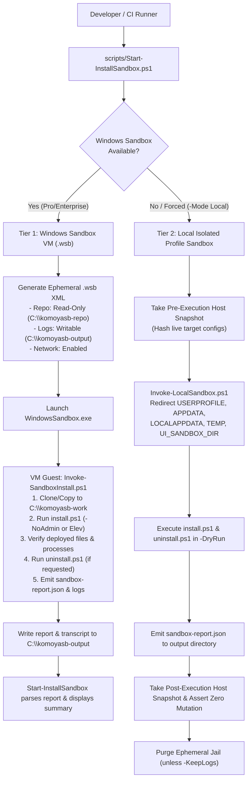
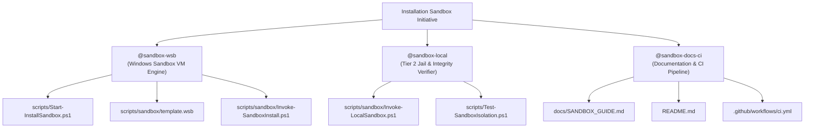

# Windows Sandbox & Ephemeral Installation Testing Architecture Specification

## 1. Executive Summary & Objective

Testing desktop configuration managers, window managers (`komorebi`), hotkey daemons (`whkd`), status bars (`yasb`), and shell customizations on Windows poses a fundamental verification challenge: **how to test real end-to-end installation and uninstallation without altering or contaminating the developer's live workstation.**

While `komoyasb` already possesses an in-process shadow dry-run engine (`scripts/lib/DryRunContext.psm1`), dry-run simulation cannot verify:
1. True package manager (`winget`) installation behavior, service registration, and dependency extraction.
2. Real-time background process invocation and socket/named-pipe IPC creation (`\\.\pipe\komorebi`).
3. Clean rollback and file restoration in a pristine Windows 11 environment.

This specification introduces a **Two-Tier Installation Sandbox** architecture:
- **Tier 1 — Windows Sandbox VM (`.wsb`):** A disposable, hardware-isolated Hyper-V micro-VM running real Windows 11. It mounts the repository strictly read-only, runs installation against real packages and services, validates deployed configurations and active processes, tests uninstallation rollback, and writes structured telemetry back to the host via a dedicated writable exchange folder.
- **Tier 2 — Local Isolated Profile Sandbox (Fallback & CI):** A lightweight environment-variable and directory jail (`USERPROFILE`, `APPDATA`, `LOCALAPPDATA`, `TEMP`, `UI_SANDBOX_DIR`) combined with `DryRunContext.psm1` that guarantees zero host mutation on systems lacking Hyper-V/Windows Sandbox support (such as Windows Home editions or standard GitHub Actions CI runners).

All sandbox operations emit an identical, structured `sandbox-report.json` document. Implementation is partitioned across 3 parallel Swarm workers with **Zero File Overlap**.

---

## 2. Baseline Host & Repository Audit

### 2.1 Host Environment Capabilities
A diagnostic inspection of the local host environment was performed:
- **Operating System:** Windows 10 Home (Core Edition, Build 26300 - Windows 11 Kernel Platform).
- **Windows Sandbox Binary (`WindowsSandbox.exe`):** Absent (`Test-Path "C:\Windows\System32\WindowsSandbox.exe"` returns `False`).
- **Feature `Containers-DisposableClientVM`:** Not enabled / unavailable out-of-the-box on Windows Home edition without elevation/Pro upgrade.
- **Implication:** The Two-Tier architecture is strictly necessary. The primary entry point (`scripts/Start-InstallSandbox.ps1`) must feature auto-detection (`-Mode Auto`) that defaults to Tier 1 when Windows Sandbox is present and gracefully falls back to Tier 2 when unavailable.

### 2.2 Input Mapping for Clean Windows 11 Execution
| Script / Component | Inputs Required | VM Resource Requirement | Sandbox Isolation Mapping |
|---|---|---|---|
| `bootstrap.ps1` | `RepoUrl`, `Branch`, `InstallDir`, `NoAdmin`, `ForwardArgs` | Outbound Internet (HTTPS to GitHub) | `<Networking>Enable</Networking>` in `.wsb`. |
| `install.ps1` | Repository source tree (`configs/`, `themes/`, `scripts/`) | Local filesystem access to repository files | Mounted as **Read-Only** `<HostFolder>` mapped to `C:\komoyasb-repo`. |
| `install.ps1` (Packages) | `winget` CLI, Windows Package Manager source feeds | Outbound Internet (HTTPS to CDN / MS Store) | Network enabled; non-interactive user mode for rootless tests. |
| `install.ps1` (Configs) | `$env:USERPROFILE`, `$env:APPDATA`, `$env:LOCALAPPDATA` | User profile directories | Pristine default user profile inside VM; redirected profile in Tier 2. |
| `sync-theme.ps1` | Workspace configs and theme templates | Temporary scratch directory | Working copy created in `C:\komoyasb-work` inside VM. |
| `uninstall.ps1` | Backup manifests in `themes/.backups` | Backups produced during install | Created inside ephemeral VM or redirected shadow jail. |
| `UI / Tauri (.exe)` | `UI_SANDBOX_DIR` environment hook | UI state workspace directory | Set to sandbox output root in both Tier 1 and Tier 2. |
| Telemetry & Logs | Transcript logs, JSON report | Shared writable output directory | Dedicated writable `<HostFolder>` mapped to `C:\komoyasb-output`. |

### 2.3 Synergy with Existing Shadow Execution
- **`DryRunContext.psm1`**: Operates at the application logic layer by redirecting mutating actions (`Invoke-SystemAction`, `Resolve-TargetPath`) to virtual shadow paths.
- **`UI_SANDBOX_DIR`**: Used by `DryRunContext.psm1` (line 125) and `ui/src-tauri/src/state.rs` (line 38) as the root folder for simulated UI execution.
- **Sandboxing Complementarity**:
  - **Tier 1** does **not** replace `DryRunContext`; rather, it executes `install.ps1` with **real** system actions (`-DryRun:$false`) because the entire OS container is disposable.
  - **Tier 2** harnesses `UI_SANDBOX_DIR` and `DryRunContext` while surrounding it with process-level environment variable redirection (`USERPROFILE`, `APPDATA`, `LOCALAPPDATA`) to ensure that even raw external commands or ambient path expansions cannot escape into the host user profile.

---

## 3. Two-Tier Architecture Specification



### 3.1 Tier 1: Windows Sandbox VM (`.wsb`) Engine

#### 3.1.1 Windows Sandbox Configuration (`.wsb`)
Windows Sandbox uses an XML configuration format (`.wsb`). The launcher generates a dynamic `.wsb` file per run:

```xml
<Configuration>
  <Networking>Enable</Networking>
  <MappedFolders>
    <!-- 1. Source Repository: Strictly Read-Only -->
    <MappedFolder>
      <HostFolder>C:\Users\username\Projects\komoyasb</HostFolder>
      <SandboxFolder>C:\komoyasb-repo</SandboxFolder>
      <ReadOnly>true</ReadOnly>
    </MappedFolder>
    <!-- 2. Writable Output / Telemetry Exchange Folder -->
    <MappedFolder>
      <HostFolder>C:\Users\username\AppData\Local\Temp\komoyasb-sandbox-20261122-120000</HostFolder>
      <SandboxFolder>C:\komoyasb-output</SandboxFolder>
      <ReadOnly>false</ReadOnly>
    </MappedFolder>
  </MappedFolders>
  <LogonCommand>
    <Command>powershell.exe -ExecutionPolicy Bypass -NoProfile -Command "Start-Process powershell.exe -ArgumentList '-ExecutionPolicy Bypass -NoProfile -File C:\komoyasb-repo\scripts\sandbox\Invoke-SandboxInstall.ps1 -RepoDir C:\komoyasb-repo -OutputDir C:\komoyasb-output' -Verb RunAs"</Command>
  </LogonCommand>
</Configuration>
```

#### 3.1.2 Guest Automation Workflow (`Invoke-SandboxInstall.ps1`)
Inside the Windows Sandbox VM, the guest bootstrapper executes the following phases:
1. **Work Directory Setup**: Copies `C:\komoyasb-repo` to `C:\komoyasb-work` so that configuration compilation, theme generation, and timestamped backups have a writable workspace without violating the read-only host mount.
2. **Pre-flight & Winget Check**: Verifies `winget` presence in the sandbox. If missing (common on minimal Windows Sandbox images), bootstraps the App Installer CLI using the official Microsoft package provider.
3. **Execution Phase**:
   - Executes `C:\komoyasb-work\install.ps1` with the requested flags (`-Theme <theme>`, `-NoAdmin:$NoAdmin`, `-SkipPackages:$SkipPackages`).
   - Captures full standard output and standard error to `C:\komoyasb-output\sandbox-install.log`.
4. **Validation Phase**:
   - Asserts deployed runtime files exist:
     - `$env:USERPROFILE\.config\komorebi\komorebi.json`
     - `$env:USERPROFILE\.config\komorebi\applications.yaml`
     - `$env:USERPROFILE\.config\whkdrc`
     - `$env:USERPROFILE\.config\yasb\config.yaml`
     - `$env:USERPROFILE\.config\yasb\styles.css`
   - Validates JSON/YAML syntax of all generated files.
   - Verifies process health if `-SkipPackages` was not passed (checks `Get-Process` for `komorebi`, `whkd`, `yasb`).
5. **Rollback Phase (Optional / `-TestUninstall`)**:
   - Executes `C:\komoyasb-work\uninstall.ps1`.
   - Asserts runtime files are cleanly removed or restored to baseline.
   - Asserts all subsystem processes are stopped.
6. **Telemetry & Exit**:
   - Formats execution timings, status flags, and component verdicts into `C:\komoyasb-output\sandbox-report.json`.
   - Writes exit completion token (`C:\komoyasb-output\completed.token`).

#### 3.1.3 Host Polling & Result Processing (`Start-InstallSandbox.ps1`)
1. Generates ephemeral host output directory: `$env:TEMP\komoyasb-sandbox-<timestamp>-<guid>`.
2. Emits dynamic `.wsb` file.
3. Spawns `WindowsSandbox.exe <path-to-wsb>`.
4. Polls for `completed.token` in the output folder with a configurable timeout (default: 300 seconds).
5. Parses `sandbox-report.json`, prints an ANSI summary table, and exits with the guest exit code.
6. Cleans up temporary artifacts unless `-KeepLogs` is passed.

---

### 3.2 Tier 2: Local Isolated Profile Sandbox (Fallback & CI)

#### 3.2.1 Environment Variable Jail
For environments where Windows Sandbox is unavailable, `Invoke-LocalSandbox.ps1` executes inside an isolated child `pwsh` process where key Windows environment paths are redirected to a temporary scratch directory:

```powershell
$jailRoot = Join-Path $env:TEMP ("komoyasb-localjail-" + [System.Guid]::NewGuid().ToString("N"))
$jailUser   = Join-Path $jailRoot "userprofile"
$jailApp    = Join-Path $jailRoot "appdata"
$jailLocal  = Join-Path $jailRoot "localappdata"
$jailTemp   = Join-Path $jailRoot "temp"

$envOverrides = @{
    "USERPROFILE"    = $jailUser
    "HOME"           = $jailUser
    "APPDATA"        = $jailApp
    "LOCALAPPDATA"   = $jailLocal
    "TEMP"           = $jailTemp
    "TMP"            = $jailTemp
    "UI_SANDBOX_DIR" = $jailRoot
}
```

#### 3.2.2 Execution Under `DryRunContext`
Within the environment jail:
- `install.ps1` and `uninstall.ps1` are executed with `-DryRun -SandboxRoot $jailRoot`.
- `DryRunContext.psm1` intercepts all file modifications, registry writes, and process controls.
- Any tool or command that resolves `$env:USERPROFILE` or `$env:LOCALAPPDATA` writes strictly inside the jail.
- Emits the identical `sandbox-report.json` document to the requested `-OutputDir`.

#### 3.2.3 Host Integrity Assertion (`Test-SandboxIsolation.ps1`)
`Test-SandboxIsolation.ps1` performs an end-to-end verification gate for Tier 2:
1. **Pre-Execution Snapshot**: Computes SHA-256 hashes of all live host target paths:
   - `$env:USERPROFILE\.config\komorebi`
   - `$env:USERPROFILE\.config\yasb`
   - `$env:USERPROFILE\.config\whkdrc`
   - `$env:APPDATA\FlowLauncher`
   - `$env:LOCALAPPDATA\komoyasb`
   - Repository source directories (`configs/`, `themes/`, `scripts/`).
2. **Execute Tier 2 Sandbox**: Runs `Invoke-LocalSandbox.ps1` in standard and `-NoAdmin` modes.
3. **Post-Execution Snapshot & Diff**: Asserts **zero** file creations, mutations, or deletions outside `$jailRoot`.
4. **Cleanup Verification**: Asserts that omitting `-KeepLogs` purges `$jailRoot` completely.

---

## 4. Unified Sandbox Report Schema (`sandbox-report.json`)

To ensure interoperability between Tier 1, Tier 2, and CI telemetry, both tiers adhere to the following strict JSON schema:

```json
{
  "$schema": "http://json-schema.org/draft-07/schema#",
  "title": "KomoyasbSandboxReport",
  "type": "object",
  "required": [
    "timestamp",
    "tier",
    "mode",
    "status",
    "durationMs",
    "installation",
    "verification",
    "hostIntegrity"
  ],
  "properties": {
    "timestamp": { "type": "string", "format": "date-time" },
    "tier": { "type": "string", "enum": ["Tier1-WSB", "Tier2-Local"] },
    "mode": { "type": "string", "enum": ["Elevated", "Rootless-NoAdmin"] },
    "status": { "type": "string", "enum": ["PASS", "FAIL"] },
    "durationMs": { "type": "integer", "minimum": 0 },
    "hostInfo": {
      "type": "object",
      "properties": {
        "osVersion": { "type": "string" },
        "isVirtualMachine": { "type": "boolean" },
        "windowsSandboxAvailable": { "type": "boolean" }
      }
    },
    "installation": {
      "type": "object",
      "required": ["executed", "exitCode", "phaseTimings"],
      "properties": {
        "executed": { "type": "boolean" },
        "exitCode": { "type": "integer" },
        "phaseTimings": { "type": "object" },
        "packagesInstalled": { "type": "array", "items": { "type": "string" } },
        "configsCreated": { "type": "array", "items": { "type": "string" } }
      }
    },
    "verification": {
      "type": "object",
      "required": ["configsValid", "processesVerified", "themesCompiled"],
      "properties": {
        "configsValid": { "type": "boolean" },
        "processesVerified": { "type": "boolean" },
        "themesCompiled": { "type": "boolean" },
        "details": { "type": "array", "items": { "type": "string" } }
      }
    },
    "uninstallation": {
      "type": "object",
      "properties": {
        "executed": { "type": "boolean" },
        "exitCode": { "type": "integer" },
        "configsRestored": { "type": "boolean" },
        "processesStopped": { "type": "boolean" }
      }
    },
    "hostIntegrity": {
      "type": "object",
      "required": ["hostMutationsDetected", "liveSnapshotVerified"],
      "properties": {
        "hostMutationsDetected": { "type": "integer", "enum": [0] },
        "liveSnapshotVerified": { "type": "boolean" },
        "inspectedPaths": { "type": "array", "items": { "type": "string" } }
      }
    },
    "errors": {
      "type": "array",
      "items": { "type": "string" }
    },
    "artifacts": {
      "type": "object",
      "properties": {
        "logFile": { "type": "string" },
        "ledgerFile": { "type": "string" },
        "reportFile": { "type": "string" }
      }
    }
  }
}
```

---

## 5. Worker Ownership Map (Zero File Overlap)

To prevent file contention during swarm implementation, work is partitioned across 3 workers with **strictly disjoint file ownership**:



### 5.1 Worker 1: `@sandbox-wsb`
- **Scope & Owned Files:**
  - `scripts/Start-InstallSandbox.ps1`
  - `scripts/sandbox/template.wsb`
  - `scripts/sandbox/Invoke-SandboxInstall.ps1`
- **Responsibilities:**
  1. Implement `Start-InstallSandbox.ps1` with CLI parameters:
     - `-Mode <Auto|WSB|Local>` (Default: `Auto`)
     - `-NoAdmin` (switch for rootless test)
     - `-TestUninstall` (switch to test rollback)
     - `-KeepLogs` (switch to retain exchange directory)
     - `-TimeoutSeconds` (default: 300)
  2. Implement `template.wsb` with clean XML structure and parameter placeholders (`__REPO_DIR__`, `__LOG_DIR__`, `__COMMAND__`).
  3. Implement `Invoke-SandboxInstall.ps1` to run inside the VM, copy the read-only repo to `C:\komoyasb-work`, execute `install.ps1`, validate deployed files, optionally run `uninstall.ps1`, and emit `sandbox-report.json`.
  4. Ensure robust fallback to `Invoke-LocalSandbox.ps1` when `-Mode Auto` detects that `WindowsSandbox.exe` is missing.
- **Definition of Done (DoD):**
  - XML syntax passes `.wsb` validation.
  - PowerShell AST static check (`tests/verify-host-safety.ps1`) passes on all created scripts.
  - `Start-InstallSandbox.ps1 -Mode WSB` successfully generates valid `.wsb` files and handles missing VM binaries gracefully.

### 5.2 Worker 2: `@sandbox-local`
- **Scope & Owned Files:**
  - `scripts/sandbox/Invoke-LocalSandbox.ps1`
  - `scripts/Test-SandboxIsolation.ps1`
- **Responsibilities:**
  1. Implement `Invoke-LocalSandbox.ps1` creating an isolated profile and directory jail (`USERPROFILE`, `APPDATA`, `LOCALAPPDATA`, `TEMP`, `UI_SANDBOX_DIR`).
  2. Execute `install.ps1` (and `uninstall.ps1` if `-TestUninstall` is specified) within the jail using `DryRunContext.psm1`.
  3. Emit the schema-compliant `sandbox-report.json` and execution logs to the output directory.
  4. Implement `Test-SandboxIsolation.ps1`:
     - Snapshots live host configuration targets (SHA-256 baseline).
     - Runs `Invoke-LocalSandbox.ps1` in standard and `-NoAdmin` modes.
     - Asserts 0 host mutations post-execution.
     - Verifies automatic cleanup of ephemeral jail folders when `-KeepLogs` is omitted.
- **Definition of Done (DoD):**
  - `Test-SandboxIsolation.ps1` exits `0` with 100% assertions passed.
  - Zero files modified or created outside the temporary jail directory.

### 5.3 Worker 3: `@sandbox-docs-ci`
- **Scope & Owned Files:**
  - `docs/SANDBOX_GUIDE.md`
  - `README.md`
  - `.github/workflows/ci.yml`
- **Responsibilities:**
  1. Author `docs/SANDBOX_GUIDE.md`:
     - Instructions for enabling Windows Sandbox via `Enable-WindowsOptionalFeature -Online -FeatureName Containers-DisposableClientVM -All`.
     - Usage guide for `Start-InstallSandbox.ps1` (WSB and Local modes).
     - Architecture explanation and troubleshooting guide.
  2. Update `README.md`:
     - Add a prominent "Sandboxed Installation Testing" section detailing 1-command testing (`.\scripts\Start-InstallSandbox.ps1`).
  3. Integrate into `.github/workflows/ci.yml`:
     - Add a new CI job `sandbox-installation-safety` that executes `scripts/Test-SandboxIsolation.ps1`.
- **Definition of Done (DoD):**
  - `.github/workflows/ci.yml` contains valid YAML and passes linting.
  - Documentation links are 100% valid with zero 404s.

---

## 6. Security & Host-Integrity Invariants

The installation sandbox is governed by 5 mandatory invariants:

1. **Strict Read-Only Source Mount (`<ReadOnly>true</ReadOnly>`):**
   In Tier 1 (`.wsb`), the host repository directory is mounted strictly read-only. The guest VM cannot write, modify, or delete any files in the host git working copy under any circumstances.
2. **Zero Host Registry & Profile Mutation:**
   - In Tier 1, all registry writes and system settings occur inside the disposable VM container and are discarded when the sandbox closes.
   - In Tier 2, all registry writes are intercepted by `DryRunContext.psm1` (`Invoke-SystemAction -ActionType "RegistryWrite"`), and environment variables redirect all file I/O to ephemeral directories.
3. **Zero Leaked Ephemeral Artifacts:**
   Unless explicitly requested with `-KeepLogs`, all temporary folders (`$env:TEMP\komoyasb-sandbox-*` or `$env:TEMP\komoyasb-localjail-*`) must be purged in `finally` blocks.
4. **Pre- and Post-Execution Cryptographic Hashing:**
   `Test-SandboxIsolation.ps1` must compute recursive SHA-256 hashes of all monitored host directories before and after execution to mathematically prove zero host modification.
5. **AST Safety & StrictMode Compliance:**
   - All scripts must enforce `Set-StrictMode -Version Latest` and `$ErrorActionPreference = 'Stop'`.
   - All array accesses must be wrapped in `@(...)` to prevent `.Count` on null/scalar errors.
   - All paths must resolve via `$PSScriptRoot`.
   - All mutating calls must comply with `tests/verify-host-safety.ps1`.

---

## 7. Verification & Final QA Gate

Before any implementation is considered complete, the final QA gate must execute and pass the following sequential commands:

### Gate 1: Static AST & XML Verification
```powershell
# 1. Verify XML syntax of template.wsb
[xml](Get-Content -LiteralPath .\scripts\sandbox\template.wsb)

# 2. Verify PowerShell syntax and host-safety across all sandbox scripts
powershell -NoProfile -ExecutionPolicy Bypass -File .\tests\verify-host-safety.ps1
```

### Gate 2: Tier 2 Local Sandbox Isolation & Host Zero-Mutation Verification
```powershell
# Execute Tier 2 isolation test (standard and rootless)
powershell -NoProfile -ExecutionPolicy Bypass -File .\scripts\Test-SandboxIsolation.ps1
```
*Criteria: Exit code 0, 0 host mutations detected, ephemeral directories purged.*

### Gate 3: Start-InstallSandbox CLI Verification
```powershell
# Execute 1-command sandbox runner in Local mode
powershell -NoProfile -ExecutionPolicy Bypass -File .\scripts\Start-InstallSandbox.ps1 -Mode Local -TestUninstall
```
*Criteria: Exit code 0, emits valid sandbox-report.json with "status": "PASS".*

### Gate 4: Unified Test Runner & Coverage Verification
```powershell
# Full test suite with >= 90% coverage threshold
powershell -NoProfile -ExecutionPolicy Bypass -File .\scripts\Invoke-AllTests.ps1 -CoverageThreshold 90
```
*Criteria: All 4 domains (PowerShell, Rust, Frontend, E2E) PASS with coverage intact.*
