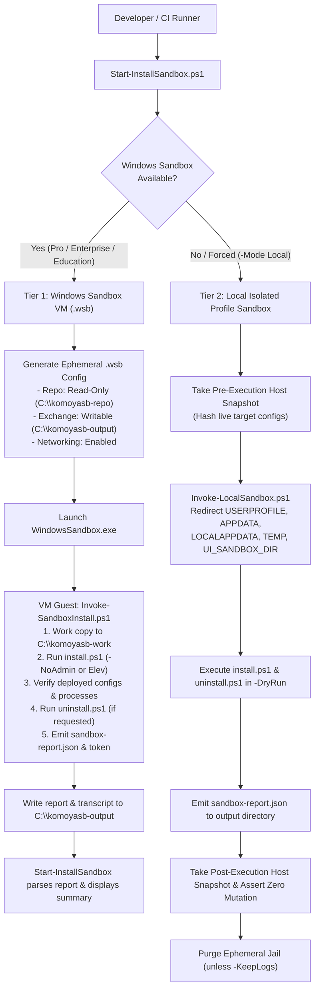
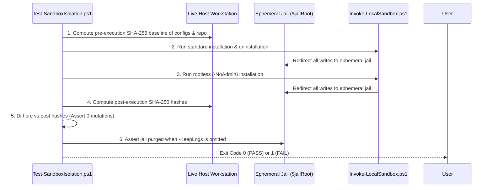

# Two-Tier Installation Sandbox & Ephemeral Testing Guide

## 1. Overview & Testing Philosophy

Developing and validating desktop configuration orchestrators, tiling window managers (`komorebi`), hotkey daemons (`whkd`), status bars (`yasb`), and shell customizations on Windows presents a critical engineering challenge: **how to perform true end-to-end installation and uninstallation testing without mutating, contaminating, or corrupting the developer's live workstation.**

While `komoyasb` provides an in-process dry-run simulation engine (`scripts/lib/DryRunContext.psm1`), in-process simulation cannot verify:
1. **Real Package Management:** Genuine package installation, uninstallation, dependency resolution, and service registration via `winget`.
2. **Subsystem Inter-Process Communication:** Real runtime process spawns, Win32 AppBar registrations, and named-pipe IPC creation (`\\.\pipe\komorebi`).
3. **Pristine Environment Behavior:** Configuration deployment and path resolution on a clean Windows 11 installation without existing user settings.
4. **Clean Rollback & Restoration:** Full teardown and file restoration verified against a real OS baseline.

To solve this, `komoyasb` introduces a **Two-Tier Installation Sandbox** architecture:



---

## 2. Architecture: Tier 1 vs. Tier 2

| Dimension | Tier 1 — Windows Sandbox VM (`.wsb`) | Tier 2 — Local Isolated Profile Sandbox |
| :--- | :--- | :--- |
| **Isolation Mechanism** | Hardware-isolated Hyper-V micro-VM running disposable Windows 11 kernel | Process-level environment variable redirection + directory jail + `DryRunContext.psm1` |
| **Host Protection** | Physical OS boundary; repository mounted strictly read-only (`<ReadOnly>true</ReadOnly>`) | Cryptographically verified immutability gate (`Test-SandboxIsolation.ps1`) |
| **Package Manager Testing** | Real `winget` installation, uninstallation, and binary execution | Simulated package provisioning via intercepted system action dispatch |
| **Process Execution** | Real background daemons (`komorebi.exe`, `whkd.exe`, `yasb.exe`) | Mocked / guarded background processes; zero actual process spawns on live host |
| **System Prerequisites** | Windows 11/10 Pro/Enterprise/Education with Hyper-V virtualization | Any Windows edition (including Windows Home) and standard CI runners |
| **Execution Speed** | ~45–90 seconds (VM cold start + provisioning) | ~3–10 seconds (near-instant execution) |
| **Output Artifacts** | `sandbox-install.log`, `sandbox-report.json`, `completed.token` | `sandbox-install.log`, `sandbox-report.json` |

### 2.1 Tier 1: Windows Sandbox VM Engine (`.wsb`)

Tier 1 executes within a fresh Windows Sandbox container spawned via a dynamically generated `.wsb` XML manifest:
- **Strict Read-Only Source Mount:** The host repository root is mounted to `C:\komoyasb-repo` with `<ReadOnly>true</ReadOnly>`. The guest VM cannot modify host git files under any circumstance.
- **Writable Telemetry Exchange:** An ephemeral host directory (`$env:TEMP\komoyasb-sandbox-<timestamp>-<guid>`) is mounted to `C:\komoyasb-output` with read-write permissions for receiving logs, report JSON, and the completion token.
- **Guest Automation (`Invoke-SandboxInstall.ps1`):**
  1. Copies `C:\komoyasb-repo` to `C:\komoyasb-work` inside the VM, providing a writable working directory for configuration compilation and backups without modifying the host mount.
  2. Runs `install.ps1` with the specified parameters (`-Theme`, `-NoAdmin`, `-SkipPackages`).
  3. Verifies deployed files:
     - `%USERPROFILE%\.config\komorebi\komorebi.json`
     - `%USERPROFILE%\.config\komorebi\applications.yaml`
     - `%USERPROFILE%\.config\whkdrc`
     - `%USERPROFILE%\.config\yasb\config.yaml`
     - `%USERPROFILE%\.config\yasb\styles.css`
  4. Validates JSON and YAML syntax of all deployed files.
  5. Verifies running processes (`komorebi`, `whkd`, `yasb`).
  6. If `-TestUninstall` is passed, executes `uninstall.ps1` and asserts complete file cleanup and process termination.
  7. Emits `sandbox-report.json` and creates `completed.token`.

### 2.2 Tier 2: Local Isolated Profile Sandbox

Tier 2 provides a zero-mutation guarantee on systems lacking Hyper-V or Windows Sandbox support:
- **Environment Variable Jail:** Spawns a child PowerShell process redirecting critical profile and cache locations to an ephemeral scratch folder:
  ```powershell
  $jailRoot = Join-Path $env:TEMP ("komoyasb-localjail-" + [System.Guid]::NewGuid().ToString("N"))
  $envOverrides = @{
      "USERPROFILE"    = Join-Path $jailRoot "userprofile"
      "HOME"           = Join-Path $jailRoot "userprofile"
      "APPDATA"        = Join-Path $jailRoot "appdata"
      "LOCALAPPDATA"   = Join-Path $jailRoot "localappdata"
      "TEMP"           = Join-Path $jailRoot "temp"
      "TMP"            = Join-Path $jailRoot "temp"
      "UI_SANDBOX_DIR" = $jailRoot
  }
  ```
- **DryRunContext Guardrails:** Executes `install.ps1` and `uninstall.ps1` with `-DryRun -SandboxRoot $jailRoot`. All mutating actions (file writes, registry modifications, process controls) are captured into an in-memory shadow ledger.
- **Automatic Cleanup:** In `finally` blocks, the ephemeral directory jail is completely deleted unless `-KeepLogs` is passed.

---

## 3. Windows Sandbox Prerequisites & Setup

### 3.1 System Requirements

To run Tier 1 (Windows Sandbox VM), your system must satisfy:
- **Windows Edition:** Windows 11 Pro, Enterprise, or Education; or Windows 10 Pro / Enterprise (build 18305 or later).
  > [!NOTE]
  > Windows Home editions do not support the Windows Sandbox feature out of the box. On Windows Home, the runner automatically defaults to **Tier 2 Local Sandbox**.
- **Hardware Architecture:** AMD64 (x64) or ARM64.
- **BIOS/UEFI Virtualization:** Hardware virtualization must be enabled in your system firmware (Intel VT-x or AMD-V / SVM).
- **RAM & Storage:** Minimum 4 GB RAM (8 GB recommended), minimum 1 GB free disk space, and at least 2 CPU cores.

### 3.2 Enabling Windows Sandbox via PowerShell

Open an **elevated PowerShell prompt (Run as Administrator)** and execute:

```powershell
Enable-WindowsOptionalFeature -Online -FeatureName Containers-DisposableClientVM -All
```

If prompted to restart your computer, type `Y` to reboot.

### 3.3 Enabling Windows Sandbox via Windows Settings / GUI

1. Press `Win + R`, type `optionalfeatures.exe`, and press **Enter**.
2. Scroll down in the "Turn Windows features on or off" dialog.
3. Check the box for **Windows Sandbox**.
4. Click **OK** and allow Windows to download and apply the feature.
5. Restart your computer when prompted.

### 3.4 Verifying Windows Sandbox Availability

Run the following command to verify whether Windows Sandbox is available on your machine:

```powershell
# Check feature status
Get-WindowsOptionalFeature -Online -FeatureName Containers-DisposableClientVM

# Check executable existence
Test-Path "C:\Windows\System32\WindowsSandbox.exe"
```

If both return `Enabled` and `True`, Tier 1 is ready to use.

---

## 4. Single-Command Sandbox Runner (`Start-InstallSandbox.ps1`)

The entry point for sandbox testing is `scripts/Start-InstallSandbox.ps1`. It features intelligent auto-detection, execution polling, structured telemetry parsing, and automated artifact cleanup.

### 4.1 CLI Parameter Reference

| Parameter | Type | Default | Description |
| :--- | :--- | :--- | :--- |
| `-Mode` | `string` | `'Auto'` | Execution mode: `Auto`, `WSB`, or `Local`. |
| `-NoAdmin` | `switch` | `False` | Executes test in Rootless Mode without administrative privileges. |
| `-TestUninstall` | `switch` | `False` | Executes installation followed immediately by uninstallation to verify clean rollback. |
| `-KeepLogs` | `switch` | `False` | Retains ephemeral output folder and logs after test completion. |
| `-TimeoutSeconds` | `int` | `300` | Maximum wait time in seconds for sandbox execution completion. |
| `-WhatIf` | `switch` | `False` | Displays actions that would be executed without launching sandboxes. |

### 4.2 Mode Semantics

- **`-Mode Auto` (Default):**
  Checks for `WindowsSandbox.exe`. If present and enabled, launches **Tier 1 (WSB)**. If absent (e.g., Windows Home edition or unprivileged runner), prints a clear diagnostic warning and automatically falls back to **Tier 2 (Local)**.
- **`-Mode WSB`:**
  Forces Tier 1 execution. If Windows Sandbox is missing or disabled, throws an actionable terminating error with instructions on how to enable the feature.
- **`-Mode Local`:**
  Forces Tier 2 execution regardless of Windows Sandbox presence. Excellent for ultra-fast local validation during development cycles or CI pipelines.

### 4.3 CLI Usage Examples

```powershell
# 1. Standard auto-detection run (WSB if available, Local fallback if not)
powershell -ExecutionPolicy Bypass -File .\scripts\Start-InstallSandbox.ps1

# 2. Force Tier 1 Windows Sandbox with full installation and uninstallation verification
powershell -ExecutionPolicy Bypass -File .\scripts\Start-InstallSandbox.ps1 -Mode WSB -TestUninstall

# 3. Force Tier 2 Local Sandbox in Rootless Mode (no admin)
powershell -ExecutionPolicy Bypass -File .\scripts\Start-InstallSandbox.ps1 -Mode Local -NoAdmin

# 4. Retain logs and artifacts for debugging
powershell -ExecutionPolicy Bypass -File .\scripts\Start-InstallSandbox.ps1 -Mode Local -KeepLogs

# 5. Full regression gate with custom timeout
powershell -ExecutionPolicy Bypass -File .\scripts\Start-InstallSandbox.ps1 -Mode Auto -TestUninstall -KeepLogs -TimeoutSeconds 450
```

---

## 5. Host Immutability & Zero-Mutation Gate (`Test-SandboxIsolation.ps1`)

To mathematically prove that Tier 2 Local Sandbox does not contaminate the developer's workstation, `scripts/Test-SandboxIsolation.ps1` executes an end-to-end cryptographic integrity verification:



### 5.1 Monitored Host Targets

`Test-SandboxIsolation.ps1` takes cryptographic SHA-256 snapshots of the following host directories before and after sandbox execution:
- `$env:USERPROFILE\.config\komorebi`
- `$env:USERPROFILE\.config\yasb`
- `$env:USERPROFILE\.config\whkdrc`
- `$env:APPDATA\FlowLauncher`
- `$env:LOCALAPPDATA\komoyasb`
- Repository source directories: `configs/`, `themes/`, `scripts/`

### 5.2 Verification Assertions

The test fails (exit code `1`) if:
1. Any file inside the monitored paths is modified, created, or deleted.
2. Any temporary jail directories remain unpurged when `-KeepLogs` is omitted.
3. The internal sandbox reports indicate any failure status (`"status": "FAIL"`).

### 5.3 Running the Immutability Gate

```powershell
powershell -NoProfile -ExecutionPolicy Bypass -File .\scripts\Test-SandboxIsolation.ps1
```

---

## 6. Telemetry & Unified Report Schema (`sandbox-report.json`)

Both Tier 1 and Tier 2 generate an identical `sandbox-report.json` document adhering to the schema specified in `docs/SANDBOX_ARCHITECTURE.md`:

```json
{
  "$schema": "http://json-schema.org/draft-07/schema#",
  "timestamp": "2026-11-22T21:00:00Z",
  "tier": "Tier1-WSB",
  "mode": "Elevated",
  "status": "PASS",
  "durationMs": 42150,
  "hostInfo": {
    "osVersion": "Microsoft Windows 11 Pro 10.0.26100",
    "isVirtualMachine": true,
    "windowsSandboxAvailable": true
  },
  "installation": {
    "executed": true,
    "exitCode": 0,
    "phaseTimings": {
      "preflight": 1200,
      "packages": 28400,
      "configs": 3100,
      "themes": 1800
    },
    "packagesInstalled": ["LGUG2Z.komorebi", "LGUG2Z.whkd", "amnweb.yasb"],
    "configsCreated": [
      ".config\\komorebi\\komorebi.json",
      ".config\\komorebi\\applications.yaml",
      ".config\\whkdrc",
      ".config\\yasb\\config.yaml",
      ".config\\yasb\\styles.css"
    ]
  },
  "verification": {
    "configsValid": true,
    "processesVerified": true,
    "themesCompiled": true,
    "details": [
      "komorebi.json syntax validated",
      "whkdrc keybindings validated",
      "yasb config.yaml parsed successfully"
    ]
  },
  "uninstallation": {
    "executed": true,
    "exitCode": 0,
    "configsRestored": true,
    "processesStopped": true
  },
  "hostIntegrity": {
    "hostMutationsDetected": 0,
    "liveSnapshotVerified": true,
    "inspectedPaths": [
      "~\\.config\\komorebi",
      "~\\.config\\yasb",
      "~\\.config\\whkdrc"
    ]
  },
  "errors": [],
  "artifacts": {
    "logFile": "sandbox-install.log",
    "reportFile": "sandbox-report.json"
  }
}
```

---

## 7. Continuous Integration (CI) Pipeline Integration

In GitHub Actions, Windows Sandbox cannot run because standard GitHub-hosted runners do not support nested virtualization.

Therefore, the CI workflow (`.github/workflows/ci.yml`) executes **Tier 2 Local Sandbox Isolation** via the dedicated `sandbox-isolation-gate` job:

```yaml
sandbox-isolation-gate:
  name: Sandbox Isolation & Zero Host Mutation Gate
  runs-on: windows-latest
  steps:
    - name: Checkout repository
      uses: actions/checkout@v4

    - name: Verify Host Immutability & Ephemeral Jail Isolation
      shell: powershell
      run: |
        powershell -NoProfile -ExecutionPolicy Bypass -File .\scripts\Test-SandboxIsolation.ps1
```

This guarantees that every commit and pull request is mathematically validated against accidental host mutation or path contamination.

---

## 8. Troubleshooting & FAQ

### Q1: Error "Windows Sandbox is not enabled or available on this edition of Windows"
- **Cause:** You ran `Start-InstallSandbox.ps1 -Mode WSB` on a system where Windows Sandbox is disabled or on Windows Home edition.
- **Solution:**
  - If you are on Windows 11/10 Pro or Enterprise, enable the feature via PowerShell:
    ```powershell
    Enable-WindowsOptionalFeature -Online -FeatureName Containers-DisposableClientVM -All
    ```
  - If you are on Windows Home edition, run with `-Mode Local` or `-Mode Auto`:
    ```powershell
    .\scripts\Start-InstallSandbox.ps1 -Mode Local
    ```

### Q2: Error "Virtualization is disabled in firmware (BIOS/UEFI)"
- **Cause:** Hardware virtualization (VT-x for Intel, SVM/AMD-V for AMD) is disabled in your motherboard BIOS/UEFI settings.
- **Solution:**
  1. Restart your PC and press the BIOS key (usually `F2`, `F10`, `Del`, or `Esc`).
  2. Locate the CPU configuration menu:
     - **Intel:** Enable **Intel Virtualization Technology** (or **Intel VT-x**).
     - **AMD:** Enable **SVM Mode** (Secure Virtual Machine) or **AMD-V**.
  3. Save settings and reboot.

### Q3: Execution timeout waiting for `completed.token`
- **Cause:** Package downloads (`winget`) or network connectivity inside the VM was delayed, exceeding the default 300-second timeout.
- **Solution:**
  - Increase the timeout threshold:
    ```powershell
    .\scripts\Start-InstallSandbox.ps1 -Mode WSB -TimeoutSeconds 600
    ```
  - Inspect the guest installation transcript with `-KeepLogs`:
    ```powershell
    .\scripts\Start-InstallSandbox.ps1 -Mode WSB -KeepLogs
    ```
    Examine `sandbox-install.log` in the preserved exchange directory.

### Q4: How do I inspect the ephemeral logs and report after a run?
- Pass `-KeepLogs` to either `Start-InstallSandbox.ps1` or `Invoke-LocalSandbox.ps1`. The script prints the exact path to the output directory upon completion:
  ```powershell
  .\scripts\Start-InstallSandbox.ps1 -KeepLogs
  ```
  Output folder example:
  `C:\Users\<user>\AppData\Local\Temp\komoyasb-sandbox-20261122-120000-abcd`
