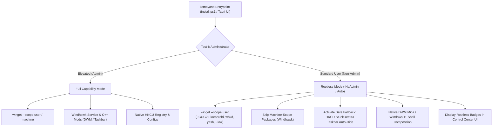
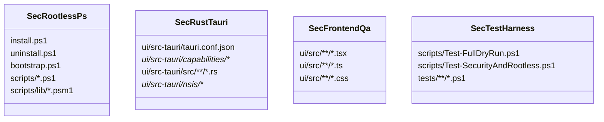

# Security Architecture & Rootless (Non-Admin) Hardening Specification

This document defines the comprehensive security architecture, least-privilege (rootless/non-admin) contract, vulnerability findings register, worker ownership boundaries, and automated verification gates for the `komoyasb` Windows 11 desktop environment suite.

---

## 1. Executive Summary & Zero-UAC Design Philosophy

Windows 11 desktop customization environments traditionally demand elevated administrative rights (`RunAs Administrator`), causing security degradation, corporate endpoint policy violations, and unconstrained User Account Control (UAC) prompts.

`komoyasb` implements a **First-Class Rootless Architecture**:
- Operates under standard, unprivileged user accounts with **Zero UAC elevation demands**.
- Confines all filesystem mutations to `%LOCALAPPDATA%`, `%APPDATA%`, and the user's `$HOME\.config` directory.
- Confines registry writes exclusively to `HKEY_CURRENT_USER` (`HKCU`).
- Employs Windows Package Manager (`winget`) with mandatory `--scope user` constraints.
- Gracefully degrades machine-dependent subsystems (e.g., Windhawk C++ kernel/DWM hooks) to native, unprivileged Win32 shell fallbacks (`HKCU` taskbar auto-hide via `StuckRects3`).
- Packages the Tauri v2 Control Center desktop executable with NSIS `currentUser` install mode, completely removing `C:\Program Files` write dependencies.



---

## 2. Baseline Security & Code Quality Findings Register

The baseline repository audit revealed concrete vulnerabilities, hardening gaps, and privilege-elevation dependencies ranked by severity:

| Finding ID | Severity | Subsystem / File | Description & Vulnerability Scenario | Remediation Specification |
|---|---|---|---|---|
| **SEC-01** | **High** | Packaging<br>`ui/src-tauri/tauri.conf.json` | **NSIS Defaults to `perMachine` Elevation:** `bundle.windows.nsis.installMode` was omitted, causing NSIS installer to request administrator elevation to write to `Program Files`. | Configure `"installMode": "currentUser"` in `tauri.conf.json` to target `%LOCALAPPDATA%\Programs` without UAC. |
| **SEC-02** | **High** | Package Provisioning<br>`scripts/lib/Environment.psm1` | **Missing Winget User-Scope Flag:** `Install-WingetPackage` invoked `winget install` without `--scope user`, causing UAC elevation triggers or `0x80070005` Access Denied errors on non-admin accounts. | Add `--scope user` to winget arguments; detect package compatibility; gracefully skip machine-only packages when rootless. |
| **SEC-03** | **High** | Shell Integration<br>`scripts/apply-windhawk-mods.ps1` | **Elevated Service & `ProgramData` Dependency:** Windhawk requires an NT service (LocalSystem) and writes to `C:\ProgramData\Windhawk\Mods`. Non-admin execution fails without fallback. | Guard Windhawk execution behind `Test-IsAdministrator`; in Rootless mode, automatically skip and activate native `StuckRects3` fallback. |
| **SEC-04** | **High** | Rust Tauri IPC<br>`ui/src-tauri/src/commands/statusbar.rs` | **Registry File String Injection in `set_eartrumpet_config`:** Unsanitized `config.theme` string interpolated directly into `eartrumpet_settings.reg`, allowing arbitrary registry key injection. | Enforce strict whitelist validation (`System`, `Dark`, `Light`) before generating registry payload. |
| **SEC-05** | **Medium** | Rust Tauri IPC<br>`ui/src-tauri/src/commands/*.rs` | **Path Traversal via Unvalidated IPC Parameters:** `load_theme(name)` and `restore_backup(timestamp)` concatenate user strings directly with root folders without canonical root jailing. | Implement `validate_safe_path` with canonicalization and allowed-root validation (`repo_root`, `.config`, `AppData`). |
| **SEC-06** | **Medium** | Process Supervisor<br>`scripts/watchdog.ps1` | **Unquoted ProcessStartInfo Arguments:** `watchdog.ps1` joined arguments via `-join " "` without quoting, causing launch failures when `$env:USERPROFILE` contains whitespace. | Properly escape and quote arguments with spaces in `ProcessStartInfo.Arguments`. |
| **SEC-07** | **Medium** | Bootstrap Engine<br>`bootstrap.ps1` | **Zip Extraction Path Traversal (Zip Slip) & Missing Hash Check:** `ZipFile::ExtractToDirectory` used without validating archive entry relative paths or release checksums. | Validate extraction targets within staging boundaries; add sha256 checksum verification when available; remove legacy `iex` examples. |
| **SEC-08** | **Medium** | Rust Tauri IPC<br>`ui/src-tauri/src/commands/{mods,performance}.rs` | **Unvalidated IPC Enums (`mod_id`, `profile`):** IPC handlers accept freeform strings and pass them to PowerShell without allowlist verification. | Enforce Rust enum deserialization or strict string allowlists (`taskbar-autohide`, `dwm-mica-effects`, `notification-styling`). |
| **SEC-09** | **Medium** | Backup Engine<br>`ui/src-tauri/src/commands/system.rs` | **Backup Directory Path Discrepancy & Non-Atomic Writes:** `system.rs` reads backups from `.backups/` whereas `install.ps1` writes to `themes/.backups/`; `restore_backup` uses non-atomic writes. | Harmonize backup root path to `themes/.backups/`; use `atomic_write_file` for configuration restoration. |
| **SEC-10** | **Medium** | Frontend Quality<br>`ui/src/App.tsx`, `ui/src/main.tsx` | **Missing React Error Boundaries:** Uncaught exceptions in UI tabs or IPC responses cause full application blank screen crash. | Wrap root view components and individual navigation views in robust React `ErrorBoundary` with reload capability. |
| **SEC-11** | **Low** | Frontend UI / UX<br>`ui/src/components/**/*.{tsx,ts}` | **Missing Rootless / Non-Admin UI Status Badges:** UI does not inform standard users that Rootless mode is active and Windhawk mods are gracefully degraded. | Add visual `Rootless Mode (Non-Admin)` badge and informational tooltips across Titlebar, FirstRunBanner, and Windhawk manager. |
| **SEC-12** | **Low** | Test Suite<br>`ui/src/lib/ipc.test.ts`, `App.test.tsx` | **TypeScript Typings & Test Discrepancies:** Test files contained outdated IPC signatures, causing `tsc --noEmit` errors despite Vitest passing. | Fix mock types, align IPC test signatures, and verify full clean compilation under `npx tsc --noEmit`. |

---

## 3. Rootless Mode Architecture & Contract (`-NoAdmin` / Auto-Detect)

### 3.1 Privilege Detection Specification (`Test-IsAdministrator`)

A standardized, zero-allocation privilege detection helper must be exported by `scripts/lib/Environment.psm1`:

```powershell
function Test-IsAdministrator {
    <#
    .SYNOPSIS
        Evaluates whether the current PowerShell process has elevated Administrator privileges.
    .DESCRIPTION
        Inspects the WindowsPrincipal claims token of the current WindowsIdentity for the
        Builtin Administrators Security Identifier (SID S-1-5-32-544).
    .OUTPUTS
        [bool] True if running elevated with administrative token, false otherwise.
    #>
    [CmdletBinding()]
    param()

    try {
        $identity = [System.Security.Principal.WindowsIdentity]::GetCurrent()
        $principal = [System.Security.Principal.WindowsPrincipal]::new($identity)
        return $principal.IsInRole([System.Security.Principal.WindowsBuiltInRole]::Administrator)
    } catch {
        return $false
    }
}
```

### 3.2 Auto-Detection & Fallback Workflow in `install.ps1`

`install.ps1` supports an explicit `-NoAdmin` switch while defaulting to automatic privilege discovery:

```powershell
[CmdletBinding(SupportsShouldProcess = $true)]
param(
    # ...
    [Parameter(Mandatory = $false)]
    [switch]$NoAdmin,
    # ...
)

# Privilege resolution:
$isAdmin = Test-IsAdministrator
$rootlessMode = $NoAdmin -or (-not $isAdmin)

if ($rootlessMode) {
    Write-Host "[komoyasb] Operating in ROOTLESS MODE (Non-Admin / Zero-UAC)." -ForegroundColor Cyan
    Write-Host "[komoyasb] All packages will be scoped to current user; machine-only mods will gracefully degrade." -ForegroundColor DarkGray
} else {
    Write-Host "[komoyasb] Operating in ELEVATED MODE (Administrator)." -ForegroundColor Yellow
}
```

### 3.3 Rootless Feature Matrix

| Feature / Component | Elevated (Admin) Mode | Rootless (Non-Admin) Mode | Fallback / Degradation Mechanism |
|---|---|---|---|
| **Komorebi Window Manager** | Installed via winget / binary | Installed via `winget --scope user` | Identical: runs 100% in user space (`~/.config/komorebi/komorebi.json`) |
| **whkd Keybinding Daemon** | Installed via winget / binary | Installed via `winget --scope user` | Identical: runs 100% in user space (`~/.config/whkdrc`) |
| **YASB Reborn Status Bar** | Installed via winget / binary | Installed via `winget --scope user` | Identical: registers AppBar, reads `~/.config/yasb/` |
| **Flow Launcher** | Installed via winget / binary | Installed via `winget --scope user` | Identical: targets `%LOCALAPPDATA%\FlowLauncher` |
| **EarTrumpet** | Installed via winget / MS Store | Installed via `winget --scope user` / MS Store | Identical: registry settings committed to `HKCU` |
| **FluentFlyout** | Installed via MS Store (`9N45NSM4TNBP`) | Installed via MS Store (`9N45NSM4TNBP`) | Identical: MS Store package installs per-user |
| **Theme Compilation Engine** | Renders templates to `.config` / `AppData` | Renders templates to `.config` / `AppData` | Identical: 100% unprivileged file templating |
| **Performance Profiles** | Applies EcoQoS & Priority to user processes | Applies EcoQoS & Priority to user processes | Identical: Win32 `SetProcessInformation` on own processes |
| **Native Wallpaper Sync** | Sets `HKCU\Control Panel\Desktop` | Sets `HKCU\Control Panel\Desktop` | Identical: Win32 `SystemParametersInfoW(SPI_SETDESKWALLPAPER)` |
| **Windhawk C++ Engine** | Injected via Windhawk NT service | **SKIPPED GRACEFULLY** | Logged as skipped; UI displays Rootless badge |
| **Taskbar Suppression** | Windhawk `taskbar-autohide.wh.cpp` | **NATIVE HKCU FALLBACK** | Native `StuckRects3` binary mutation in `HKCU` |
| **DWM Window Styling** | Windhawk `dwm-mica-effects.wh.cpp` | **NATIVE COMPOSITION FALLBACK** | Standard Windows 11 DWM Mica/Acrylic composition |
| **Control Center Tauri UI** | NSIS unprivileged or elevated | NSIS `currentUser` mode | Installed in `%LOCALAPPDATA%\Programs`, zero UAC prompts |
| **Startup Persistence** | `HKCU\...\Run` | `HKCU\...\Run` | Zero `HKLM` or elevated Task Scheduler dependencies |

### 3.4 Safe Native Taskbar Auto-Hide Fallback (`StuckRects3`)

When Windhawk is not available or running in Rootless mode, `scripts/apply-windhawk-mods.ps1` executes the native Win32 `StuckRects3` fallback:

```powershell
function Set-NativeTaskbarAutoHide {
    <#
    .SYNOPSIS
        Toggles native Windows 11 taskbar auto-hide without third-party drivers or administrator rights.
    .DESCRIPTION
        Mutates byte index 8 in registry value HKCU:\Software\Microsoft\Windows\CurrentVersion\Explorer\StuckRects3\Settings.
        0x03 enables auto-hide; 0x02 disables auto-hide. Restarts or notifies explorer.exe cleanly.
    #>
    [CmdletBinding(SupportsShouldProcess = $true)]
    param(
        [Parameter(Mandatory = $true)]
        [bool]$Enable,

        [Parameter(Mandatory = $false)]
        [switch]$DryRun
    )

    $regPath = "HKCU:\Software\Microsoft\Windows\CurrentVersion\Explorer\StuckRects3"
    $valName = "Settings"

    if (Test-IsDryRun -or $DryRun) {
        Invoke-SystemAction -ActionType "RegistryWrite" -Target "$regPath\$valName" -Metadata @{
            Action = "TaskbarAutoHide"
            Enable = $Enable
            TargetByte = if ($Enable) { "0x03" } else { "0x02" }
        }
        Write-Host "[DRYRUN] Set taskbar auto-hide ($Enable) via HKCU StuckRects3" -ForegroundColor Cyan
        return
    }

    try {
        $bytes = (Get-ItemProperty -Path $regPath -Name $valName -ErrorAction Stop).$valName
        if ($bytes -and $bytes.Length -ge 9) {
            $bytes[8] = if ($Enable) { [byte]0x03 } else { [byte]0x02 }
            Set-ItemProperty -Path $regPath -Name $valName -Value $bytes -ErrorAction Stop
            # Signal Windows Shell to reload taskbar state
            Stop-Process -Name explorer -Force -ErrorAction SilentlyContinue
            Write-Host "[komoyasb] Native taskbar auto-hide applied ($Enable) via HKCU StuckRects3." -ForegroundColor Green
        }
    } catch {
        Write-Warning "Could not update StuckRects3 taskbar setting: $_"
    }
}
```

---

## 4. Worker Ownership Map (Strict Zero File Overlap)

To guarantee flawless parallel execution during `/swarm`, the codebase is partitioned into **four disjoint ownership domains**. No worker may touch or modify files outside its assigned domain:



### 4.1 Worker 1: `@sec-rootless-ps` (PowerShell & Provisioning Engine)
- **Assigned Files:**
  - `install.ps1`
  - `uninstall.ps1`
  - `bootstrap.ps1`
  - `scripts/apply-windhawk-mods.ps1`
  - `scripts/Set-OsPerformance.ps1`
  - `scripts/Set-PerformanceProfile.ps1`
  - `scripts/sync-theme.ps1`
  - `scripts/sync-wallpaper.ps1`
  - `scripts/watchdog.ps1`
  - `scripts/lib/Environment.psm1`
  - `scripts/lib/DryRunContext.psm1`
  - `scripts/lib/TemplateEngine.psm1`
- **Responsibilities:**
  1. Implement and export `Test-IsAdministrator` in `Environment.psm1`.
  2. Add `-NoAdmin` switch to `install.ps1`, `bootstrap.ps1`, and `uninstall.ps1`.
  3. Update `Install-WingetPackage` to enforce `--scope user` on user packages and skip machine-only packages (`RamenSoftware.Windhawk`) when `$rootlessMode` is active.
  4. Implement `Set-NativeTaskbarAutoHide` (`StuckRects3`) in `apply-windhawk-mods.ps1` and integrate it as automatic fallback when rootless or when Windhawk is absent.
  5. Harden `watchdog.ps1` argument string escaping (`ProcessStartInfo.Arguments`) to support user profiles with spaces.
  6. Harden `bootstrap.ps1` against Zip Slip path traversal during extraction and remove insecure `iex` comment snippets.
  7. Validate `$Theme` and paths in `sync-theme.ps1` against traversal characters (`..`).
  8. Preserve all Google-style docstrings and full `DryRunContext` ledger compatibility.

### 4.2 Worker 2: `@sec-rust-tauri` (Tauri v2 / Rust Backend & NSIS Packaging)
- **Assigned Files:**
  - `ui/src-tauri/tauri.conf.json`
  - `ui/src-tauri/capabilities/**`
  - `ui/src-tauri/nsis/**`
  - `ui/src-tauri/src/**/*.rs`
- **Responsibilities:**
  1. Update `ui/src-tauri/tauri.conf.json` NSIS bundle config with `"installMode": "currentUser"`.
  2. Implement canonicalization and allowed-root validation (`validate_safe_path`) in `validator.rs` or `sandbox.rs`:
     - Disallow any path resolving outside `repo_root`, user home `.config`, `%APPDATA%`, or `%LOCALAPPDATA%`.
     - Reject paths containing uncanonicalized traversal tokens.
  3. Harden IPC command handlers against parameter injection:
     - `commands/theme.rs`: sanitize `name` in `load_theme` and `set_active_theme`.
     - `commands/system.rs`: sanitize `timestamp` in `restore_backup`; align backup root to `themes/.backups/`; use `atomic_write_file` for restored files.
     - `commands/mods.rs`: enforce whitelist on `mod_id` (`taskbar-autohide`, `dwm-mica-effects`, `notification-styling`).
     - `commands/performance.rs`: enforce whitelist on `profile` (`ultra-low`, `balanced`, `visual-rich`, `gaming`, `custom`).
     - `commands/statusbar.rs`: sanitize and escape `config.theme` in `set_eartrumpet_config` before generating `.reg` file content.
  4. Expose a new Tauri IPC query command `get_privilege_status` returning `{ isElevated: bool, isRootless: bool }`.
  5. Pass `-NoAdmin` forward when spawning PowerShell child processes in rootless or sandbox mode.

### 4.3 Worker 3: `@sec-frontend-qa` (React / TypeScript UI & Least-Privilege UX)
- **Assigned Files:**
  - `ui/src/**/*.{ts,tsx,css}`
  - `ui/src/test/**`
- **Responsibilities:**
  1. Add a reusable React `ErrorBoundary` component (`ui/src/components/ui/error-boundary.tsx`) and wrap views in `App.tsx` and the application root in `main.tsx`.
  2. Add Rootless Mode indicators:
     - Badge in `Titlebar.tsx`: `Rootless Mode (User)` when running unprivileged or sandboxed.
     - In `WindhawkModsManager.tsx`: detect rootless mode and display `Admin Required (Windhawk Disabled)` badge on mod cards, with an info tooltip explaining that the native `HKCU` `StuckRects3` taskbar auto-hide fallback is active.
     - In `FirstRunBanner.tsx` and `ProvisioningModal.tsx`: add a toggle for `-NoAdmin (Rootless)` installation mode.
  3. Validate form inputs on client-side before calling IPC (alphanumeric theme names, valid path characters, no traversal tokens).
  4. Fix all test mock typing discrepancies in `src/lib/ipc.test.ts` and `src/App.test.tsx` so `npx tsc --noEmit` and Vitest pass with 0 errors.

### 4.4 Worker 4: `@sec-test-harness` (Automated Security & Dry-Run Test Suites)
- **Assigned Files:**
  - `scripts/Test-FullDryRun.ps1`
  - `scripts/Test-SecurityAndRootless.ps1`
  - `tests/**/*.ps1`
- **Responsibilities:**
  1. Extend `scripts/Test-SecurityAndRootless.ps1` with new automated assertions:
     - Test Rootless Execution: Verify `install.ps1 -NoAdmin -DryRun` executes cleanly without administrative privilege checks or elevation requests.
     - Test Winget `--scope user` Assertion: Verify package installation dry-run actions contain `--scope user`.
     - Test Machine-Scope Skipping: Verify `RamenSoftware.Windhawk` is skipped when `-NoAdmin` is set.
     - Test `StuckRects3` Interception: Verify taskbar auto-hide fallback records registry mutation on `HKCU:\Software\Microsoft\Windows\CurrentVersion\Explorer\StuckRects3`.
     - Test Rust Path Traversal Rejection: Assert path traversal payloads (`../../../etc/passwd`, `..\..\..\Windows\System32`) are rejected by validation logic.
     - Test EarTrumpet Registry Injection Prevention: Assert newline/quote payloads in theme string are blocked.
  2. Update `scripts/Test-FullDryRun.ps1` matrix to include `-NoAdmin` across all performance profile and theme permutations.
  3. Ensure `tests/verify-host-safety.ps1` passes with zero violations across all updated scripts.

---

## 5. Verification Gate & Quality Acceptance Criteria

Before any pull request or merge can land, the complete verification gate must pass 100% cleanly without errors or warnings:

### 5.1 Verification Commands

```powershell
# 1. PowerShell AST Static Safety Gate
powershell.exe -NoProfile -ExecutionPolicy Bypass -File tests\verify-host-safety.ps1

# 2. Security, Path-Traversal & Rootless Automated Test Suite
powershell.exe -NoProfile -ExecutionPolicy Bypass -File scripts\Test-SecurityAndRootless.ps1

# 3. Full End-to-End Dry-Run Matrix (Zero Host Mutation)
powershell.exe -NoProfile -ExecutionPolicy Bypass -File scripts\Test-FullDryRun.ps1

# 4. Frontend TypeScript Static Typecheck
pnpm --dir ui exec tsc --noEmit

# 5. Frontend React Vitest Unit & Integration Suite
node ui\node_modules\vitest\vitest.mjs run --root ui

# 6. Rust Backend Test Suite (when cargo toolchain is present)
cargo test --manifest-path ui\src-tauri\Cargo.toml
```

### 5.2 Mandatory Acceptance Criteria
- **Zero Host Mutation:** Cryptographic SHA-256 snapshot across all live host targets (`~/.config`, `AppData`, `configs`) must be 100% identical before and after dry-run test execution.
- **Zero Elevation Calls:** AST analysis must detect zero `-Verb RunAs` or UAC invocation tokens across all scripts.
- **Rootless Feasibility:** Full stack installation and configuration workflow must execute with exit code 0 under standard unprivileged user accounts with `-NoAdmin`.
- **Zero File Overlap:** Git diff across all four worker branches must confirm zero file conflicts.
- **Code Standards:** 100% adherence to Google-style comment blocks, English identifiers, and `DryRunContext.psm1` ledger serialization.
