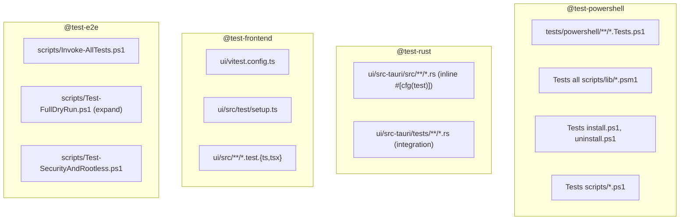

# Testing & Coverage Architecture

> Comprehensive test infrastructure plan for achieving **> 90% meaningful line coverage** across all domains: PowerShell, Rust/Tauri v2, React/TypeScript Frontend, and End-to-End orchestration.

---

## Table of Contents

1. [Tooling Inventory & Setup Plan](#1-tooling-inventory--setup-plan)
2. [Quality & Anti-Gaming Charter](#2-quality--anti-gaming-charter)
3. [Worker Ownership Map (Zero File Overlap)](#3-worker-ownership-map-zero-file-overlap)
4. [Coverage Thresholds & QA Gate](#4-coverage-thresholds--qa-gate)
5. [Testable Surface Inventory](#5-testable-surface-inventory)

---

## 1. Tooling Inventory & Setup Plan

### 1.1 Current Baseline

| Domain | Tool | Installed? | Version / Status |
|---|---|---|---|
| PowerShell | Pester | ⚠️ **v3.4.0** (need v5+) | `C:\Program Files\WindowsPowerShell\Modules\Pester\3.4.0` |
| Rust | `cargo` / `rustup` | ❌ **Not in PATH** | Sandbox limitation — available on host outside sandbox |
| Rust | `cargo-llvm-cov` | ❌ Not installed | Requires explicit install |
| Rust | `llvm-tools-preview` | ❌ Not installed | Required by `cargo-llvm-cov` |
| Frontend | `vitest` | ❌ Not in devDependencies | Missing from `ui/package.json` |
| Frontend | `@testing-library/react` | ❌ Not in devDependencies | Missing from `ui/package.json` |
| Frontend | `@vitest/coverage-v8` | ❌ Not in devDependencies | Missing from `ui/package.json` |
| Frontend | `jsdom` | ❌ Not in devDependencies | Missing from `ui/package.json` |
| Frontend | `@testing-library/jest-dom` | ❌ Not in devDependencies | Missing from `ui/package.json` |

### 1.2 Existing Tests

| File | Type | Coverage |
|---|---|---|
| `tests/unit/Test-DryRunContext.Tests.ps1` | Pester unit tests (v3 syntax) | DryRunContext, Environment, TemplateEngine modules |
| `scripts/Test-FullDryRun.ps1` | E2E harness script (non-Pester) | Full install → uninstall lifecycle with host zero-mutation |
| `tests/verify-host-safety.ps1` | AST static analysis gate | Verifies all mutating cmdlets are DryRun-guarded |
| `ui/src-tauri/src/utils/atomic_write.rs` | 2 Rust `#[cfg(test)]` unit tests | atomic write valid JSON, invalid JSON rollback |
| `ui/src-tauri/src/utils/validator.rs` | 3 Rust `#[cfg(test)]` unit tests | JSON, YAML, whkdrc validation |
| `ui/src-tauri/src/utils/sandbox.rs` | 1 Rust `#[cfg(test)]` unit test | SandboxContext creation |

### 1.3 Installation Commands (Dev-Only Dependencies)

#### PowerShell — Pester v5

```powershell
# Install Pester v5 (current user scope, no admin required)
Install-Module -Name Pester -RequiredVersion 5.6.1 -Scope CurrentUser -Force -SkipPublisherCheck
```

#### Rust — Coverage Toolchain

```powershell
# Ensure llvm-tools-preview component is installed
rustup component add llvm-tools-preview

# Install cargo-llvm-cov for source-based coverage
cargo install cargo-llvm-cov
```

#### Frontend — Vitest & Testing Library

```bash
cd ui
pnpm add -D vitest @vitest/coverage-v8 jsdom @testing-library/react @testing-library/jest-dom @testing-library/user-event
```

### 1.4 Coverage Collection Commands

#### PowerShell (Pester v5)

```powershell
$config = New-PesterConfiguration
$config.Run.Path = "tests/powershell"
$config.CodeCoverage.Enabled = $true
$config.CodeCoverage.Path = @(
    "scripts/lib/DryRunContext.psm1",
    "scripts/lib/Environment.psm1",
    "scripts/lib/TemplateEngine.psm1",
    "scripts/sync-theme.ps1",
    "scripts/Set-PerformanceProfile.ps1",
    "scripts/Set-OsPerformance.ps1",
    "scripts/apply-windhawk-mods.ps1",
    "scripts/watchdog.ps1",
    "scripts/sync-wallpaper.ps1",
    "install.ps1",
    "uninstall.ps1"
)
$config.CodeCoverage.OutputFormat = "JaCoCo"
$config.CodeCoverage.OutputPath = "coverage/powershell-coverage.xml"
$config.Output.Verbosity = "Detailed"
Invoke-Pester -Configuration $config
```

#### Rust (cargo-llvm-cov)

```powershell
cd ui/src-tauri
cargo llvm-cov --all-features --workspace --lcov --output-path ../../coverage/rust-coverage.lcov
```

#### Frontend (Vitest)

```bash
cd ui
npx vitest run --coverage --reporter=verbose
```

---

## 2. Quality & Anti-Gaming Charter

> [!IMPORTANT]
> These rules are **binding on all test workers**. Violations result in test suite rejection during code review.

### 2.1 Meaningful Coverage Mandate

Every test file MUST contain:
- **Behavioral assertions**: Tests MUST assert observable outputs, state transitions, return values, thrown errors, or rendered DOM content.
- **Happy path + at least one edge/error path** per exported function, IPC command, or component.
- **Security rejection tests**: Any function touching filesystem paths MUST have path-traversal and sandbox-escape assertions.

### 2.2 Prohibited Patterns (Auto-Reject)

| Prohibited Pattern | Reason |
|---|---|
| Empty test bodies (`it("...", () => {})`) | Zero behavioral value, inflates coverage |
| `expect(true).toBe(true)` or equivalent tautologies | No behavioral assertion |
| `// istanbul ignore` or `// coverage:ignore` without PR justification | Coverage exclusion abuse |
| `#[cfg(not(tarpaulin_include))]` without documented reason | Rust coverage exclusion abuse |
| Snapshot-only tests with no behavioral assertion | Fragile, no semantic validation |
| Tests that call `process.exit()`, `Stop-Process`, or modify `HKCU:` | Live-system side effects |
| Tests reading from or writing to `$env:USERPROFILE`, `$env:APPDATA` directly | Host mutation risk |
| `@tauri-apps/api/core` `invoke()` calls without mock | Requires running Tauri backend |

### 2.3 Required Test Categories Per Function

For each exported function/command, workers MUST write at minimum:

1. **Happy path**: Normal inputs → expected output
2. **Edge case**: Boundary values, empty inputs, missing optional params
3. **Error path**: Invalid inputs, missing files, parse failures → correct error type
4. **Rollback/recovery**: For write operations, verify original state preserved on failure
5. **Security**: For path-accepting functions, verify path-traversal rejection

### 2.4 Isolation Requirements

- **PowerShell**: All tests MUST use `Initialize-ShadowContext` or `$TestDrive` (Pester). Zero reads/writes to live `$env:USERPROFILE`, `$env:APPDATA`, `$env:ProgramData`, or registry.
- **Rust**: All filesystem tests MUST use `tempfile::tempdir()`. Zero reads/writes outside temp directories.
- **Frontend**: All Tauri IPC calls MUST be mocked via `vi.mock('@tauri-apps/api/core')`. Tests run in `jsdom` environment with no network.
- **E2E**: Scripts MUST use `-DryRun -SandboxRoot $tempDir` exclusively. Host zero-mutation is verified cryptographically.

---

## 3. Worker Ownership Map (Zero File Overlap)

### File Ownership Matrix



---

### 3.1 `@test-powershell` — PowerShell Unit Tests

**Owns:** `tests/powershell/**/*.Tests.ps1`
**Tests (read-only targets):** All `.ps1` and `.psm1` under `scripts/`, `install.ps1`, `uninstall.ps1`

#### Required Test Files

| Test File | Covers | Key Scenarios |
|---|---|---|
| `tests/powershell/DryRunContext.Tests.ps1` | `scripts/lib/DryRunContext.psm1` | `Initialize-ShadowContext` (default + custom root + env override), `Resolve-TargetPath` (all 5 prefix mappings + fallback + already-inside-sandbox), `Test-IsDryRun` (active/inactive), `Invoke-SystemAction` (all 8 action types with diff tracking), `Export-ShadowLedger` (file + console + schema validation), `Reset-ShadowContext` (purge vs keep), `Get-Sha256Hash` (valid file, missing file, locked file), jail violation throw |
| `tests/powershell/Environment.Tests.ps1` | `scripts/lib/Environment.psm1` | `Get-WorkspaceRoot` (from PSScriptRoot, fallback), `Test-CommandAvailable` (present + absent), `Test-WingetPackageInstalled` (binary path hit, cache hit, miss), `Get-InstalledWingetPackages` (mocked winget output, no winget, force refresh), `Install-WingetPackage` (dry-run intercept, custom source, missing winget, exit code handling), `New-DirectorySafely` (dry-run + live + existing), `Backup-FileWithTimestamp` (dry-run + live + missing source), `Get-UserConfigDir`/`Get-AppDataDir`/`Get-LocalAppDataDir` (shadow + live) |
| `tests/powershell/TemplateEngine.Tests.ps1` | `scripts/lib/TemplateEngine.psm1` | `Get-FlattenedTokens` (nested objects, booleans, arrays), `Convert-HexToRgba` (valid 6-char, invalid length), `Convert-HexToRgb` (valid, invalid), `Convert-HexToArgbHex` (valid, boundary alpha 0/1), `Expand-ComputedTokens` (all 15 alpha steps, non-color keys ignored), `Invoke-TemplateRendering` (happy path, missing template throw, unresolved token warning, JSON backslash escaping, SHA-256 skip-unchanged, dry-run shadow write) |
| `tests/powershell/Install.Tests.ps1` | `install.ps1` | Full DryRun pipeline (all 7 phases), `-SkipPackages`, `-Theme light`, `-ApplyWindhawk`, `-SandboxRoot` custom, `-LedgerPath` export, `Measure-InstallPhase` timing, idempotent re-run, missing theme file error |
| `tests/powershell/Uninstall.Tests.ps1` | `uninstall.ps1` | DryRun rollback from manifest, DryRun rollback without manifest (file cleanup), `-RemovePackages` with mocked winget, missing backup pointer handling, process termination interception |
| `tests/powershell/SyncTheme.Tests.ps1` | `scripts/sync-theme.ps1` | Dark + light themes, all 7 template mappings rendered, performance token injection, `perf.*` alias generation, wallpaper path normalization, missing performance.json graceful skip, theme search by `name` property |
| `tests/powershell/SetPerformanceProfile.Tests.ps1` | `scripts/Set-PerformanceProfile.ps1` | All 4 valid profiles (`ultra-low`, `balanced`, `visual-rich`, `gaming`), invalid profile rejection, dry-run updates to `performance.json` + `.current_perf`, sync-theme invocation, service reload interception |
| `tests/powershell/SetOsPerformance.Tests.ps1` | `scripts/Set-OsPerformance.ps1` | Apply + Restore actions, all 4 profiles, dry-run process priority/EcoQoS simulation, Windows animation toggle simulation, missing process graceful handling, fallback profile table |
| `tests/powershell/ApplyWindhawkMods.Tests.ps1` | `scripts/apply-windhawk-mods.ps1` | Load/Unload/Status/Compile actions, All/single mod targeting, DWM settings injection from performance profile, dry-run CLI interception, missing source file warning, SHA-256 skip-unchanged, missing CLI fallback |
| `tests/powershell/Watchdog.Tests.ps1` | `scripts/watchdog.ps1` | Status/Start/Stop/Restart actions, dry-run process simulation, `Start-FullStack` sequence (theme sync → komorebi → yasb → whkd → auxiliaries), exponential backoff threshold test (3 restarts / 60s) |

#### Mocking Strategy

```powershell
# All tests MUST mock OS boundaries:
Mock Get-Process { @() }                               # No live process queries
Mock Start-Process { $null }                            # No live process spawning
Mock Test-CommandAvailable { $false }                   # Default: nothing installed
Mock Get-InstalledWingetPackages { [System.Collections.Generic.HashSet[string]]::new() }
# DryRunContext sandbox provides filesystem isolation automatically
```

---

### 3.2 `@test-rust` — Rust Unit & Integration Tests

**Owns:** `ui/src-tauri/src/**/*.rs` (inline `#[cfg(test)]` modules) and `ui/src-tauri/tests/**/*.rs`

#### Required Test Coverage

| Module | Test File Location | Key Scenarios |
|---|---|---|
| `utils/atomic_write.rs` | Inline `#[cfg(test)]` (expand existing) | Valid JSON write + read-back, invalid JSON rollback preserves original, valid YAML write, Whkdrc write, `None` format skips validation, overwrite existing file, concurrent temp file naming (UUID uniqueness), parent directory auto-creation, write failure cleanup (read-only dir), `read_file_string` missing file error |
| `utils/validator.rs` | Inline `#[cfg(test)]` (expand existing) | JSON valid/invalid, YAML valid/invalid/unterminated, Whkdrc valid multi-line, empty key combination, empty command, comment-only file, mixed comments and bindings, empty file |
| `utils/sandbox.rs` | Inline `#[cfg(test)]` (expand existing) | `SandboxContext::new` with/without `UI_SANDBOX_DIR`, `remap_path` for repo paths → `sandbox/repo/...`, user profile paths → `sandbox/userprofile/...`, already-inside-sandbox passthrough, path-traversal with `..` components, `create_temp_shadow_root` creates directory, `find_ledger` explicit path found/missing, shadow root fallback, both missing |
| `utils/process.rs` | Inline `#[cfg(test)]` (new) | `run_powershell_script` sandbox mode returns simulated success, `run_command_binary` sandbox mode returns simulated success, non-sandbox mode with valid/invalid program |
| `error.rs` | Inline `#[cfg(test)]` (new) | All 5 error constructors (`validation`, `io`, `process`, `sandbox`, `parse`), `Serialize` output matches `AppErrorResponse` schema (code + message fields), `From<std::io::Error>` mapping, `From<serde_json::Error>` mapping, `From<serde_yaml::Error>` mapping |
| `state.rs` | Inline `#[cfg(test)]` (new) | `AppState::new()` resolves valid repo root (from CWD), `is_valid_repo_root` true for dirs with themes+configs, false otherwise, `resolve_path` delegates to sandbox `remap_path` |
| `commands/theme.rs` | `ui/src-tauri/tests/theme_commands.rs` | `get_themes` lists JSON files excluding schema, `load_theme` by filename and by `name` property, `load_theme` missing → IoError, `save_theme` atomic write + read-back, `get_active_theme_name` from marker, default fallback, `set_active_theme` writes marker |
| `commands/tiling.rs` | `ui/src-tauri/tests/tiling_commands.rs` | Load/save komorebi config, load/save float rules, load/save/validate hotkeys (valid, duplicate conflict, empty) |
| `commands/statusbar.rs` | `ui/src-tauri/tests/statusbar_commands.rs` | Load/save YASB config + CSS, load/save FluentFlyout config, get/set EarTrumpet config |
| `commands/mods.rs` | `ui/src-tauri/tests/mods_commands.rs` | Load/save Flow settings, get Windhawk mod status list, set mod state toggle |
| `commands/performance.rs` | `ui/src-tauri/tests/perf_commands.rs` | Get performance config, set profile (all 4 presets + invalid), save performance config |
| `commands/system.rs` | `ui/src-tauri/tests/system_commands.rs` | `check_deployment_status`, `get_sandbox_state`, `execute_full_dryrun` (sandboxed), `get_services_status`, `get_backups`, `restore_backup` |

#### Integration Test Pattern

```rust
// ui/src-tauri/tests/theme_commands.rs
use tempfile::tempdir;
use std::fs;
use komoyasb_control_center_lib::state::AppState;

#[test]
fn test_load_theme_by_filename() {
    let dir = tempdir().unwrap();
    let themes_dir = dir.path().join("themes");
    fs::create_dir_all(&themes_dir).unwrap();
    fs::write(themes_dir.join("dark.json"), VALID_THEME_JSON).unwrap();
    // ... test load_theme logic using AppState with temp dir
}
```

---

### 3.3 `@test-frontend` — React/TypeScript Component Tests

**Owns:** `ui/vitest.config.ts`, `ui/src/test/setup.ts`, `ui/src/**/*.test.{ts,tsx}`

#### Configuration Files to Create

**`ui/vitest.config.ts`**:
```typescript
import { defineConfig } from 'vitest/config';
import react from '@vitejs/plugin-react';

export default defineConfig({
  plugins: [react()],
  test: {
    globals: true,
    environment: 'jsdom',
    setupFiles: ['./src/test/setup.ts'],
    include: ['src/**/*.test.{ts,tsx}'],
    coverage: {
      provider: 'v8',
      reporter: ['text', 'lcov', 'json-summary'],
      reportsDirectory: '../coverage/frontend',
      include: ['src/**/*.{ts,tsx}'],
      exclude: ['src/test/**', 'src/main.tsx', 'src/vite-env.d.ts'],
      thresholds: {
        lines: 90,
        functions: 90,
        branches: 85,
        statements: 90,
      },
    },
  },
});
```

**`ui/src/test/setup.ts`**:
```typescript
import '@testing-library/jest-dom';
import { vi } from 'vitest';

// Global mock for Tauri IPC — prevents real backend calls
vi.mock('@tauri-apps/api/core', () => ({
  invoke: vi.fn(),
}));
```

#### Required Test Files

| Test File | Covers | Key Scenarios |
|---|---|---|
| `ui/src/lib/ipc.test.ts` | `lib/ipc.ts` | `invokeCommand` success path, structured `AppError` re-throw, generic string error wrapping, all 5 API namespaces (`themeApi`, `tilingApi`, `statusBarApi`, `modsApi`, `systemApi`, `performanceApi`) call correct command names with correct arg shapes |
| `ui/src/lib/utils.test.ts` | `lib/utils.ts` | All exported utility functions |
| `ui/src/App.test.tsx` | `App.tsx` | Initial render shows Titlebar + Navigation + StatusBar, default tab is 'theme', tab switching renders correct view, theme loading on mount (mocked IPC), `handleThemeChange` sets dirty flag, `handleSaveTheme` clears dirty and refreshes summaries, `handleApplyAndSync` loading state + success toast + error toast, sandbox badge visibility |
| `ui/src/components/shell/Titlebar.test.tsx` | `Titlebar.tsx` | Renders app title, sandbox badge shown when `isSandboxed=true`, sandbox badge hidden when `isSandboxed=false`, sandbox path displayed |
| `ui/src/components/shell/Navigation.test.tsx` | `Navigation.tsx` | All 6 tabs rendered, active tab highlighted, `onTabChange` callback fires with correct tab ID |
| `ui/src/components/shell/StatusBar.test.tsx` | `StatusBar.tsx` | Dirty indicator visible when `isDirty=true`, Apply button triggers `onApplyAndSync`, loading spinner during `isApplying`, sandbox badge, last sync time display |
| `ui/src/components/shell/FirstRunBanner.test.tsx` | `FirstRunBanner.tsx` | Banner visibility logic, dismissal behavior |
| `ui/src/components/views/theme/ThemeStudioView.test.tsx` | `ThemeStudioView.tsx` | Renders color tokens editor, preset manager, typography/geometry sections, `onThemeChange` propagation, `onSaveTheme` / `onLoadTheme` / `onActivateTheme` callbacks |
| `ui/src/components/views/theme/ColorTokensEditor.test.tsx` | `ColorTokensEditor.tsx` | All 14 color fields rendered, hex input validation, `onChange` fires with updated theme |
| `ui/src/components/views/theme/PresetManager.test.tsx` | `PresetManager.tsx` | Lists theme summaries, active indicator badge, load/activate click handlers |
| `ui/src/components/views/theme/WallpaperPicker.test.tsx` | `WallpaperPicker.tsx` | Path input, style selector (6 options), change propagation |
| `ui/src/components/views/theme/TypographyGeometry.test.tsx` | `TypographyGeometry.tsx` | Font family input, size inputs, border/gap/radius sliders, value change propagation |
| `ui/src/components/views/tiling/TilingView.test.tsx` | `TilingView.tsx` | Loads komorebi config on mount (mocked IPC), renders geometry editor + float rules + shortcuts |
| `ui/src/components/views/tiling/FloatRulesTable.test.tsx` | `FloatRulesTable.tsx` | Renders rules list, add/remove/edit rule, identifier kind selector, matching strategy selector |
| `ui/src/components/views/tiling/ShortcutRecorder.test.tsx` | `ShortcutRecorder.tsx` | Key combination capture, modifier display, conflict warning display |
| `ui/src/components/views/tiling/WorkspaceListEditor.test.tsx` | `WorkspaceListEditor.tsx` | Add/remove workspace, layout selector (6 options), name editing |
| `ui/src/components/views/tiling/KomorebiGeometryEditor.test.tsx` | `KomorebiGeometryEditor.tsx` | Border width/offset/style/radius controls, padding/gap sliders, transparency toggle |
| `ui/src/components/views/statusbar/StatusBarView.test.tsx` | `StatusBarView.tsx` | Loads YASB config on mount, tab sub-navigation, renders all sub-editors |
| `ui/src/components/views/statusbar/YasbWidgetOrganizer.test.tsx` | `YasbWidgetOrganizer.tsx` | Widget drag/drop reordering, left/center/right column assignment |
| `ui/src/components/views/statusbar/YasbCssEditor.test.tsx` | `YasbCssEditor.tsx` | CSS text area render, save action triggers IPC |
| `ui/src/components/views/statusbar/FluentFlyoutEditor.test.tsx` | `FluentFlyoutEditor.tsx` | All module toggles, appearance fields, placement controls |
| `ui/src/components/views/statusbar/EarTrumpetSettings.test.tsx` | `EarTrumpetSettings.tsx` | Theme selector, toggle switches, save action |
| `ui/src/components/views/statusbar/WidgetConfigForm.test.tsx` | `WidgetConfigForm.tsx` | Dynamic field rendering, type-specific controls |
| `ui/src/components/views/mods/ModsView.test.tsx` | `ModsView.tsx` | Renders Flow Launcher settings + Windhawk mods panel |
| `ui/src/components/views/mods/FlowLauncherConfig.test.tsx` | `FlowLauncherConfig.tsx` | Hotkey input, theme selector, effect selector, opacity slider, save |
| `ui/src/components/views/mods/WindhawkModsManager.test.tsx` | `WindhawkModsManager.tsx` | 3 mod cards rendered, enable/disable toggle, source viewer link |
| `ui/src/components/views/mods/ModSourceViewer.test.tsx` | `ModSourceViewer.tsx` | Source code display, loading state |
| `ui/src/components/views/performance/PerformanceView.test.tsx` | `PerformanceView.tsx` | Loads config on mount, renders preset cards + granular controls |
| `ui/src/components/views/performance/PresetCards.test.tsx` | `PresetCards.tsx` | All 4 preset cards rendered, active indicator, selection callback |
| `ui/src/components/views/performance/GranularControls.test.tsx` | `GranularControls.tsx` | All subsystem sections (komorebi, yasb, dwm, launcher, flyout, os), toggle/slider/select controls |
| `ui/src/components/views/services/ServicesView.test.tsx` | `ServicesView.tsx` | Service cards rendered, backup/restore modal, sync panel |
| `ui/src/components/views/services/ServiceCard.test.tsx` | `ServiceCard.tsx` | Running/stopped states, PID display, start/stop/restart buttons, memory/CPU metrics |
| `ui/src/components/views/services/BackupRestoreModal.test.tsx` | `BackupRestoreModal.tsx` | Backup list display, restore action, timestamp formatting |
| `ui/src/components/views/services/SandboxToggleBanner.test.tsx` | `SandboxToggleBanner.tsx` | Sandbox active/inactive display, path shown |
| `ui/src/components/views/services/SyncApplyPanel.test.tsx` | `SyncApplyPanel.tsx` | Dry-run vs live toggle, apply button, result display |
| `ui/src/components/views/system/DryRunLedgerModal.test.tsx` | `DryRunLedgerModal.tsx` | Ledger summary display, action list, file diffs table, change type badges |
| `ui/src/components/ui/*.test.tsx` | All 11 UI primitives | Render, interaction, accessibility (button, badge, dialog, input, select, slider, switch, tabs, toast, color-picker) |
| `ui/src/features/bar-osd/index.test.ts` | `features/bar-osd/index.ts` | All exported functions/hooks |
| `ui/src/features/shell-services/index.test.ts` | `features/shell-services/index.ts` | All exported functions/hooks |
| `ui/src/features/tiling/index.test.ts` | `features/tiling/index.ts` | All exported functions/hooks |

#### IPC Mock Pattern

```typescript
import { vi } from 'vitest';
import { invoke } from '@tauri-apps/api/core';

const mockInvoke = vi.mocked(invoke);

beforeEach(() => {
  mockInvoke.mockReset();
});

test('themeApi.getThemes calls get_themes command', async () => {
  mockInvoke.mockResolvedValue([{ name: 'dark', variant: 'dark', path: '...', isActive: true }]);
  const result = await themeApi.getThemes();
  expect(mockInvoke).toHaveBeenCalledWith('get_themes');
  expect(result).toHaveLength(1);
});
```

---

### 3.4 `@test-e2e` — End-to-End Orchestration & Aggregation

**Owns:** `scripts/Invoke-AllTests.ps1`, expanded `scripts/Test-FullDryRun.ps1`, `scripts/Test-SecurityAndRootless.ps1`

#### Scripts to Create / Expand

| Script | Purpose |
|---|---|
| `scripts/Invoke-AllTests.ps1` | Unified test & coverage aggregator across all 3 domains. Runs Pester, cargo test, vitest sequentially. Collects coverage reports into `coverage/`. Fails if any domain < 90% line coverage. |
| `scripts/Test-FullDryRun.ps1` (expand) | Add: matrix over all 4 performance presets (`ultra-low`, `balanced`, `visual-rich`, `gaming`); light theme variant; `-SkipPackages` flag variant; Windhawk mods enabled variant; verify sandbox cleanup when `-KeepSandbox` is NOT passed |
| `scripts/Test-SecurityAndRootless.ps1` (new) | Path-traversal injection tests (templates with `../../../etc/passwd` tokens, shadow jail violation assertions), rootless `-NoAdmin` badge propagation, verify zero registry writes, verify zero `Start-Process` for winget in dry-run, `verify-host-safety.ps1` AST gate PASS assertion |

#### E2E Test Matrix

| Dimension | Values | Covered By |
|---|---|---|
| Performance preset | `ultra-low`, `balanced`, `visual-rich`, `gaming` | `Test-FullDryRun.ps1` expanded matrix |
| Theme | `dark`, `light` | `Test-FullDryRun.ps1` expanded matrix |
| Install flags | default, `-SkipPackages`, `-ApplyWindhawk` | `Test-FullDryRun.ps1` variants |
| Uninstall flags | default, `-RemovePackages` | `Test-FullDryRun.ps1` uninstall step |
| Security | path traversal, jail escape, rootless | `Test-SecurityAndRootless.ps1` |
| Failure recovery | corrupted sandbox, missing theme file, invalid JSON | `Test-FullDryRun.ps1` failure injection |

#### Coverage Aggregation (`Invoke-AllTests.ps1`)

```powershell
# Pseudocode for unified aggregation
$results = @{
    PowerShell = @{ Passed = 0; Failed = 0; Coverage = 0.0 }
    Rust       = @{ Passed = 0; Failed = 0; Coverage = 0.0 }
    Frontend   = @{ Passed = 0; Failed = 0; Coverage = 0.0 }
    E2E        = @{ Passed = 0; Failed = 0 }
}

# 1. Run Pester → parse JaCoCo XML → extract line coverage %
# 2. Run cargo llvm-cov → parse LCOV → extract line coverage %
# 3. Run vitest --coverage → parse json-summary → extract line coverage %
# 4. Run E2E scripts → collect exit codes
# 5. Assert all domains >= 90% and all E2E = PASS
# 6. Output summary table
```

---

## 4. Coverage Thresholds & QA Gate

### 4.1 Minimum Thresholds

| Domain | Metric | Minimum | Target |
|---|---|---|---|
| **PowerShell** | Line coverage (Pester CodeCoverage) | **90%** | 95% |
| **Rust** | Line coverage (cargo-llvm-cov) | **90%** | 95% |
| **Frontend** | Line coverage (Vitest v8) | **90%** | 95% |
| **Frontend** | Branch coverage | **85%** | 90% |
| **E2E** | All suites PASS | **100%** | 100% |
| **Security** | AST host-safety gate | **PASS** | PASS |

### 4.2 QA Gate Checklist (All Must Pass)

- [ ] `Invoke-Pester` exits with 0 failed tests
- [ ] PowerShell code coverage ≥ 90%
- [ ] `cargo test --all-features` exits with 0 failures
- [ ] Rust line coverage ≥ 90%
- [ ] `npx vitest run` exits with 0 failures
- [ ] Frontend line coverage ≥ 90%
- [ ] `Test-FullDryRun.ps1` exits 0 for all matrix combinations
- [ ] `Test-SecurityAndRootless.ps1` exits 0
- [ ] `verify-host-safety.ps1` exits 0
- [ ] Zero test files write to live user directories
- [ ] Zero tests require network access
- [ ] Zero tests require admin/elevated privileges

---

## 5. Testable Surface Inventory

### 5.1 PowerShell Modules & Scripts

| File | Exported Functions / Entry Points | Line Count |
|---|---|---|
| `scripts/lib/DryRunContext.psm1` | `Initialize-ShadowContext`, `Resolve-TargetPath`, `Invoke-SystemAction`, `Export-ShadowLedger`, `Reset-ShadowContext`, `Test-IsDryRun`, `Get-ShadowContext`, `Get-Sha256Hash` | 470 |
| `scripts/lib/Environment.psm1` | `Get-WorkspaceRoot`, `Get-InstalledWingetPackages`, `Test-CommandAvailable`, `Test-WingetPackageInstalled`, `Install-WingetPackage`, `Get-UserConfigDir`, `Get-AppDataDir`, `Get-LocalAppDataDir`, `New-DirectorySafely`, `Backup-FileWithTimestamp` | 434 |
| `scripts/lib/TemplateEngine.psm1` | `Get-FlattenedTokens`, `Convert-HexToRgba`, `Convert-HexToRgb`, `Convert-HexToArgbHex`, `Expand-ComputedTokens`, `Invoke-TemplateRendering` | 363 |
| `install.ps1` | Main script (7 phases) | 310 |
| `uninstall.ps1` | Main script (4 phases) | 237 |
| `scripts/sync-theme.ps1` | Main script (7 steps) | 344 |
| `scripts/Set-PerformanceProfile.ps1` | Main script (5 steps) | 181 |
| `scripts/Set-OsPerformance.ps1` | `Set-ProcessEcoQoS`, `Set-ProcessPrioritySafe`, `Set-WindowsClientAreaAnimationSafe`, `Apply-ProcessTweak` | 288 |
| `scripts/apply-windhawk-mods.ps1` | `Invoke-WindhawkCommand`, Load/Unload/Status/Compile actions | 287 |
| `scripts/watchdog.ps1` | `Get-WatchedProcessStatus`, `Stop-WatchedProcesses`, `Start-WatchedProcess`, `Start-FullStack`, Monitor loop | 272 |
| **Total PowerShell** | | **~3,186 lines** |

### 5.2 Rust Modules

| File | Public Items | Line Count |
|---|---|---|
| `ui/src-tauri/src/utils/atomic_write.rs` | `read_file_string`, `atomic_write_file` | 153 |
| `ui/src-tauri/src/utils/validator.rs` | `ConfigFormat`, `validate_syntax`, `validate_whkdrc_syntax` | 130 |
| `ui/src-tauri/src/utils/sandbox.rs` | `SandboxContext` (new, create_temp_shadow_root, find_ledger, remap_path) | 168 |
| `ui/src-tauri/src/utils/process.rs` | `ProcessOutput`, `run_powershell_script`, `run_command_binary` | 123 |
| `ui/src-tauri/src/error.rs` | `AppError` (5 variants + constructors + Serialize + From impls) | 168 |
| `ui/src-tauri/src/state.rs` | `AppState` (new_with_app_handle, new, discover_dev_repo_root, resolve_path) | 153 |
| `ui/src-tauri/src/commands/theme.rs` | 5 IPC commands + 6 structs | 319 |
| `ui/src-tauri/src/commands/tiling.rs` | 7 IPC commands | ~250 est. |
| `ui/src-tauri/src/commands/statusbar.rs` | 8 IPC commands | ~300 est. |
| `ui/src-tauri/src/commands/mods.rs` | 4 IPC commands | ~200 est. |
| `ui/src-tauri/src/commands/performance.rs` | 3 IPC commands | ~200 est. |
| `ui/src-tauri/src/commands/system.rs` | 9 IPC commands | ~400 est. |
| **Total Rust** | | **~2,564 lines** |

### 5.3 Frontend Components

| Category | Files | Count |
|---|---|---|
| Shell components | Titlebar, Navigation, StatusBar, FirstRunBanner | 4 |
| UI primitives | badge, button, color-picker, dialog, input, select, slider, switch, tabs, toast | 10 |
| Theme views | ThemeStudioView, ColorTokensEditor, PresetManager, WallpaperPicker, TypographyGeometry | 5 |
| Tiling views | TilingView, FloatRulesTable, ShortcutRecorder, WorkspaceListEditor, KomorebiGeometryEditor | 5 |
| StatusBar views | StatusBarView, YasbWidgetOrganizer, YasbCssEditor, FluentFlyoutEditor, EarTrumpetSettings, WidgetConfigForm, WidgetFieldHelpers | 7 |
| Mods views | ModsView, FlowLauncherConfig, WindhawkModsManager, ModSourceViewer | 4 |
| Performance views | PerformanceView, PresetCards, GranularControls | 3 |
| Services views | ServicesView, ServiceCard, BackupRestoreModal, SandboxToggleBanner, SyncApplyPanel | 5 |
| System views | DryRunLedgerModal | 1 |
| Lib/types | ipc.ts, utils.ts, ipc types | 3 |
| Features | bar-osd, shell-services, tiling | 3 |
| **Total Frontend** | | **~50 files** |

### 5.4 IPC Commands (Complete Registry — 36 commands)

| Namespace | Command | Args |
|---|---|---|
| Theme | `get_themes` | — |
| Theme | `load_theme` | `name: String` |
| Theme | `save_theme` | `theme: UnifiedTheme` |
| Theme | `get_active_theme_name` | — |
| Theme | `set_active_theme` | `name: String` |
| Tiling | `load_komorebi_config` | — |
| Tiling | `save_komorebi_config` | `config: KomorebiConfig` |
| Tiling | `load_float_rules` | — |
| Tiling | `save_float_rules` | `rules: Vec<ApplicationRule>` |
| Tiling | `load_hotkeys` | — |
| Tiling | `save_hotkeys` | `hotkeys: Vec<HotkeyBinding>` |
| Tiling | `validate_hotkeys` | `hotkeys: Vec<HotkeyBinding>` |
| StatusBar | `load_yasb_config` | — |
| StatusBar | `save_yasb_config` | `config: YasbConfig` |
| StatusBar | `load_yasb_css` | — |
| StatusBar | `save_yasb_css` | `css: String` |
| StatusBar | `load_fluentflyout_config` | — |
| StatusBar | `save_fluentflyout_config` | `config: FluentFlyoutConfig` |
| StatusBar | `get_eartrumpet_config` | — |
| StatusBar | `set_eartrumpet_config` | `config: EarTrumpetConfig` |
| Mods | `load_flow_settings` | — |
| Mods | `save_flow_settings` | `settings: FlowSettings` |
| Mods | `get_windhawk_mods` | — |
| Mods | `set_windhawk_mod_state` | `modId: String, enabled: bool` |
| Performance | `get_performance_config` | — |
| Performance | `set_performance_profile` | `profile: String, dryRun: bool` |
| Performance | `save_performance_config` | `config: PerformanceConfig` |
| System | `check_deployment_status` | — |
| System | `run_install_provisioning` | `dryRun, skipPackages, theme?` |
| System | `execute_full_dryrun` | `theme?, keepSandbox?` |
| System | `get_services_status` | — |
| System | `service_action` | `name: String, action: String` |
| System | `apply_sync_theme` | `dryRun: bool` |
| System | `get_backups` | — |
| System | `restore_backup` | `timestamp: String` |
| System | `get_sandbox_state` | — |
